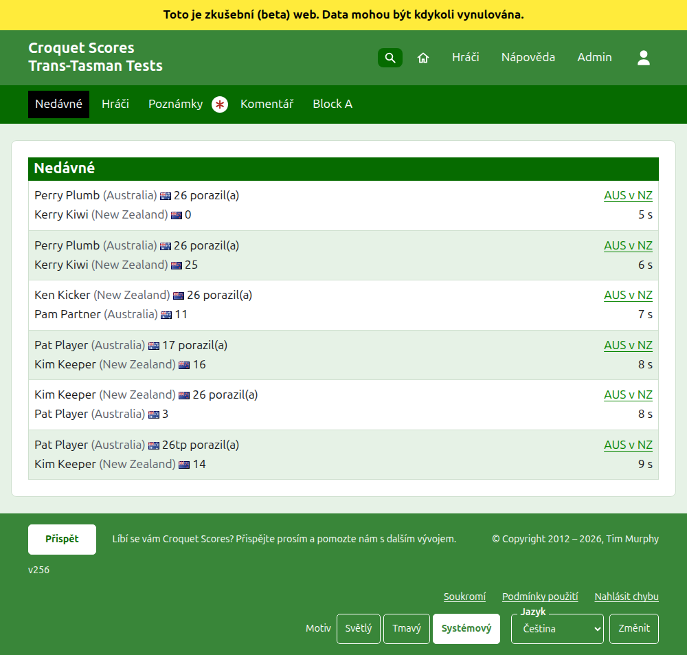
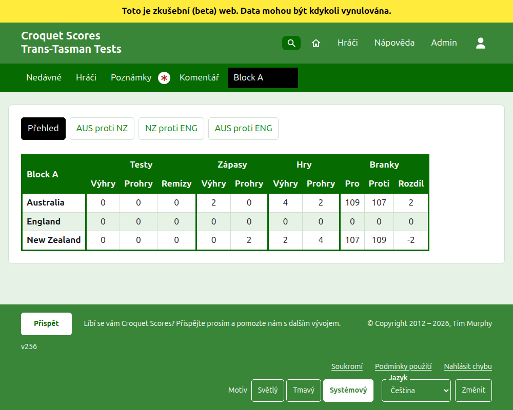
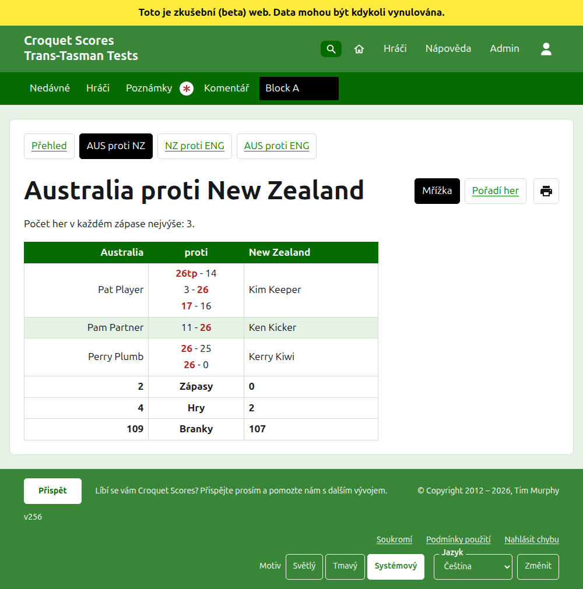
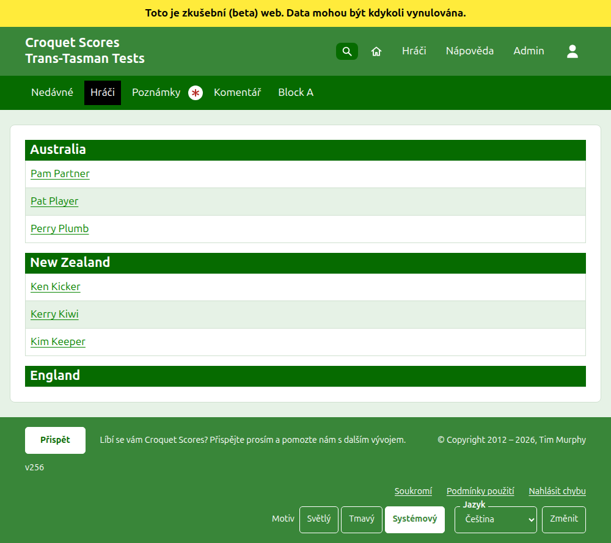

# Co vidí veřejnost

Nic se nezveřejňuje: veřejné stránky se kreslí z toho, co drží admin, takže zadané skóre na nich je hned. Nepotřebují účet ani skriptování a jsou uspořádány pro telefon.

## Stránka turnaje

Stránka turnaje je na jeho roce, sportu a názvu, například `/2026/ac/trans-tasman-tests`. Nadepisuje ji název turnaje s podtitulem pod ním. Uvádí každou používanou hru, naposledy přidanou první, aby čtenář, který se vrátí, viděl, co se od té doby stalo. Každá hra říká vítěze, jeho tým a jeho skóre, potom poraženého a jeho, s testem, v němž se hrála, a jak dávno byla přidána.

Tmavozelená lišta nabízí oddíly turnaje: **Nedávné**, což je tato stránka, **Přehled**, **Hráči**, **Poznámky** a **Komentář**, potom testy. Test se říká jako zkrácené názvy jeho týmů s „proti“ mezi nimi, například „AUS proti NZ“. Testy ve skupině se nenabízejí po jednom: skupina je jeden oddíl, nazvaný jako skupina, stojící tam, kde by byl její první test. Poznámky jsou označeny červenou hvězdičkou, dokud je poznámka, kterou čtenář nečetl.

## Přehled

Turnaj, jehož testy nejsou v žádné skupině, má **Přehled**: jednu tabulku všech týmů, seřazenou, s testy, které vyhrál, prohrál a remizoval, jeho vyhranými a prohranými hrami a jeho brankami pro, proti a rozdílem. Kde jsou zápasy jakéhokoli testu nejlepší z víc než jedné hry, vyhrané a prohrané zápasy následují za testy. Týmy jsou seřazeny podle vyhraných testů, potom vyhraných zápasů, potom rozdílu her, potom rozdílu branek a nakonec podle pořadí turnaje. Test, jehož týmy jsou vyrovnané v zápasech, se rozhoduje podle rozdílu her, potom rozdílu branek, nebo je remízou, kde turnaj zaškrtává **Vyrovnané testy jsou remízy**. V přehledu čtenář hledá každý tým jako celek.

V **Interstate Shield** jsou týmy seřazeny podle vyhraných testů, potom podle rozdílu zápasů místo vyhraných zápasů, potom podle rozdílu her, potom podle rozdílu branek. Týmy, které jsou stále vyrovnané, se seřadí podle testů, které proti sobě vyhrály. Jeho přehled ukazuje sloupec **Rozdíl** pod Zápasy a pod Hry i pod Branky a Shield se nikdy nehraje po skupinách.

Turnaj s testem ve skupině nemá Přehled. Stránka každé skupiny místo toho ukazuje, jak týmy této skupiny stojí, protože jedna tabulka týmů napříč skupinami, které spolu nikdy nehrály, by nic neseřadila.

## Skupina

Stránka skupiny ukazuje, jak týmy skupiny stojí, počítajíc jen testy skupiny, v tabulce, kterou používá přehled. Nad tabulkou, v samostatné řadě, nabízí **Přehled**, což je tato stránka, a každý z testů skupiny, vedoucí na stránku testu.

## Test

Stránku testu nadepisují plné názvy jeho týmů, například „Austrálie proti Nový Zéland“, a říká, z kolika her je každý zápas nejlepší. Její tabulku nadepisují oba týmy, první vlevo. Každý odehraný zápas je řádek, v pořadí, v jakém začal, s hráčem prvního týmu vlevo, hráčem druhého vpravo a hrami zápasu mezi nimi, každá se skóre první strany a potom druhé, s označeným vítězem. Pod zápasy jsou hry a branky každého týmu a, kde je každý zápas nejlepší z víc než jedné hry, jeho vyhrané zápasy, na jeho vlastní straně.

Test se ukazuje dvěma způsoby, nabízenými na řádku jeho názvu: **Mřížka**, což je tato tabulka, a **Pořadí her**, které uvádí každou hru testu v tabulce nadepsané **Hra** a **Datum**, nejprve nejstarší. Stisknutí záhlaví podle něj řadí a web si pamatuje, jak čtenář naposledy řadil. Vedle pohledů je tlačítko tisku, zobrazené tam, kde je skriptování zapnuté, které vytiskne stránku bez lišt. Test ve skupině nabízí Přehled své skupiny a testy v řadě nad svým nadpisem, s tímto testem označeným.

## Hráči

Stránka Hráči uvádí hráče tým po týmu: každý tým pod nadpisem svého názvu, v pořadí týmů turnaje, a jeho hráče pod ním v abecedním pořadí.

## Poznámky

Stránka Poznámky se jmenuje **Poznámky organizátorů** a říká „Zatím žádné poznámky.“, dokud žádné nejsou. Uvádí poznámky turnaje, naposledy napsanou první, každou vedoucí na vlastní stránku a říkající, jak dávno byla napsána. Poznámka, kterou čtenář nečetl, je označena červenou hvězdičkou, dokud ji neotevře.

## Adresy, které se přesouvají

Turnaj si ponechá svou adresu, když se jeho název opraví. Kde se přesune, protože se změnil jeho rok nebo sport, jeho stará adresa vede na novou, aby odkaz uchovaný z dřívějška stále fungoval. Stránky archivovaného turnaje se nenajdou, dokud se neobnoví.
