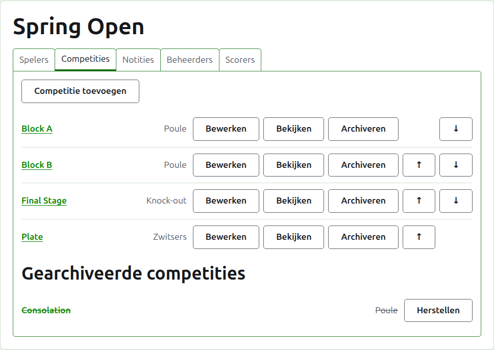
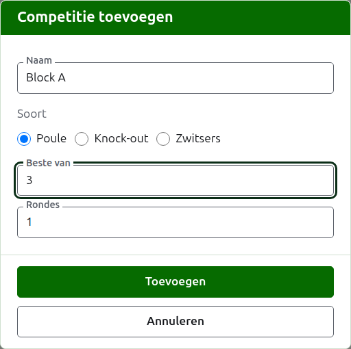
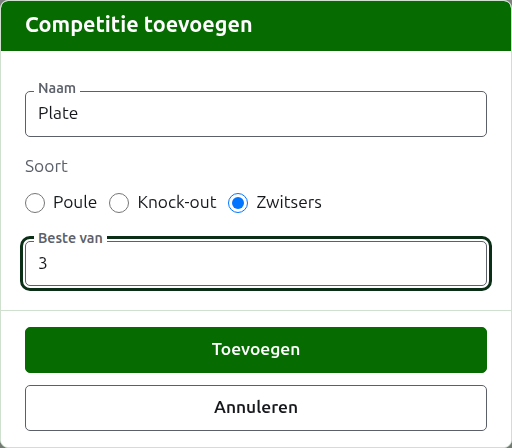
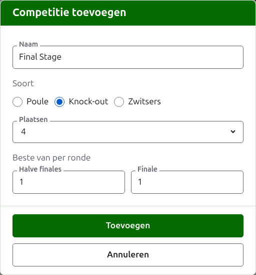

# Competities

Het tabblad **Competities** van de pagina van een toernooi is waar zijn competities worden toegevoegd, op volgorde gezet en opzijgezet. Een competitie is een poule, een knock-out of een Zwitsers systeem. Elke competitie heeft een eigen pagina, waar haar spelers worden geplaatst en haar scores worden ingevoerd.

## Een competitie toevoegen

Druk op **Competitie toevoegen**, boven de lijst. Er opent een dialoogvenster over de pagina, dat vraagt naar de naam van de competitie, haar soort, en de vorm die bij haar soort hoort.

**Naam** is waar de spelers naar zoeken op de pagina van het toernooi om hun partijen te vinden. Ze is tussen 1 en 254 tekens lang, en één letter is genoeg, omdat een poule vaak met één letter wordt aangeduid. Twee competities in één toernooi kunnen niet dezelfde naam hebben.

**Soort** is een poule, een knock-out of een Zwitsers systeem. Het dialoogvenster begint op een poule, wat de meeste competities zijn.

### Een poule of een Zwitsers systeem

Een poule en een Zwitsers systeem vragen alleen waarvan elke wedstrijd de **Beste van** is, wat op 1 begint. De beste van 3 wordt gewonnen door wie twee partijen wint. Het mag een even getal zijn, omdat in een poule of een Zwitsers systeem een speler wordt gerangschikt op de partijen die die wint, en een wedstrijd van twee partijen die elk één keer gewonnen zijn een uitslag is als elke andere.

### Een knock-out

Een knock-out vraagt hoeveel **Plaatsen** de loting heeft, en waarvan elke ronde de beste is. De plaatsen worden aangeboden als 2, 4, 8, 16, 32, 64 en 128, omdat elk ander aantal niet ronde na ronde kan halveren tot een finale, en het dialoogvenster begint op 8. Plaatsen die overblijven nadat de spelers zijn geplaatst, worden gevuld met vrijlotingen, die worden toegevoegd waar de spelers staan.

Een loting heeft zoveel rondes als nodig is om de plaatsen te halveren tot één, dus een loting van 8 plaatsen heeft drie rondes. Het dialoogvenster vraagt waarvan elke ronde de beste is, samen onder **Beste van per ronde**, in de volgorde waarin ze worden gespeeld. De laatste drie heten zoals de rondes van een loting worden genoemd, **Kwartfinales**, **Halve finales** en **Finale**, en de rondes daarvóór bij hun nummer, Ronde 1 eerst. Meer plaatsen kiezen voegt rondes toe aan het begin van de loting, en minder kiezen haalt ze weg aan het begin, zodat wat voor de finale is getypt nog steeds van de finale is. Elke ronde is de beste van een oneven aantal partijen, omdat een wedstrijd in een knock-out een winnaar moet hebben.

### Meerdere tegelijk toevoegen

Druk op **Toevoegen**. De competitie wordt toegevoegd, het dialoogvenster zegt dat, en de naam wordt leeggemaakt voor de volgende, met de soort en de vorm zoals ze waren: competities die samen worden toegevoegd, lijken meestal op elkaar, dus "Block B" na "Block A" is alleen een naam. Druk op **Annuleren** om het dialoogvenster te sluiten zodra ze er allemaal in staan.

## Een competitie wijzigen

**Bewerken** opent hetzelfde dialoogvenster op de competitie, met de titel Competitie bewerken, met haar naam en haar vorm zoals ze zijn. De soort wordt niet gevraagd, omdat je van een poule geen knock-out maakt door haar te wijzigen: een competitie van de verkeerde soort archiveer je en voeg je opnieuw toe. Druk op **Opslaan** om de wijziging te bewaren en het dialoogvenster te sluiten.

Een knock-out met een partij heeft spelers op een plaats in de loting, en een wijziging van de plaatsen zou ze verschuiven, dus die wordt geweigerd zodra een partij is ingevoerd. De beste-van van de rondes kan nog wel worden gewijzigd.

## Volgorde

De competities staan in de volgorde van het toernooi, wat de volgorde is waarin ze op de openbare pagina's en in de donkergroene balk verschijnen. **Omhoog** en **Omlaag** verplaatsen een competitie één plaats.

## Naar een competitie gaan

De naam van een competitie, of **Bekijken**, opent haar pagina, waar haar spelers worden geplaatst en haar scores worden ingevoerd. De donkergroene balk onder de kop leidt er ook naartoe, vanaf elke pagina van het toernooi.

## Een competitie archiveren

**Archiveren** zet een competitie opzij, of ze nu partijen heeft of niet; die worden bij haar bewaard en komen terug wanneer ze wordt hersteld. Een gearchiveerde competitie staat onder **Gearchiveerde competities**, doorgestreept, biedt alleen **Herstellen**, en staat niet op de openbare pagina's. Archiveren vraagt niet eerst, omdat herstellen het ongedaan maakt.

Volgende: [Spelers in een competitie plaatsen](entering-players-in-a-competition.md).
