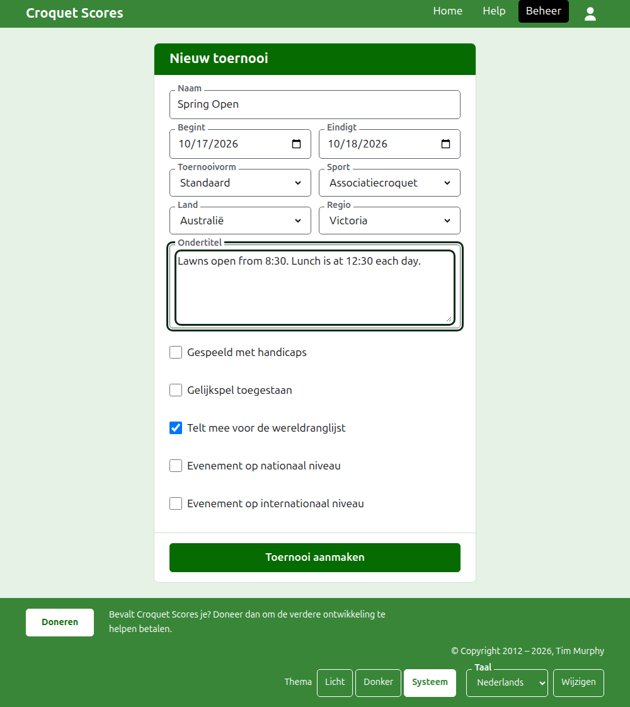

# Een toernooi aanmaken

Druk op **Nieuw toernooi** boven de lijst met toernooien in het beheer. De knop staat boven de lijst en niet eronder, zodat een lange lijst hem niet van het scherm van een telefoon duwt.

Het formulier vraagt alles waarmee een toernooi begint. Een toernooi van de gewone soort is een naam, twee dagen en een land verwijderd: alles verder wordt voor je bepaald en kan worden gewijzigd.

## Wat het formulier vraagt

**Naam.** Waar lezers naar zoeken om het toernooi te vinden, zoals "Spring Open". Ze is tussen 3 en 254 tekens lang. Een naam helemaal in kleine letters, of helemaal in hoofdletters, wordt geweigerd, omdat die op elke pagina waarop hij staat op een vergissing zou lijken. Twee toernooien mogen dezelfde naam hebben, omdat hetzelfde toernooi elk jaar wordt gespeeld.

**Begint** en **Eindigt.** De dagen waarop het toernooi loopt. Een toernooi kan niet eindigen voordat het begint, en kan niet later beginnen of eindigen dan het einde van volgend jaar. Een toernooi hoort bij het jaar waarin het begint, dat ook het jaar in zijn adres is, dus een toernooi dat over de jaarwisseling loopt, staat in het jaar waarin het begint.

**Opzet.** Kies **Standaard** voor een toernooi tussen spelers. De andere opzetten zijn voor toernooien tussen teams, die een eigen handleiding hebben.

**Sport.** De sporten die de website aanbiedt, in zijn volgorde: Associatiecroquet, Golfcroquet, Amerikaans croquet met 6 poortjes en Ricochet op Croquet Scores. Gateball Scores vraagt geen sport en geen opzet, omdat elk toernooi daar een standaardtoernooi gateball is.

**Land** en **Regio.** Waar het toernooi wordt gespeeld. Een regio wordt alleen gevraagd waar het land dat je kiest in regio's is verdeeld, zoals de staten van Australië; een land dat zijn eigen enige regio is, vraagt er geen. Een regio hoeft niet gekozen te worden, ook al wordt er een aangeboden.

**Ondertitel.** Alles wat je lezers wilt laten weten en dat geen eigen veld heeft: waar je kunt parkeren, wanneer de lunch is, wie je kunt bellen. Ze staat onder de naam van het toernooi op elke openbare pagina. Ze wordt geschreven in Markdown, dus een woord kun je vet maken met sterretjes eromheen, en een lijst maak je met een streepje aan het begin van elke regel. Ze kan tot 2000 tekens lang zijn, en mag leeg blijven.

Hoe de competities worden gespeeld en geteld, met handicaps, met gelijkspel en voor de wereldranglijsten, bepaalt elke competitie zelf wanneer ze wordt toegevoegd.

**Evenement op nationaal niveau** en **Evenement op internationaal niveau.** Een toernooi kan het ene zijn, het andere, of geen van beide, maar nooit allebei: het ene aanvinken vinkt het andere uit.

## Het aanmaken

Druk op **Toernooi aanmaken**. Je komt op de pagina van het toernooi in het beheer, van waaruit het wordt geleid, en jij bent zijn eerste toernooileider. Het staat in het beheer onder het jaar waarin het begint.

Het openbare adres van het toernooi wordt gemaakt uit zijn jaar, zijn sport en zijn naam, als `/2026/ac/spring-open`. Het houdt dat adres wanneer de naam later wordt gecorrigeerd, zodat een al verstuurde link het nog vindt; het verhuist alleen wanneer het jaar waarin het begint, of de sport, verandert.

## Als iets wordt geweigerd

Wat wordt geweigerd, staat onder het veld waar het over gaat, en wat je hebt getypt blijft staan. Er wordt niets bewaard totdat elk veld is geaccepteerd. Wat het vaakst wordt geweigerd, is een naam helemaal in kleine letters, een einde vóór het begin, en een land dat niet is gekozen.

Volgende: [Spelers](players.md).
