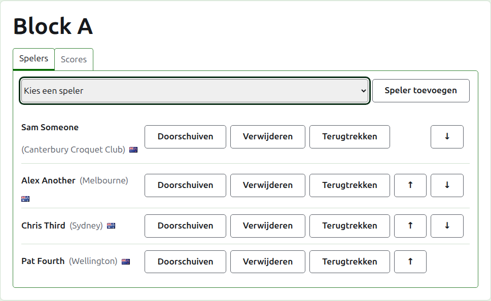
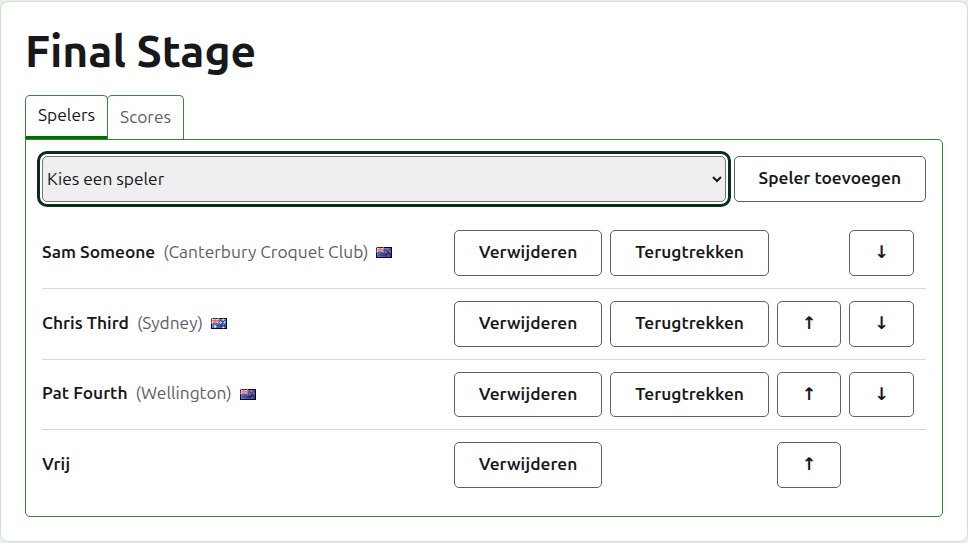
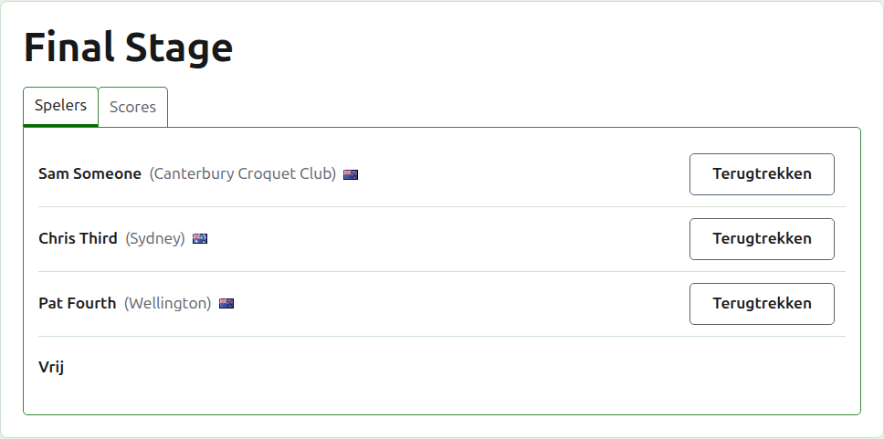
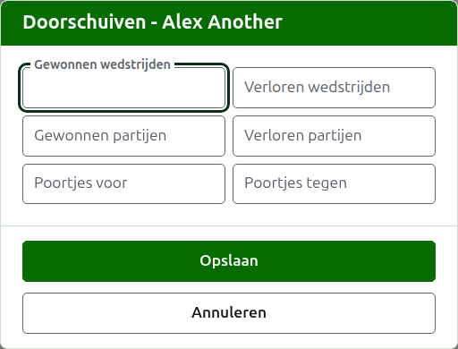
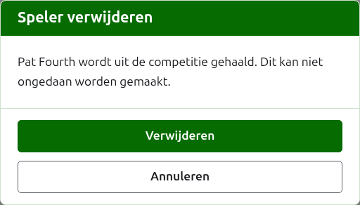
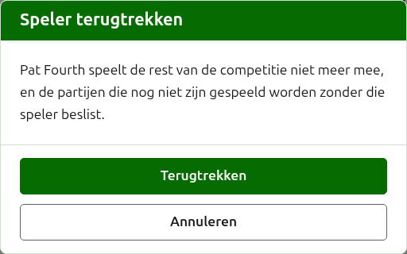
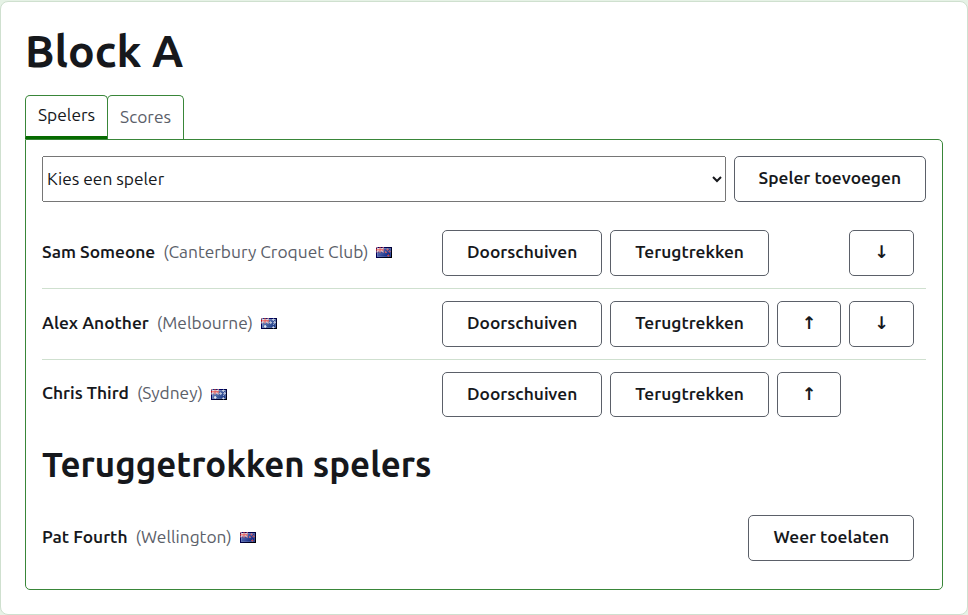

# Spelers in een competitie plaatsen

De pagina van een competitie open je via haar naam op het tabblad Competities, of via de donkergroene balk. Ze heeft de naam van de competitie als kop, met twee tabbladen eronder: **Spelers** en **Scores**. Ze opent op Spelers, omdat de spelers worden geplaatst voordat er iets wordt gespeeld.

Een speler in een competitie is een van de spelers van het toernooi, dus spelers worden geplaatst door ze te kiezen in plaats van ze te typen. Alles over hen behalve hun plaats in de competitie, en wat ze erin doorschuiven, wordt gewijzigd op het tabblad Spelers van het toernooi.

## Een speler toevoegen

Boven de lijst biedt een keuzelijst elke speler van het toernooi aan die nog niet in de competitie zit, in de volgorde van het toernooi. Kies er een en druk op **Speler toevoegen**. De speler komt in de volgorde van het toernooi tussen de al geplaatste spelers, de keuzelijst biedt hem niet meer aan, en de cursor gaat terug naar de keuzelijst zodat de volgende met het toetsenbord kan worden gekozen. Waar elke speler van het toernooi in de competitie zit, wordt de keuzelijst niet getoond en zegt het tabblad dat.

Gearchiveerde spelers van het toernooi worden niet aangeboden.

## Vrijlotingen in een knock-out

Een knock-out wordt pas gespeeld wanneer elke plaats in de loting is gevuld, en de plaatsen die de spelers overlaten, worden gevuld met vrijlotingen. Daarom biedt de keuzelijst in een knock-out eerst **Vrij** aan, vóór de spelers, en blijft dat aanbieden hoeveel vrijlotingen er ook worden toegevoegd, omdat een loting er meerdere nodig kan hebben.

Een vrijloting wordt in de loting geplaatst zoals een speler: ze kan omhoog en omlaag worden verplaatst en worden verwijderd, maar ze kan zich niet terugtrekken, omdat ze niets speelt. Een speler die wordt geplaatst in een knock-out waarvan elke plaats is gevuld, wordt geweigerd, en het tabblad zegt dat onder de keuzelijst.

De volgorde van de spelers in een knock-out is de loting. De eerste twee plaatsen treffen elkaar in de eerste wedstrijd, de volgende twee in de volgende, en zo verder. Zet de spelers in de volgorde waarin de loting gespeeld moet worden voordat er een score wordt ingevoerd, want zodra de knock-out een partij in gebruik heeft, staan de spelers vast: niemand kan worden toegevoegd, verwijderd of verplaatst. Een speler kan zich nog wel terugtrekken.

## Volgorde

De spelers staan in de volgorde van de competitie, wat de volgorde is waarin een knock-out wordt geloot en waarin een poule op haar openbare pagina wordt getoond. **Omhoog** en **Omlaag** verplaatsen een speler één plaats.

## Doorschuiven

**Doorschuiven** zegt wat een speler meeneemt in een competitie uit spel dat daar niet is gescoord: de uitslagen van een eerdere fase, of van partijen die zijn gespeeld voordat de competitie hier werd bijgehouden. Het wordt aangeboden in een poule en een Zwitsers systeem, die een stand hebben waarin het kan meetellen, en niet in een knock-out.

Het dialoogvenster vraagt zes aantallen: gewonnen en verloren wedstrijden, gewonnen en verloren partijen, en poortjes voor en tegen. Elk aantal is optioneel. Een leeg gelaten aantal schuift niets door, wat niet hetzelfde is als 0 doorschuiven, zodat wie het later wijzigt het ziet zoals het is achtergelaten. Druk op **Opslaan** om alle zes te bewaren.

## Een speler verwijderen

**Verwijderen** haalt een per ongeluk geplaatste speler eruit. Die blijft een van de spelers van het toernooi, en wordt weer aangeboden in de keuzelijst, maar er wordt niets bewaard van zijn plaats in de competitie, dus Verwijderen vraagt eerst.

Een speler die een partij in gebruik heeft in de competitie, kan niet worden verwijderd, omdat de partijen dan tegen iemand zouden zijn die er niet meer is, en krijgt geen Verwijderen. Een speler van wie alle partijen gearchiveerd zijn, kan wel worden verwijderd, en zijn gearchiveerde scores gaan mee.

## Een speler terugtrekken

**Terugtrekken** is voor een speler die niets meer van de competitie zal spelen. Die blijft erin, met de partijen die die heeft gespeeld, en staat onder **Teruggetrokken spelers** na de spelers die nog spelen. In een knock-out gaat zijn tegenstander in een nog niet besliste wedstrijd door.

Terugtrekken vraagt eerst, omdat het de uitkomst van de competitie verandert: de partijen die de speler niet heeft gespeeld, worden zonder die speler beslist.

Een teruggetrokken speler biedt alleen **Weer toelaten**, wat de speler terugzet tussen de spelende spelers, na de spelers die bleven, zonder te vragen.

Volgende: [Scores](scores.md).
