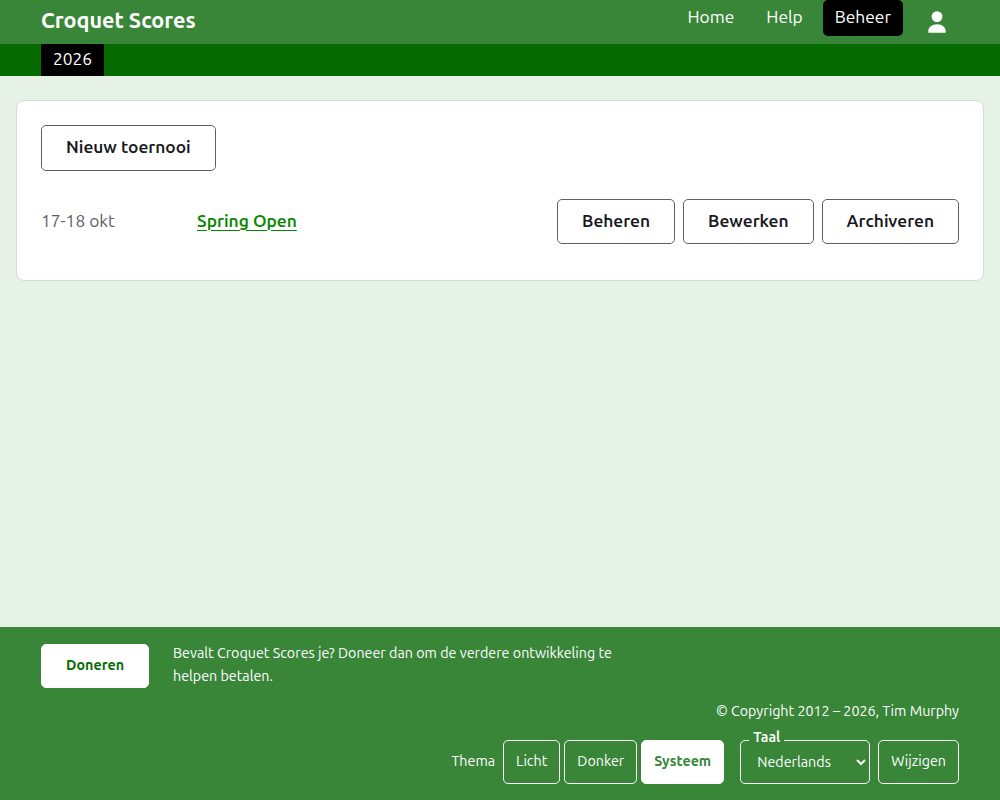
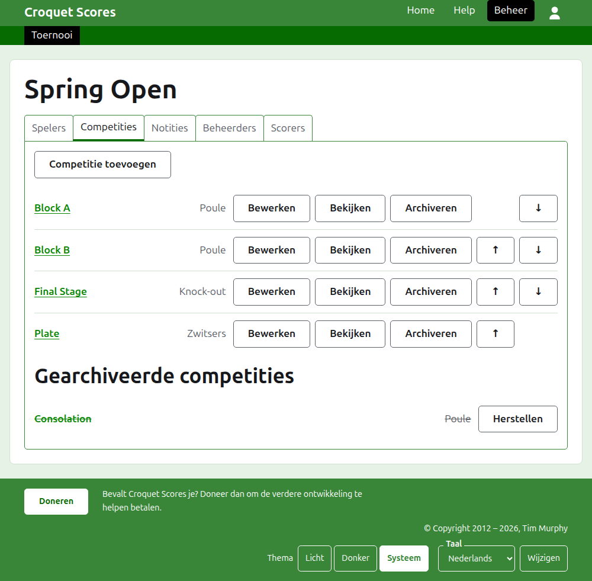

# Een standaardtoernooi leiden

Een standaardtoernooi is een toernooi tussen spelers die een voor een worden ingevoerd: een clubweekend, een open toernooi, een kampioenschap. De spelers worden ingedeeld in poules, knock-outs en Zwitserse systemen, en de scores komen online zodra ze gespeeld zijn. Deze handleiding neemt een beheerder mee van het inloggen tot een toernooi waarvan de uitslagen voor het publiek te zien zijn.

Ze staat op zichzelf. Niets erin hangt af van de handleiding voor een toernooi tussen teams, die apart is geschreven.

## Voordat je begint

Je hebt een account nodig. Klik [hier](/account/register) om een account te registreren.

Alles wat een beheerder doet, gebeurt in het beheergedeelte van de website. De openbare pagina's, waar spelers en toeschouwers het toernooi volgen, worden opgebouwd uit wat het beheer bevat, dus er hoeft niets gepubliceerd te worden: een ingevoerde score staat meteen op de openbare pagina's.

## De pagina's op volgorde

1. [Een toernooi aanmaken](creating-a-tournament.md): de naam, de dagen, de sport, waar het wordt gespeeld, en waarvoor het meetelt.
2. [Spelers](players.md): de spelers van het toernooi invoeren, corrigeren, en de per ongeluk ingevoerde spelers opzijzetten.
3. [Competities](competitions.md): poules, knock-outs en Zwitserse systemen toevoegen en op volgorde zetten.
4. [Spelers in een competitie plaatsen](entering-players-in-a-competition.md): wie in welke competitie speelt, vrijlotingen in een knock-out, doorschuiven, verwijderen en terugtrekken.
5. [Scores](scores.md): uitslagen invoeren, corrigeren, en de per ongeluk ingevoerde uitslagen opzijzetten.
6. [Notities](notes.md): de spelers vertellen wat ze moeten weten terwijl het toernooi loopt.
7. [Beheerders en scorers](managers-and-scorers.md): de leiding van het toernooi delen, en iemand scores laten invoeren zonder dat die verder iets kan veranderen.
8. [Ranglijsten](rankings.md): het bestand dat naar de wereldranglijst wordt gestuurd, en wat er voor jou nog in te vullen is.
9. [Een toernooi wijzigen, archiveren en herstellen](changing-and-archiving.md): de gegevens van het toernooi corrigeren, en een toernooi opzijzetten.
10. [Wat het publiek ziet](what-the-public-sees.md): de pagina's die je spelers volgen, en hoe wat jij invoert daarop verschijnt.

## Hoe het beheer is ingedeeld

De voordeur van het beheer toont de toernooien waar jij een rol in hebt, één jaar tegelijk.

Door op de naam van een toernooi te drukken, of op **Beheren**, open je zijn pagina. Alles wat er te leiden valt, zit in zes tabbladen onder de naam: **Spelers**, **Competities**, **Notities**, **Beheerders**, **Scorers** en **Ranglijsten**. De pagina opent op Spelers, omdat de spelers het eerste zijn wat je invoert.

De donkergroene balk onder de kop is om tussen pagina's te bewegen. Ze leidt naar het toernooi, als **Toernooi**, en naar elk van zijn competities bij naam, zodat je van het toernooi naar een competitie en tussen competities kunt gaan zonder terug te gaan via het tabblad Competities. De pagina waar je op staat, is zwart gemarkeerd.

## Wat overal geldt

**Niets wordt definitief verwijderd behalve een notitie.** Spelers, competities, scores en het toernooi zelf worden gearchiveerd in plaats van verwijderd: opzijgezet, doorgestreept, en onder een eigen kop vermeld, met **Herstellen** om ze terug te halen. Archiveren, herstellen en omhoog en omlaag verplaatsen vragen nooit om bevestiging, omdat elk ervan ongedaan wordt gemaakt door de andere kant op te drukken. Wat niet ongedaan kan worden gemaakt, zoals een speler uit een competitie verwijderen of een notitie verwijderen, vraagt het eerst.

**Een dialoogvenster over de pagina bewaart niets totdat je op zijn knop drukt.** Annuleren, of de Escape-toets, sluit het en laat alles zoals het was. Dialoogvensters die dingen toevoegen, zoals Speler toevoegen en Score toevoegen, blijven open nadat er een is toegevoegd, zodat je een lijst na elkaar kunt intypen.

**Wat wordt geweigerd, staat naast het veld waar het over gaat.** Niets wat geweigerd is, wordt bewaard, en wat je hebt getypt blijft staan, zodat je het kunt verbeteren in plaats van opnieuw typen.

**Het beheer werkt op een telefoon.** Elke knop is groot genoeg om met een duim in te drukken, en niets is breder dan het scherm.

Volgende: [Een toernooi aanmaken](creating-a-tournament.md).
