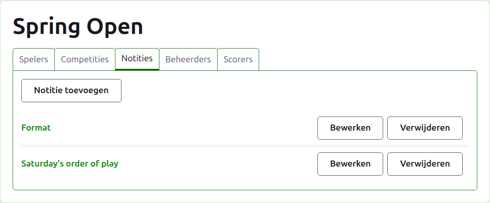
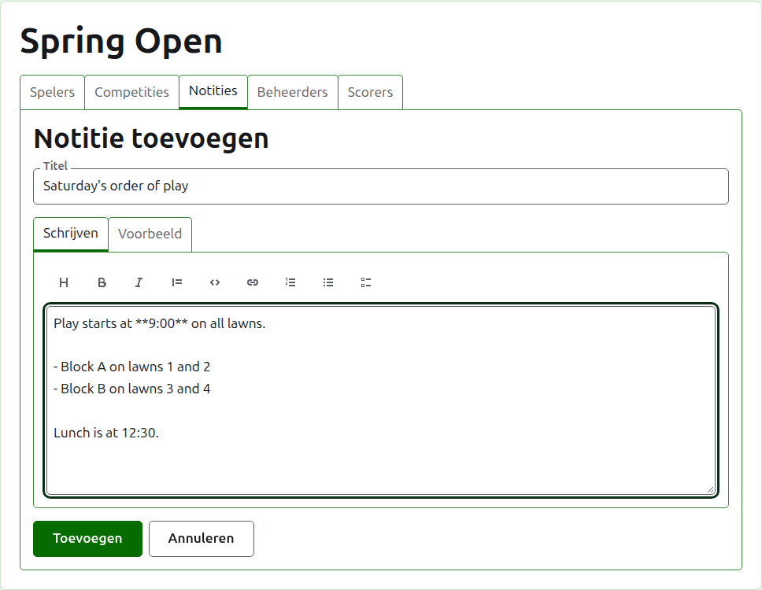
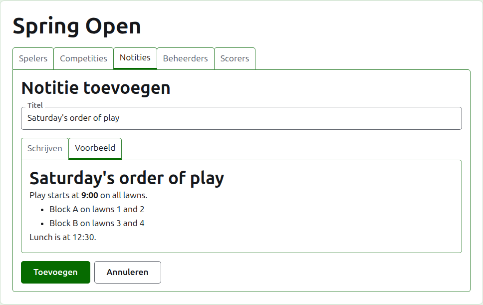
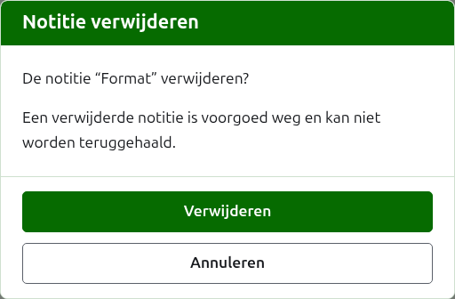

# Notities

Het tabblad **Notities** van de pagina van een toernooi is waar zijn toernooileiders schrijven wat de spelers moeten weten terwijl het toernooi loopt: de opzet, een wijziging in het speelschema, het tijdstip van de lunch. Lezers vinden ze op de openbare pagina Notities van het toernooi, en een notitie die ze niet hebben gelezen is daar gemarkeerd met een rood sterretje, dat ook het onderdeel Notities op elke pagina van het toernooi markeert totdat ze haar openen.

## Een notitie schrijven

Druk op **Notitie toevoegen**, boven de lijst. Een paneel neemt de plaats van de lijst in, omdat een notitie uitgebreid wordt geschreven en de ruimte nodig heeft.

**Titel** is verplicht, en is waaronder de notitie in de lijst staat. Het is platte tekst.

**Beschrijving** wordt geschreven in Markdown en mag leeg blijven waar de titel alles zegt wat er te zeggen is. De werkbalk boven het vak schrijft de Markdown voor je: Kop, Vet, Cursief, Citaat, Code, Link, Genummerde lijst, Lijst met opsommingstekens en Takenlijst. Elk werkt op wat is geselecteerd, of aan het begin van elke geselecteerde regel, of zet de cursor waar de woorden komen.

**Voorbeeld** toont de notitie zoals een lezer haar op haar pagina zal zien.

Druk op **Toevoegen**. De notitie wordt bewaard, de lijst komt terug met haar bovenaan, en ze staat meteen op de openbare pagina Notities.

## Een notitie bewerken

Druk op de titel van een notitie, of op haar **Bewerken**, om het paneel op die notitie te openen. Druk op **Opslaan** om de wijziging te bewaren. Een notitie die is bewerkt nadat een lezer haar las, wordt voor die lezer opnieuw gemarkeerd.

## Een notitie verwijderen

Een notitie die niet meer van toepassing is, wordt verwijderd. Een verwijderde notitie is voorgoed weg, dus **Wissen** vraagt eerst.

Volgende: [Toernooileiders en scorebijhouders](managers-and-scorers.md).
