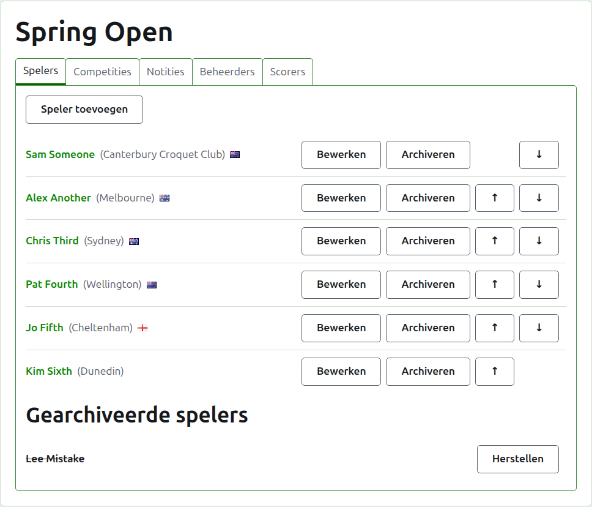
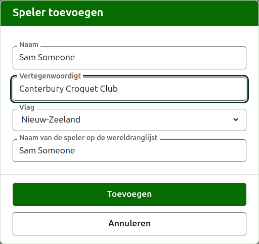
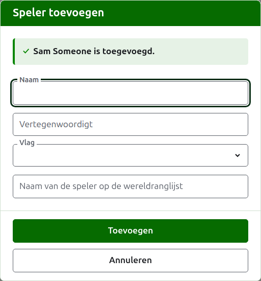
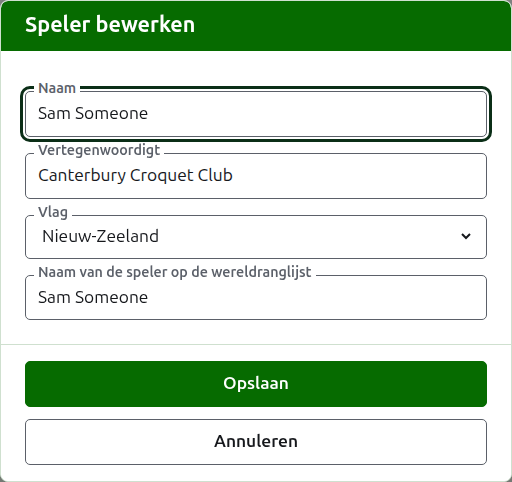
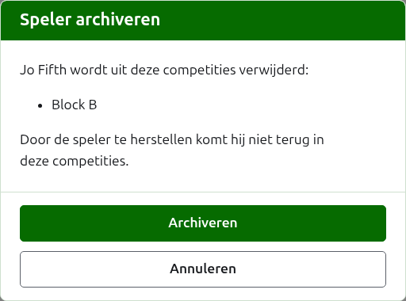

# Spelers

Het tabblad **Spelers** van de pagina van een toernooi is waar zijn spelers worden ingevoerd, gecorrigeerd, op volgorde gezet en opzijgezet. Het is het tabblad waarop de pagina opent, omdat het invoeren van de spelers het eerste is wat je met een toernooi doet.

Spelers worden hier eenmalig ingevoerd, in het toernooi. In welke competities elke speler speelt, kies je daarna, op de eigen pagina van elke competitie, uit de spelers die hier zijn ingevoerd. Zie [Spelers in een competitie plaatsen](entering-players-in-a-competition.md).



## Spelers toevoegen {#add-a-player}

Druk op **Speler toevoegen**, boven de lijst. Er opent een dialoogvenster over de pagina.



**Naam** is verplicht. Het is de naam van de speler zoals die op elke pagina wordt getoond, tussen 3 en 254 tekens. Twee spelers in één toernooi kunnen niet dezelfde naam hebben, hoe het hoofdlettergebruik ook is; waar twee spelers echt dezelfde naam hebben, maak je het onderscheid in de naam zelf, als "Andrew Hobbs (2)".

**Vertegenwoordigt** is waarvoor de speler speelt, geschreven zoals een lezer het zou zeggen: een club, een regio of een land, zoals "Canterbury Croquet Club". Het staat tussen haakjes achter de naam. Het mag leeg blijven.

**Vlag** is de vlag die naast de naam van de speler wordt getoond. Ze mag op geen blijven staan, zoals bij de meeste spelers. Wat een speler vertegenwoordigt en welke vlag die voert, worden apart gehouden, omdat een speler voor een club in het ene land kan spelen en de vlag van een ander land kan voeren.

**Naam van de speler op de wereldranglijst** is de naam waaronder de wereldranglijst de speler kent. Ze wordt alleen gevraagd in een toernooi Associatiecroquet of Golfcroquet, de twee sporten waarvan de wereldranglijst de spelers bijhoudt. De spelers van Amerikaans croquet met 6 poortjes zijn op de ranglijst onder hun eigen naam bekend, dus daar wordt ze niet gevraagd, en de naam van elke speler op de wereldranglijst is altijd gewoon zijn naam. Terwijl je een speler toevoegt, volgt ze de naam zoals je die typt, omdat de meeste spelers op de ranglijst onder hun eigen naam bekend zijn, en ze houdt op met volgen zodra je erin typt. Leeg gelaten wordt ze bewaard als de naam van de speler.

Terwijl je een naam typt, worden de spelers die de wereldranglijst kent en van wie de naam zo begint aangeboden, zodat je een naam kunt overnemen zoals de ranglijst hem spelt in plaats van hem uit te typen. Naast de naam op de wereldranglijst zegt een vinkje dat de ranglijst de naam kent, en een vraagteken dat die hem niet kent: de naam kan verkeerd gespeld zijn, of de speler kan nieuw zijn op de ranglijst. Het is alleen advies. Een naam die de ranglijst niet kent, wordt net zo goed bewaard als een die ze wel kent.

Druk op **Toevoegen**. De speler wordt toegevoegd, het dialoogvenster zegt dat, en de velden worden leeggemaakt voor de volgende speler, met de cursor terug in de naam. Voeg zo de hele lijst toe, en druk dan op **Annuleren** om het dialoogvenster te sluiten. Annuleren bewaart niets wat niet al was toegevoegd.



Een speler heet nooit "Bye". De byes van een knock-out worden in de knock-out zelf toegevoegd, waar ook de spelers worden geplaatst, dus een naam waarvan het eerste woord het Engelse "bye" is, wordt geweigerd, en het dialoogvenster legt uit waarom.

## Meerdere spelers tegelijk toevoegen {#adding-multiple-players}

Om een hele lijst in één keer toe te voegen, druk je op **Spelers toevoegen**, naast **Speler toevoegen**. Er opent een dialoogvenster over de pagina met één vak, waarin meerdere regels tekst passen. Je kunt de lijst uit een spreadsheet kopiëren en in het vak plakken.

**De eerste regel noemt de velden**, gescheiden door komma's of tabs: **Name**, en een of meer van **Representing**, **Flag**, **Handicap** en **WorldRankingPlayerName**, in willekeurige volgorde. Deze namen typ je in het Engels, in welke taal de site ook staat. **Name** moet er een van zijn. **Elke regel daarna is een speler**, met een waarde voor elk veld in dezelfde volgorde, op dezelfde manier gescheiden. Een speler zonder waarde voor een veld laat het leeg, maar houdt de komma of tab. Bijvoorbeeld, met komma's:

```
Name,Representing,Flag
Sam Someone,Canterbury Croquet Club,New Zealand
Alex Another,,England
```

- **Naam, Vertegenwoordigt en Naam van de speler op de wereldranglijst** vallen onder dezelfde regels als wanneer je één speler toevoegt (zie [Spelers toevoegen](players.md#add-a-player)). Een naam is tussen 3 en 254 tekens, staat nog niet in het toernooi, hoe het hoofdlettergebruik ook is, en is niet "Bye".
- **Vlag** is de naam van het land of de plaats, in jouw taal, zoals de lijst in het dialoogvenster Speler toevoegen die aanbiedt, zoals Nieuw-Zeeland.
- **Handicap** is een getal met teken, met maximaal twee cijfers en één cijfer achter de komma, zoals 4, +4 of -1.5.
- Een speler zonder **WorldRankingPlayerName** is bekend onder zijn naam, net als wanneer hij afzonderlijk wordt toegevoegd.
- **Komma's of tabs.** Cellen die uit een spreadsheet zijn gekopieerd, zijn gescheiden door tabs, en een lijst die met de hand is getypt, is meestal gescheiden door komma's. Beide werken. Staat er in de eerste regel een tab, dan wordt de hele lijst met tabs gelezen, en anders met komma's.
- Een waarde met het scheidingsteken erin wordt tussen dubbele aanhalingstekens geschreven, zoals een spreadsheet dat doet: "Smith, John" in een lijst die door komma's is gescheiden. Een aanhalingsteken binnen een waarde wordt tweemaal geschreven.
- Van elke waarde worden de spaties aan de uiteinden verwijderd, en een lege regel wordt genegeerd.
- Een lijst bevat hoogstens 500 spelers. Voeg de rest toe in een andere lijst.

Druk op **Toevoegen**. De hele lijst wordt gecontroleerd voordat er iets van wordt bewaard, dus een lijst met een fout erin voegt niemand toe. Wat er fout is, wordt onder het vak gemeld, bij de regel waarop het staat, waarbij de eerste regel als regel 1 telt. Elke fout wordt vermeld, niet alleen de eerste, en wat je hebt getypt blijft staan zodat je het kunt herstellen. Zodra de lijst is bewaard, sluit het dialoogvenster en toont het tabblad Spelers de nieuwe spelers, in de volgorde waarin je ze hebt geschreven. Anders dan bij **Speler toevoegen**, dat openblijft voor de volgende speler, is er hier geen volgende: de lijst was de volgende.

De **?** in de titelbalk van het dialoogvenster leidt hiernaartoe.

## Een speler corrigeren {#correcting-a-player}

Druk op de naam van een speler, of op **Bewerken**, om hetzelfde dialoogvenster op die speler te openen, met de titel Speler bewerken. Verander wat fout is en druk op **Opslaan**, wat de wijziging bewaart en het dialoogvenster sluit. Een speler van wie de naam wordt gecorrigeerd, houdt de naam op de wereldranglijst die die had, omdat de ranglijst hem nog onder die naam kent. In Amerikaans croquet met 6 poortjes is de naam van een speler op de wereldranglijst altijd zijn naam, dus als je de naam corrigeert, corrigeer je die ook.



Een speler die hier wordt gecorrigeerd, is overal gecorrigeerd: in elke competitie waarin die speelt, en op elke openbare pagina.

## Spelers op volgorde zetten

De spelers staan in de volgorde van het toernooi, wat de volgorde is waarin ze worden aangeboden wanneer ze in competities worden geplaatst, en de volgorde waarin een knock-out wordt geloot. **Omhoog** en **Omlaag**, de pijlen aan het einde van elke rij, verplaatsen een speler één plaats. De eerste speler krijgt geen Omhoog en de laatste geen Omlaag.

## Een speler archiveren {#archiving-a-player}

**Archiveren** zet een speler opzij: per ongeluk ingevoerd, of teruggetrokken uit het hele toernooi. Een gearchiveerde speler staat onder **Gearchiveerde spelers**, doorgestreept, na de spelers in gebruik, en biedt alleen **Herstellen**. Een gearchiveerde speler zit in geen enkele competitie en verschijnt op geen enkele openbare pagina.

Een speler die een partij heeft gespeeld, kan niet worden gearchiveerd, omdat de partijen dan tegen iemand zouden zijn die er niet meer is, dus zo'n speler krijgt geen Archiveren. Een speler van wie alle partijen gearchiveerd zijn, kan wel worden gearchiveerd.

Het archiveren van een speler die in geen enkele competitie zit, vraagt niet eerst, omdat herstellen alles terugzet. Het archiveren van een speler die in een competitie zit, vraagt wel eerst, omdat archiveren de speler uit elke competitie haalt waarin die zit, en herstellen de speler daar niet in terugzet.



Volgende: [Competities](competitions.md).
