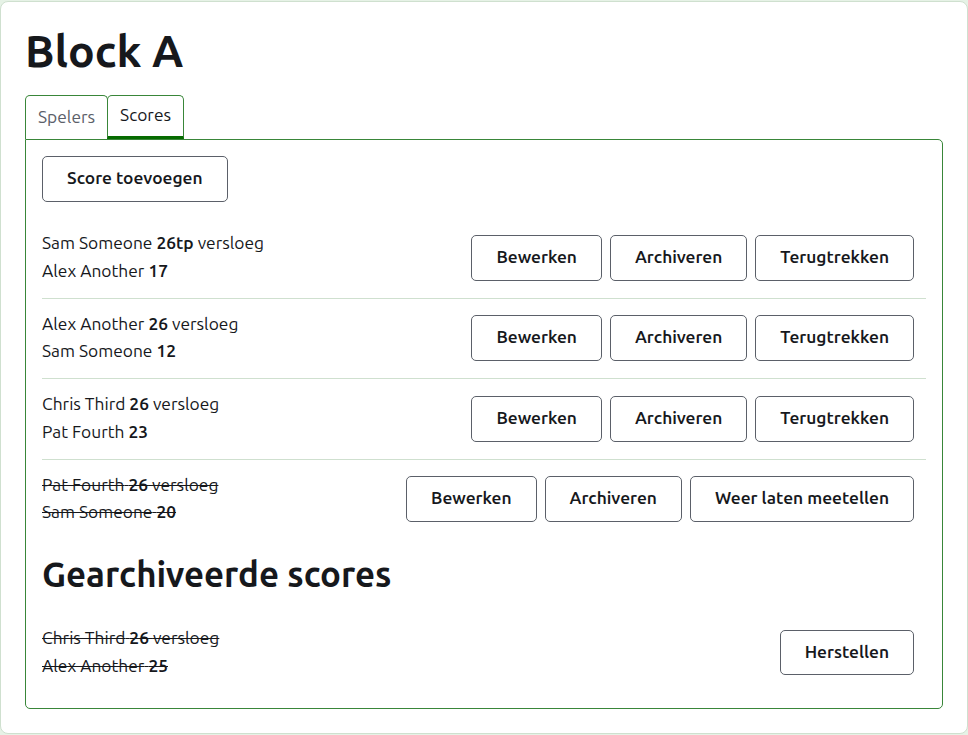
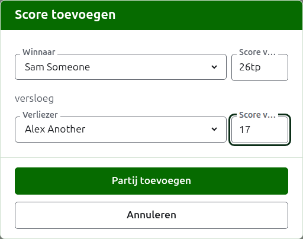
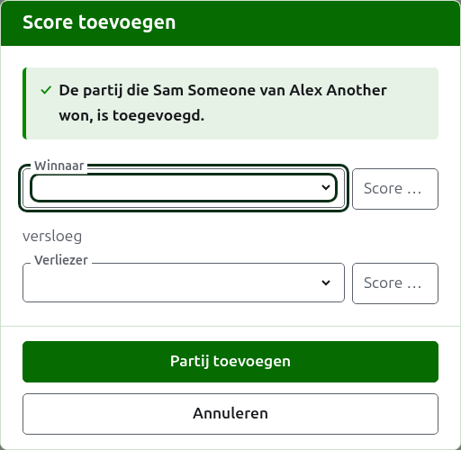
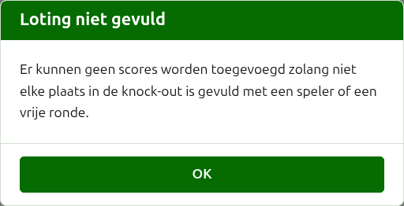
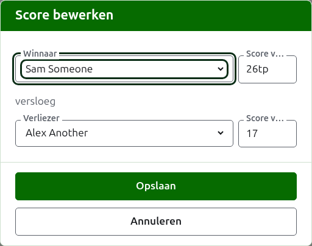

# Scores

Het tabblad **Scores** van de pagina van een competitie is waar haar partijen worden ingevoerd, gecorrigeerd en opzijgezet. Een scorebijhouder ziet alleen dit tabblad, en kan erop alles doen wat een toernooileider kan.

## Een score invoeren

Druk op **Score toevoegen**, boven de lijst. Het dialoogvenster leest zoals een uitslag wordt uitgesproken: de winnaar en zijn score, dan "versloeg", dan de verliezer en zijn score.

De winnaar en de verliezer worden elk gekozen uit de spelende spelers van de competitie, in de volgorde van de competitie. Om te beginnen is niemand gekozen, zodat een partij nooit wordt genoteerd op naam van een speler die je niet hebt gekozen. In een knock-out kiest het kiezen van de winnaar ook tegen wie die is geloot als verliezer, waar je het kunt zien en een ander kunt kiezen.

Een score wordt getypt zoals de scorebijhouder die heeft opgeschreven: het aantal punten, en wat erop volgt, dat wordt bewaard en getoond zoals getypt, als "26tp" voor 26 poortjes en een triple peel. Het getal zijn de cijfers waarmee de score begint; een score die niet met een cijfer begint, wordt geweigerd.

Een partij die met gelijke punten is gewonnen, zoals wanneer ze door de tijd wordt afgebroken en op een andere manier wordt beslist, zegt wie heeft gewonnen met een markering achter de score van de winnaar: "6w" versloeg "6". Op Croquet Scores zijn de markeringen "w", "won" en "winner"; Gateball Scores neemt ook "cb" en "so". De score van een winnaar moet hoger zijn dan die van de verliezer, of gemarkeerd, tenzij het toernooi gelijkspel toestaat, in welk geval gelijke punten zonder markering worden bewaard als gelijkspel.

Druk op **Partij toevoegen**. De partij wordt toegevoegd, het dialoogvenster zegt welke, en de velden worden leeggemaakt voor de volgende, omdat scores in een reeks komen die aan het einde van een ronde van een bord worden afgelezen. Druk op **Annuleren** zodra ze er allemaal in staan.

Wat wordt geweigerd, staat onder het veld waar het over gaat: een winnaar of verliezer die niet is gekozen, een score die niet is getypt of niet met een cijfer begint, dezelfde speler als beide, een score van een verliezer die als gewonnen is gemarkeerd, of een score van een winnaar die lager is dan die van de verliezer. In een knock-out worden twee spelers die niet tegen elkaar zijn geloot boven de velden geweigerd.

## De loting van een knock-out moet eerst gevuld zijn

Een knock-out wordt pas gespeeld wanneer elke plaats in de loting een speler of een bye bevat. Tot dan legt Score toevoegen uit waarom er geen scores kunnen worden toegevoegd, in plaats van het dialoogvenster te openen.

## De lijst met scores

De scores in gebruik staan in de volgorde waarin ze zijn ingevoerd, oudste eerst, zodat de lijst leest zoals de competitie is gespeeld. Elke score noemt de winnaar en zijn score, dan de verliezer en de zijne, en biedt **Bewerken** en **Archiveren**.

## Een score corrigeren

**Bewerken** opent hetzelfde dialoogvenster op die score, met de titel Score bewerken, met de spelers gekozen en de scores zoals ze zijn getypt. Druk op **Opslaan** om de correctie te bewaren en het dialoogvenster te sluiten.

Een correctie behoudt de uitslag: een gewonnen partij blijft gewonnen, en een gelijkgespeelde partij blijft gelijk. Een partij waarvan de uitslag fout was, archiveer je en voer je opnieuw in.

Waar een score gearchiveerd zou kunnen worden, kunnen ook de spelers worden gewijzigd, niet alleen de scores. In een knock-out behoudt een score waarvan de winnaar al in de volgende ronde heeft gespeeld zijn spelers, omdat veranderen wie haar won de volgende partij zou laten spelen door iemand die daar niet was gekomen; alleen de scores kunnen worden gecorrigeerd.

## Een score archiveren

**Archiveren** zet een score opzij zodat ze voor niets meetelt. Ze staat onder **Gearchiveerde scores**, doorgestreept, en biedt alleen **Herstellen**. Geen van beide vraagt eerst, omdat elk het andere ongedaan maakt.

In een knock-out gaat de winnaar van een wedstrijd door naar de volgende ronde, dus een score van een wedstrijd waarvan de winnaar in de volgende ronde heeft gespeeld, krijgt geen Archiveren. De partij in de volgende ronde wordt eerst gearchiveerd, en dan kunnen de partijen ervóór worden gearchiveerd. Waar een ronde de beste van 3 of 5 is, wordt elke partij van de wedstrijd op dezelfde manier behandeld. Een poule en een Zwitsers systeem hebben geen rondes die van elkaar afhangen, dus elke score daarin kan worden gearchiveerd.

## Een score terugtrekken

Een speler die een competitie verlaat, wordt daar gewoonlijk uit teruggetrokken, op het tabblad Spelers, en dat is alles wat nodig is: die speelt niet meer, en de partijen die die wel speelde blijven staan, maar tellen niet meer mee voor winst/verlies en poortjes. Een score terugtrekken is voor het zeldzamere geval dat een gespeelde partij niet mag meetellen. In de Australische President's Eights bijvoorbeeld blijven de uitslagen van de eerste ronde staan wanneer een speler zich terugtrekt, en worden alleen zijn partijen uit de tweede ronde uit de telling gehaald: trek die partijen terug.

In een poule of een Zwitsers systeem wordt een score die is gespeeld maar niet mag meetellen teruggetrokken in plaats van gearchiveerd. **Terugtrekken** houdt haar tussen de scores in gebruik, op haar plaats, maar doorgestreept en voor niets meetellend op de openbare pagina's. **Hervatten** laat haar weer meetellen. Geen van beide vraagt eerst. De scores van een knock-out krijgen geen Terugtrekken, omdat een score daar meer beslist dan de stand.

Volgende: [Notities](notes.md).
