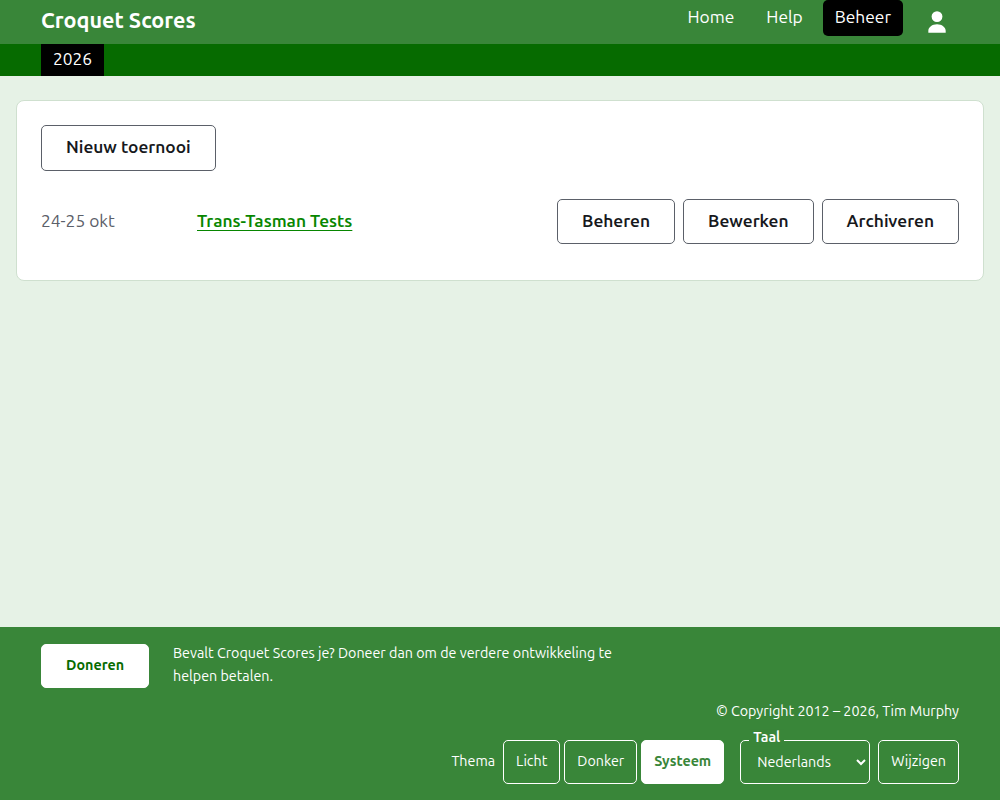
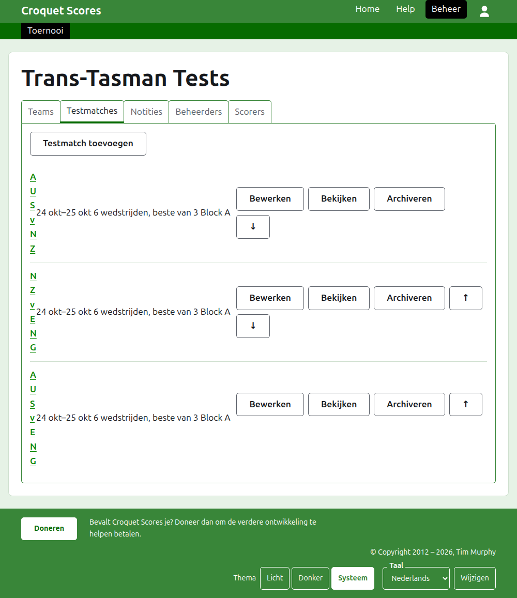

# Een toernooi tussen teams leiden

Een toernooi tussen teams is een toernooi waarin ploegen elkaar treffen, in plaats van spelers die een voor een worden ingevoerd: een testserie tussen twee landen, een interstate shield, een wereldkampioenschap voor teams. De teams worden opgezet met hun spelers, de testmatches tussen de teams worden toegevoegd, en de partijen van elke testmatch komen online zodra ze gespeeld zijn. Deze handleiding neemt een beheerder mee van het inloggen tot een toernooi waarvan de uitslagen voor het publiek te zien zijn.

Ze staat op zichzelf. Niets erin hangt af van de handleiding voor een standaardtoernooi, die apart is geschreven.

## Voordat je begint

Je hebt een account nodig. Klik [hier](/account/register) om een account te registreren.

Alles wat een beheerder doet, gebeurt in het beheergedeelte van de website. De openbare pagina's, waar spelers en toeschouwers het toernooi volgen, worden opgebouwd uit wat het beheer bevat, dus er hoeft niets gepubliceerd te worden: een ingevoerde score staat meteen op de openbare pagina's.

## De woorden

Een **team** is een ploeg, zoals Australië, met een naam, een korte naam zoals "AUS", en een vlag. Een team heeft eigen **spelers**, die voor dat team spelen en voor niemand anders. Een **testmatch** is een krachtmeting tussen twee teams, aangeduid met hun korte namen, als "AUS v ENG", bestaande uit een aantal **wedstrijden** tussen een speler van elk team, elke wedstrijd de beste van een aantal **partijen**. Testmatches kunnen in **groepen** worden gezet, als "Block A", waar veel teams onderling spelen.

## De pagina's op volgorde

1. [Een toernooi aanmaken](creating-a-tournament.md): de naam, de dagen, de sport, de toernooivorm, en waar het wordt gespeeld.
2. [Teams](teams.md): de teams toevoegen, met hun korte namen en vlaggen.
3. [De spelers van een team](team-players.md): de spelers van elk team invoeren op de eigen pagina van het team.
4. [Testmatches](tests.md): de testmatches tussen teams toevoegen, hun dagen, hoeveel wedstrijden elk heeft, en hun groepen.
5. [Scores](scores.md): de partijen van een testmatch invoeren, corrigeren, en de per ongeluk ingevoerde opzijzetten.
6. [Notities](notes.md): de spelers vertellen wat ze moeten weten terwijl het toernooi loopt.
7. [Beheerders en scorers](managers-and-scorers.md): de leiding van het toernooi delen, en iemand scores laten invoeren zonder dat die verder iets kan veranderen.
8. [Ranglijsten](rankings.md): het bestand dat naar de wereldranglijst wordt gestuurd, en wat er voor jou nog in te vullen is.
9. [Een toernooi wijzigen, archiveren en herstellen](changing-and-archiving.md): de gegevens van het toernooi corrigeren, en een toernooi opzijzetten.
10. [Wat het publiek ziet](what-the-public-sees.md): de pagina's die je spelers volgen, en hoe wat jij invoert daarop verschijnt.

## Hoe het beheer is ingedeeld

De voordeur van het beheer toont de toernooien waar jij een rol in hebt, één jaar tegelijk.

Door op de naam van een toernooi te drukken, of op **Beheren**, open je zijn pagina. Alles wat er te leiden valt, zit in zes tabbladen onder de naam: **Teams**, **Testmatches**, **Notities**, **Beheerders**, **Scorers** en **Ranglijsten**. De pagina opent op Teams, omdat de teams het eerste zijn wat je opzet.

De donkergroene balk onder de kop is om tussen pagina's te bewegen. Op de pagina van het toernooi en op de pagina van een testmatch leidt ze naar het toernooi, als **Toernooi**, en naar elke testmatch bij naam. Op de pagina van een team leidt ze in plaats daarvan naar het toernooi en naar elk team bij zijn korte naam, omdat een beheerder op de pagina van een team spelers team voor team invoert. De pagina waar je op staat, is zwart gemarkeerd.

## Wat overal geldt

**Niets wordt definitief verwijderd behalve een notitie.** Teams, spelers, testmatches, scores en het toernooi zelf worden gearchiveerd in plaats van verwijderd: opzijgezet, doorgestreept, en onder een eigen kop vermeld, met **Herstellen** om ze terug te halen. Archiveren, herstellen en omhoog en omlaag verplaatsen vragen nooit om bevestiging, omdat elk ervan ongedaan wordt gemaakt door de andere kant op te drukken. Wat niet ongedaan kan worden gemaakt, zoals een notitie verwijderen of een beheerder verwijderen, vraagt het eerst.

**Een dialoogvenster over de pagina bewaart niets totdat je op zijn knop drukt.** Annuleren, of de Escape-toets, sluit het en laat alles zoals het was. Dialoogvensters die dingen toevoegen, zoals Team toevoegen en Score toevoegen, blijven open nadat er een is toegevoegd, zodat je een lijst na elkaar kunt intypen.

**Wat wordt geweigerd, staat naast het veld waar het over gaat.** Niets wat geweigerd is, wordt bewaard, en wat je hebt getypt blijft staan, zodat je het kunt verbeteren in plaats van opnieuw typen.

**Het beheer werkt op een telefoon.** Elke knop is groot genoeg om met een duim in te drukken, en niets is breder dan het scherm.

Volgende: [Een toernooi aanmaken](creating-a-tournament.md).
