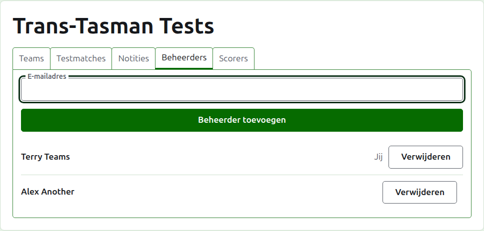
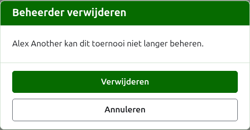
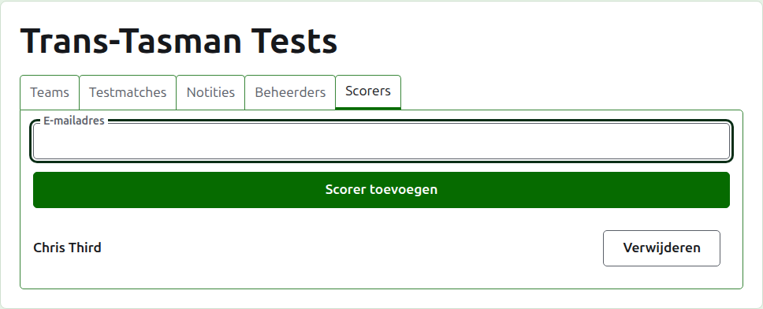
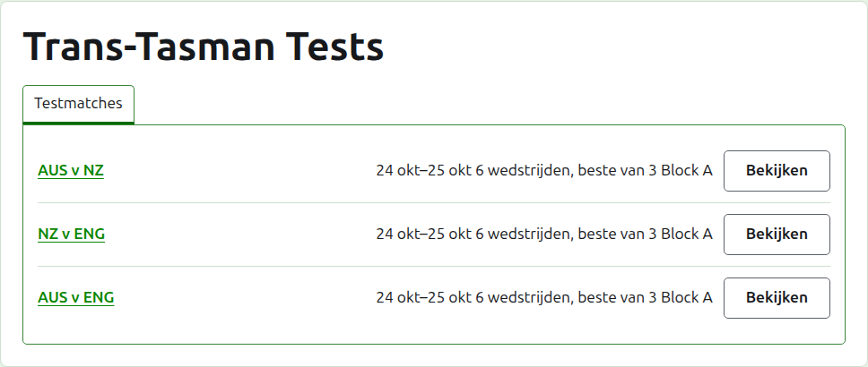

# Toernooileiders en scorebijhouders

Een toernooi heeft toernooileiders, die alles kunnen doen wat ermee gedaan kan worden, en kan scorebijhouders hebben, die zijn scores invoeren en verder niets. Wie het toernooi heeft aangemaakt, is zijn eerste toernooileider.

## Toernooileiders

Het tabblad **Toernooileiders** toont wie het toernooi leidt, in de volgorde waarin ze toernooileider zijn gemaakt, met je eigen naam als de jouwe gemarkeerd. Het is waar een toernooi wordt gedeeld, of overgedragen.

Iemand wordt toernooileider gemaakt via zijn e-mailadres. Typ het in het veld boven de lijst en druk op **Toernooileider toevoegen**. Het adres moet horen bij een account dat geregistreerd en bevestigd is; een adres zonder zo'n account wordt onder het veld geweigerd, en de site zegt er niet meer over dan dat. Een scorebijhouder die toernooileider wordt gemaakt, is geen scorebijhouder meer.

**Verwijderen** haalt een toernooileider weg. Er wordt niets bewaard van een verwijderde toernooileider, dus Verwijderen vraagt eerst; iemand wordt via zijn adres opnieuw toernooileider gemaakt als die terug gewenst is. Een toernooi heeft altijd een toernooileider, dus de laatste krijgt geen Verwijderen.

Je kunt jezelf weghalen. De vraag zegt dan wat dat betekent: je verliest je eigen weg terug naar het toernooi, en niemand op de pagina kan het voor je ongedaan maken. Een andere toernooileider kan je opnieuw toernooileider maken.

## Scorebijhouders

Het tabblad **Scorebijhouders** is het tabblad Toernooileiders voor scorebijhouders, en werkt op dezelfde manier: een e-mailadres en **Scorebijhouder toevoegen** boven de lijst, en **Verwijderen** bij elke scorebijhouder.

Een scorebijhouder ziet het toernooi in zijn eigen lijst in het beheer, met **Scores** in plaats van Beheren, en krijgt alleen de tests aangeboden: geen teams, notities, toernooileiders, scorebijhouders of ranglijsten. Die kan de pagina van een team niet openen, omdat de toernooileiders bepalen wie voor een team speelt. Op de pagina van een test kan die scores invoeren, corrigeren, archiveren, herstellen en op volgorde zetten zoals een toernooileider.

Een toernooileider wordt geen scorebijhouder gemaakt, omdat een toernooileider al alles kan wat een scorebijhouder kan. Een toernooi heeft geen scorebijhouder nodig, dus elke scorebijhouder kan worden verwijderd, ook de laatste.

Volgende: [Ranglijsten](rankings.md).
