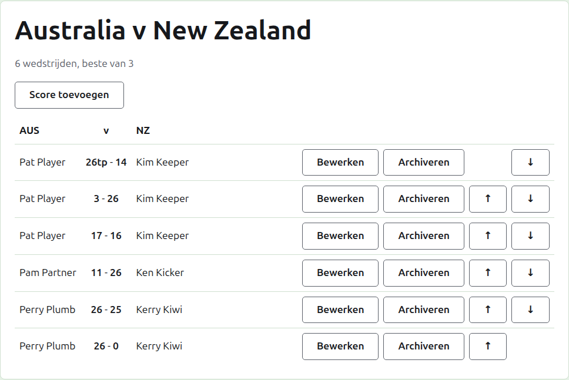
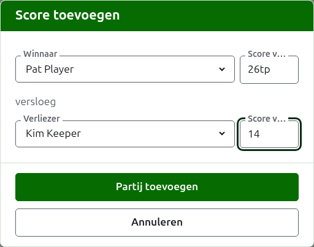

# Scores

De pagina van een test open je via haar naam op het tabblad Tests, of via de donkergroene balk. Ze heeft de volledige namen van de teams als kop, als "Australia v New Zealand", met daaronder hoeveel wedstrijden ze naar verwachting heeft en waarvan elke de beste is. Haar scores zijn de pagina, zonder tabbladen. Een toernooileider en een scorebijhouder zien dezelfde pagina, omdat een scorebijhouder met een score alles kan doen wat een toernooileider kan.

## Hoe de scores zijn ingedeeld

De scores zijn ingedeeld per team in plaats van naar wie heeft gewonnen, in een tabel met als kop de korte naam van het eerste team, "v", en die van het tweede. Elke score is een rij: de speler van het eerste team, dan beide scores met die van het eerste team eerst, als "26tp - 14", dan de speler van het tweede team, wie van hen ook heeft gewonnen. De gearchiveerde scores staan daaronder op dezelfde manier ingedeeld.

## Een score invoeren {#entering-a-score}

Druk op **Score toevoegen**, boven de lijst. Het dialoogvenster leest zoals een uitslag wordt uitgesproken: de winnaar en zijn score, dan "versloeg", dan de verliezer en zijn score.

De winnaar wordt gekozen uit de spelers in gebruik van beide teams, onder de naam van elk team, de spelers van het eerste team eerst en die van elk team in de volgorde van het team. Om te beginnen is niemand gekozen. Zodra de winnaar is gekozen, wordt de verliezer alleen uit het andere team aangeboden, omdat een partij tussen twee spelers van hetzelfde team geen partij tussen de teams is. Een gearchiveerde speler wordt niet aangeboden.

Een score wordt getypt zoals de scorebijhouder die heeft opgeschreven: het aantal punten, en wat erop volgt, dat wordt bewaard en getoond zoals getypt, als "26tp" voor 26 poortjes en een triple peel. Het getal zijn de cijfers waarmee de score begint; een score die niet met een cijfer begint, wordt geweigerd.

Een partij die met gelijke punten is gewonnen, zoals wanneer ze door de tijd wordt afgebroken en op een andere manier wordt beslist, zegt wie heeft gewonnen met een markering achter de score van de winnaar: "6w" versloeg "6". De markeringen zijn "w", "won" en "winner". De score van een winnaar moet hoger zijn dan die van de verliezer, of gemarkeerd, tenzij het toernooi gelijkspel toestaat, in welk geval gelijke punten zonder markering worden bewaard als gelijkspel.

Druk op **Partij toevoegen**. De partij wordt toegevoegd, het dialoogvenster zegt welke, en de velden worden leeggemaakt voor de volgende, omdat scores in een reeks komen die aan het einde van een sessie van een bord worden afgelezen. Druk op **Annuleren** zodra ze er allemaal in staan.

## Wedstrijden

Twee spelers die elkaar treffen, spelen een wedstrijd van de beste-van van de test. De partijen tussen hen zijn de partijen van die wedstrijd, en een partij tussen twee spelers van wie de wedstrijd al is beslist, wordt geweigerd: een van hen heeft meer partijen gewonnen dan de ander nog kan winnen, of elke partij ervan is gespeeld.

Een wedstrijd is begonnen wanneer haar twee spelers een partij in gebruik hebben. Een test begint niet meer wedstrijden dan ze naar verwachting heeft: zodra er zoveel zijn begonnen, wordt een partij tussen twee spelers die elkaar nog niet hebben getroffen geweigerd, terwijl een volgende partij van een al begonnen wedstrijd wordt geaccepteerd. Waar de test meer wedstrijden moet hebben, wijzig je dat op het tabblad Tests zodat ze die verwacht.

## Een score corrigeren {#correcting-a-score}

**Bewerken** opent hetzelfde dialoogvenster op die score, met de titel Score bewerken, met de spelers gekozen en de scores zoals ze zijn getypt. Ook de spelers kunnen worden gewijzigd, niet alleen de scores, gekozen zoals bij het toevoegen. Druk op **Opslaan** om de correctie te bewaren en het dialoogvenster te sluiten. Een correctie behoudt de uitslag: een gewonnen partij blijft gewonnen, en een gelijkgespeelde partij blijft gelijk. Een partij waarvan de uitslag fout was, archiveer je en voer je opnieuw in.

## De scores op volgorde zetten

Scores komen in de volgorde waarin ze worden ingevoerd, dus elke score in gebruik biedt **Omhoog** en **Omlaag**, die haar verwisselen met de score ernaast, zodat de lijst in de volgorde kan worden gezet waarin de partijen zijn gespeeld.

## Een score archiveren

**Archiveren** zet een score opzij zodat ze voor niets meetelt. Ze staat onder **Gearchiveerde scores**, doorgestreept, en biedt alleen **Herstellen**. Geen van beide vraagt eerst, omdat elk het andere ongedaan maakt. Elke score in een test kan worden gearchiveerd, omdat een test geen rondes heeft die van elkaar afhangen.

Een score waarvan de speler sindsdien is gearchiveerd, wordt niet hersteld totdat de speler dat is, en de pagina zegt dat.

Volgende: [Notities](notes.md).
