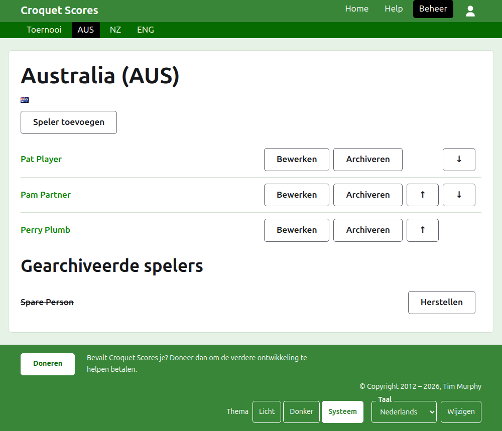
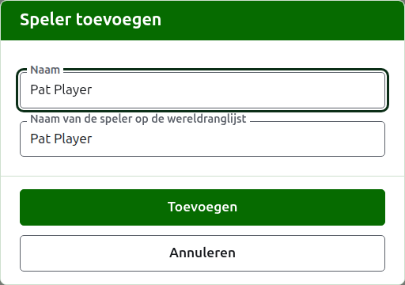

# De spelers van een team

De pagina van een team open je via zijn naam, of via **Bekijken**, op het tabblad Teams. Ze heeft de naam van het team als kop, met de korte naam tussen haakjes, en zijn vlag, zodat een beheerder die bij het verkeerde team is uitgekomen dat meteen ziet. Ze heeft één ding te tonen, de spelers van het team, dus de lijst is de pagina.

De donkergroene balk op de pagina van een team leidt naar het toernooi en naar elk team in gebruik bij zijn korte naam, zodat de spelers team voor team worden ingevoerd zonder terug te gaan naar het tabblad Teams.

Een speler in een team hoort alleen bij dat team, vertegenwoordigt het team, en voert de vlag van het team in plaats van een eigen vlag. Dezelfde persoon die voor twee teams speelt, of in twee toernooien, is in elk ervan een speler.

## Een speler toevoegen

Druk op **Speler toevoegen**, boven de lijst. Er opent een dialoogvenster over de pagina.

**Naam** is verplicht, tussen 3 en 254 tekens. Twee spelers in één team kunnen niet dezelfde naam hebben, hoe het hoofdlettergebruik ook is; een speler in een ander team mag dezelfde naam hebben.

**Naam van de speler op de wereldranglijst** is de naam waaronder de wereldranglijst de speler kent. Ze wordt alleen gevraagd in een toernooi Associatiecroquet of Golfcroquet, de twee sporten met een wereldranglijst. Terwijl je een speler toevoegt, volgt ze de naam zoals je die typt, en ze houdt op met volgen zodra je erin typt. Leeg gelaten wordt ze bewaard als de naam van de speler. Terwijl je typt, worden de spelers die de wereldranglijst kent en van wie de naam zo begint aangeboden, en naast de naam op de wereldranglijst zegt een vinkje dat de ranglijst de naam kent en een vraagteken dat die hem niet kent. Het is alleen advies: een naam die de ranglijst niet kent, wordt net zo goed bewaard als een die ze wel kent.

Een speler heet nooit "Bye": een naam waarvan het eerste woord het Engelse "bye" is, wordt geweigerd.

Druk op **Toevoegen**. De speler wordt toegevoegd, het dialoogvenster zegt dat, en de velden worden leeggemaakt voor de volgende, met de cursor terug in de naam. Voeg zo het hele team toe, en druk dan op **Annuleren** om het dialoogvenster te sluiten.

## Een speler corrigeren

Druk op de naam van een speler, of op **Bewerken**, om hetzelfde dialoogvenster op die speler te openen, met de titel Speler bewerken. Druk op **Opslaan** om de wijziging te bewaren. Een speler van wie de naam wordt gecorrigeerd, houdt de naam op de wereldranglijst die die had.

## Volgorde

De spelers staan in de volgorde van het team, wat de volgorde is waarin ze worden aangeboden wanneer een score van een testmatch wordt ingevoerd. **Omhoog** en **Omlaag** verplaatsen een speler één plaats binnen het team.

## Een speler archiveren

**Archiveren** zet een speler opzij: per ongeluk ingevoerd, of niet meer bij het team. Een gearchiveerde speler staat onder **Gearchiveerde spelers**, doorgestreept, na de spelers in gebruik, en biedt alleen **Herstellen**. Archiveren vraagt nooit eerst, omdat een speler in een team nergens anders is ingevoerd en herstellen alles terugzet.

Een speler die een partij in gebruik heeft gespeeld in een testmatch, kan niet worden gearchiveerd, omdat de partijen dan tegen iemand zouden zijn die er niet meer is, dus zo'n speler krijgt geen Archiveren. Een speler van wie alle partijen gearchiveerd zijn, kan wel worden gearchiveerd.

Volgende: [Testmatches](tests.md).
