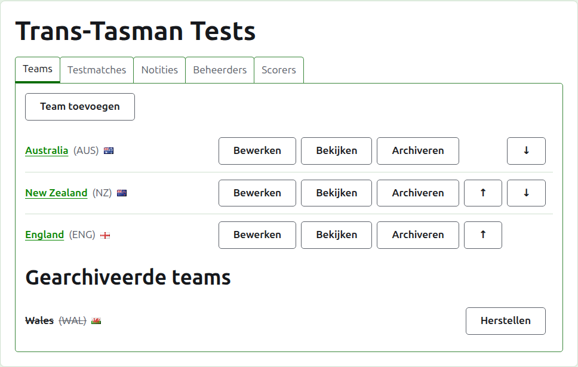
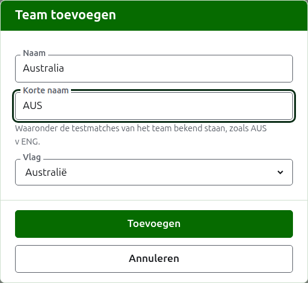
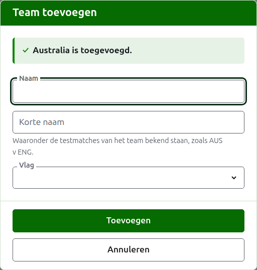
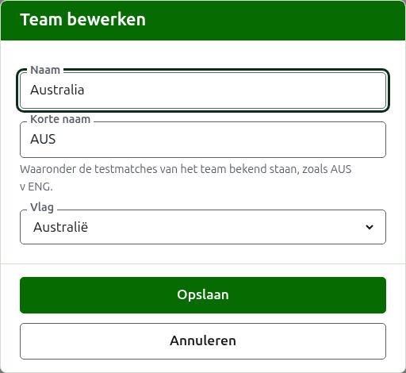

# Teams

Het tabblad **Teams** van de pagina van een toernooi is waar zijn teams worden toegevoegd, gecorrigeerd, op volgorde gezet en opzijgezet. Het is het tabblad waarop de pagina opent, omdat de teams het eerste zijn wat je opzet. Een test gaat tussen twee teams, dus er zijn minstens twee nodig voordat een test kan worden toegevoegd.

## Een team toevoegen

Druk op **Team toevoegen**, boven de lijst. Er opent een dialoogvenster over de pagina.

**Naam** is verplicht: de volledige naam van het team, als "Australia", die de kop vormt van de pagina van het team en van de tabellen op de openbare pagina's. Twee teams in één toernooi kunnen niet dezelfde naam hebben.

**Korte naam** is ook verplicht: waarmee de tests van het team worden aangeduid, als "AUS v ENG", en hoe de donkergroene balk het team noemt. Ze is hoogstens 10 tekens lang, en niet langer dan de naam, omdat een korte naam die langer is dan de naam die ze verkort, de twee verkeerd om getypt is. Twee teams kunnen ook niet dezelfde korte naam hebben.

**Vlag** wordt naast de naam van het team getoond, overal waar die verschijnt. Ze mag op geen blijven staan, zoals bij een team van een club of een regio.

Druk op **Toevoegen**. Het team wordt toegevoegd, het dialoogvenster zegt dat, en de velden worden leeggemaakt voor het volgende. Voeg zo de hele lijst toe, en druk dan op **Annuleren** om het dialoogvenster te sluiten. Annuleren bewaart niets wat niet al was toegevoegd.

## Een team corrigeren

Druk op **Bewerken** bij een team om hetzelfde dialoogvenster op dat team te openen, met de titel Team bewerken. Verander wat fout is en druk op **Opslaan**. Een team waarvan de korte naam verandert, wordt overal met de nieuwe aangeduid, dus zijn tests worden mee hernoemd.

## Volgorde

De teams staan in de volgorde van het toernooi, wat de volgorde is waarin ze worden aangeboden wanneer een test wordt toegevoegd, de volgorde waarin de donkergroene balk ze heeft, en de volgorde waarin de openbare pagina Spelers ze toont. **Omhoog** en **Omlaag**, de pijlen aan het einde van elke rij, verplaatsen een team één plaats.

## Naar een team gaan

De naam van een team, of **Bekijken**, opent de eigen pagina van het team, waar zijn spelers worden ingevoerd. Zie [De spelers van een team](team-players.md).

## Een team archiveren

**Archiveren** zet een team opzij. Zijn spelers blijven bij het team en komen terug wanneer het wordt hersteld, dus archiveren vraagt niet eerst. Een gearchiveerd team staat onder **Gearchiveerde teams**, doorgestreept, biedt alleen **Herstellen**, en zijn pagina is gesloten totdat het wordt hersteld.

Een team dat speelt in een test in gebruik, kan niet worden gearchiveerd, omdat de test dan tegen een team zou zijn dat er niet meer is, dus zo'n team krijgt geen Archiveren. Een team waarvan alle tests gearchiveerd zijn, kan wel worden gearchiveerd.

Volgende: [De spelers van een team](team-players.md).
