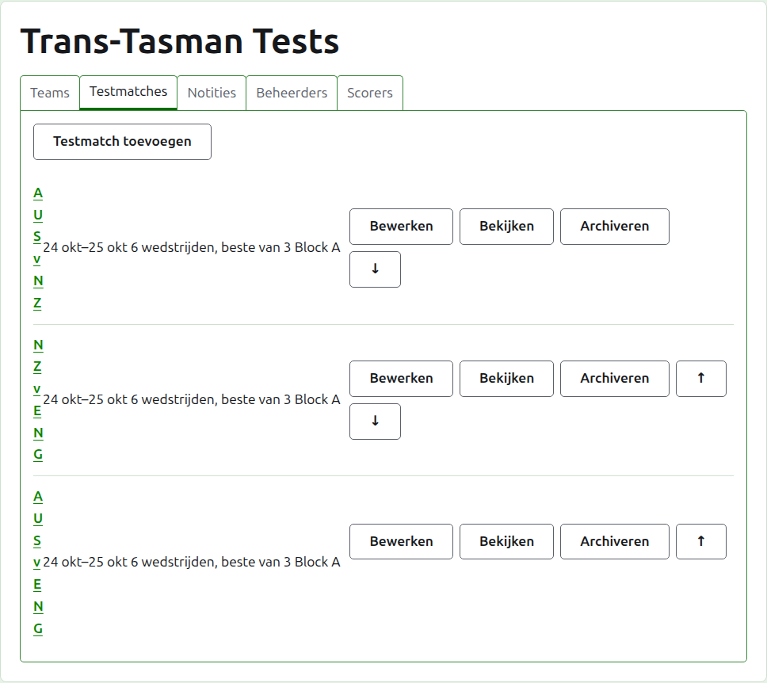
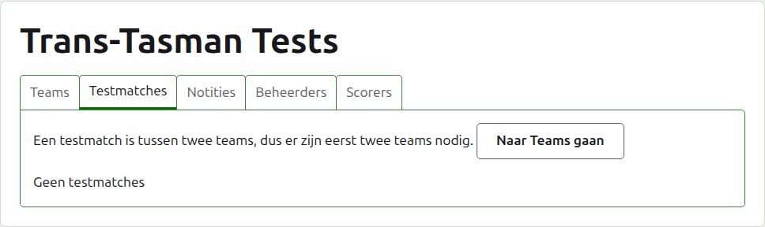
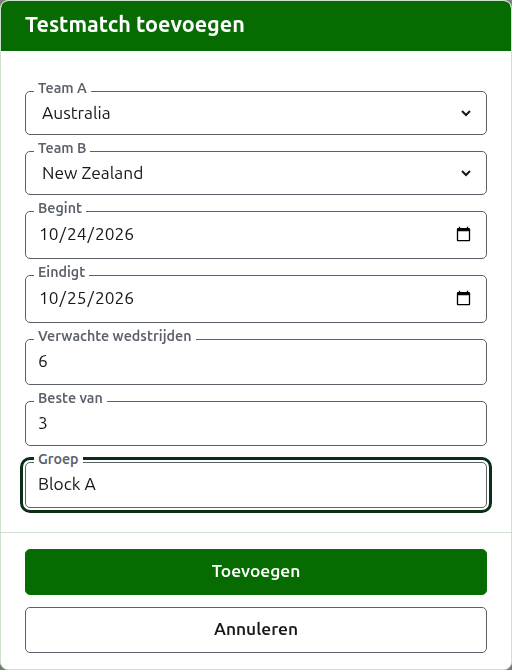
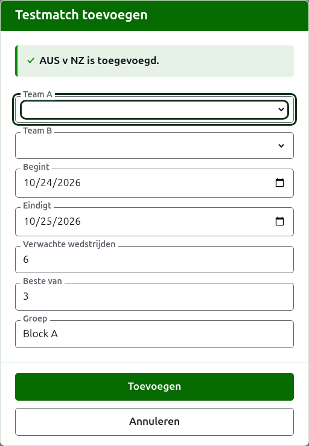
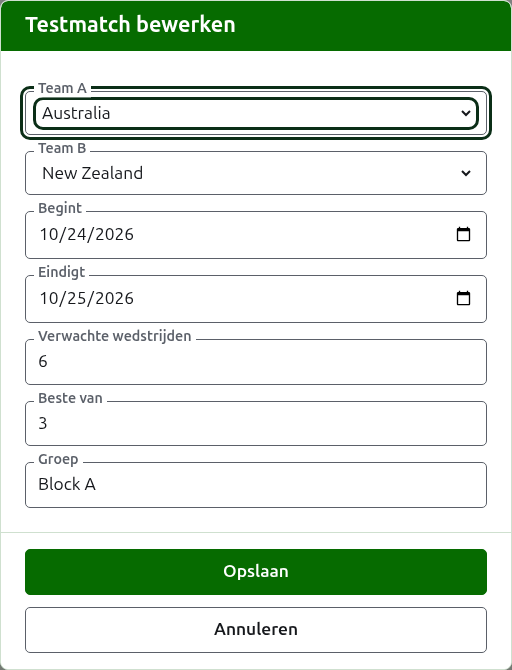

# Tests

Het tabblad **Tests** van de pagina van een toernooi is waar de tests tussen zijn teams worden toegevoegd, gewijzigd, op volgorde gezet en opzijgezet. Een test is een van de competities van het toernooi: een krachtmeting tussen twee teams, aangeduid met hun korte namen, als "AUS v NZ", gespeeld als een aantal wedstrijden tussen een speler van elk team. Elke test heeft een eigen pagina, waar haar scores worden ingevoerd.

Elke test noemt haar naam, de dagen waarop ze wordt gespeeld, hoeveel wedstrijden ze naar verwachting heeft en waarvan elke de beste is, als "6 wedstrijden, beste van 3", en haar groep als ze in een groep zit.

## Eerst twee teams

Een test gaat tussen twee teams in gebruik, dus zolang het toernooi er minder dan twee heeft, zegt het tabblad dat waar Test toevoegen zou staan, en leidt het naar het tabblad Teams.

## Een test toevoegen {#adding-a-test}

Druk op **Test toevoegen**, boven de lijst. Er opent een dialoogvenster over de pagina, dat leest in de volgorde waarin een test wordt uitgesproken.

**Team A** en **Team B** worden elk gekozen uit de teams in gebruik van het toernooi, bij naam, in de volgorde van het toernooi. Om te beginnen is geen van beide gekozen, zodat een test nooit wordt toegevoegd tussen teams die je niet hebt gekozen. Team B biedt elk team aan behalve het team dat als Team A is gekozen, omdat een team geen test tegen zichzelf speelt. Team A is het eerste team: zijn spelers staan links op de pagina van de test en op de openbare pagina. Een test heeft geen eigen naam om te typen; ze wordt aangeduid met de korte namen van haar teams.

**Begint** en **Eindigt** zijn de dagen waarop de test wordt gespeeld, die beginnen op de eerste dag van het toernooi. Een test wordt binnen haar toernooi gespeeld, dus dagen vóór het toernooi begint of nadat het eindigt, worden geweigerd.

**Verwachte wedstrijden** is hoeveel wedstrijden de test zal hebben, vastgesteld door het evenement voordat het begint, zodat wie haar scores leest kan zien hoe ver ze is. Het is een geheel getal vanaf 1. Het is ook een grens: zodra er zoveel wedstrijden zijn begonnen als de test naar verwachting heeft, wordt een partij die een nieuwe zou beginnen geweigerd, terwijl de al begonnen wedstrijden worden uitgespeeld. Een test die er meer zal hebben, wijzig je zodat ze die verwacht.

**Best of** is waarvan elke wedstrijd de beste is. Het mag even zijn, omdat een wedstrijd gedeeld kan worden.

**Gespeeld met handicaps**, **Gelijkspel toegestaan** en **Telt mee voor de wereldranglijsten** worden gevraagd zoals bij elke competitie. De laatste wordt alleen gevraagd waar het kan meetellen: een test in Associatiecroquet of Golfcroquet die niet met handicaps wordt gespeeld en geen gelijkspel toestaat. Het staat om te beginnen aangevinkt.

**Groep** is de groep waarin de test zit, waar het evenement in groepen wordt gespeeld, als "Block A". Ze is optioneel: leeg gelaten zit de test in geen groep. De tests in een groep hebben een eigen pagina op de openbare site, die toont hoe de teams van de groep ervoor staan. De **Eire Cup** en de **Interstate Shield** kennen geen groepen, dus het dialoogvenster vraagt daar niet om een groep.

Druk op **Toevoegen**. De test wordt toegevoegd, het dialoogvenster zegt welke bij haar naam, en de teams worden leeggemaakt voor de volgende, met de dagen, de verwachte wedstrijden, de beste-van en de groep zoals ze waren: tests worden per ronde toegevoegd, tussen teams die elkaar op dezelfde dag treffen, dus de volgende test van de ronde is alleen haar twee teams. Druk op **Annuleren** zodra ze er allemaal in staan.

## Een test wijzigen {#changing-a-test}

**Bewerken** opent hetzelfde dialoogvenster op de test, met de titel Test bewerken, ingevuld zoals de test is. Druk op **Opslaan** om de wijziging te bewaren.

Een test met partijen in gebruik houdt haar teams: het dialoogvenster toont ze, maar ze kunnen niet worden gewijzigd. De rest kan worden gewijzigd, binnen wat er is gespeeld: minder verwachte wedstrijden dan er al zijn begonnen, worden geweigerd, en zo ook een beste-van kleiner dan het grootste aantal partijen dat twee spelers hebben gespeeld.

## Volgorde

De tests staan in de volgorde van het toernooi, wat de volgorde is waarin ze op de openbare pagina's en in de donkergroene balk verschijnen. **Omhoog** en **Omlaag** verplaatsen een test één plaats.

## Naar een test gaan

De naam van een test, of **Bekijken**, opent haar pagina, waar haar scores worden ingevoerd. De donkergroene balk leidt er ook naartoe, vanaf de pagina van het toernooi of van elke andere test.

## Een test archiveren

**Archiveren** zet een test opzij, en wordt ongedaan gemaakt door **Herstellen**, dus geen van beide vraagt eerst. Een gearchiveerde test staat onder **Gearchiveerde tests**, doorgestreept, biedt alleen Herstellen, en staat niet op de openbare pagina's.

Een test met partijen in gebruik is gespeeld, en kan niet worden gearchiveerd totdat haar partijen dat zijn. Een test waarvan alle partijen gearchiveerd zijn, kan wel worden gearchiveerd, omdat een gearchiveerde partij voor niets meetelt. Een test waarvan een team sindsdien is gearchiveerd, wordt niet hersteld totdat het team dat is, en het tabblad zegt dat.

Volgende: [Scores](scores.md).
