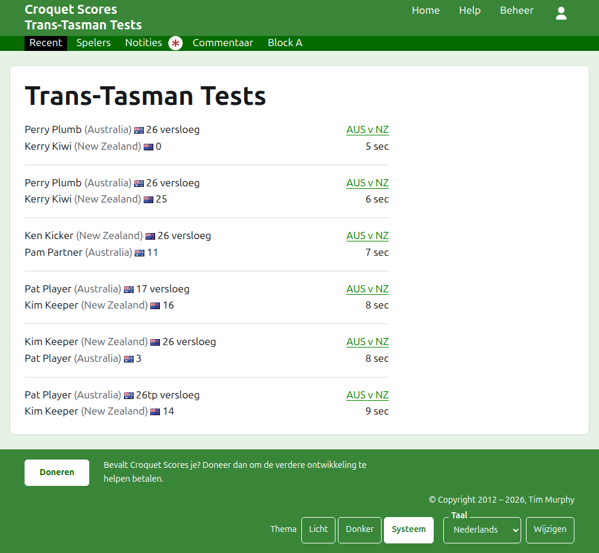
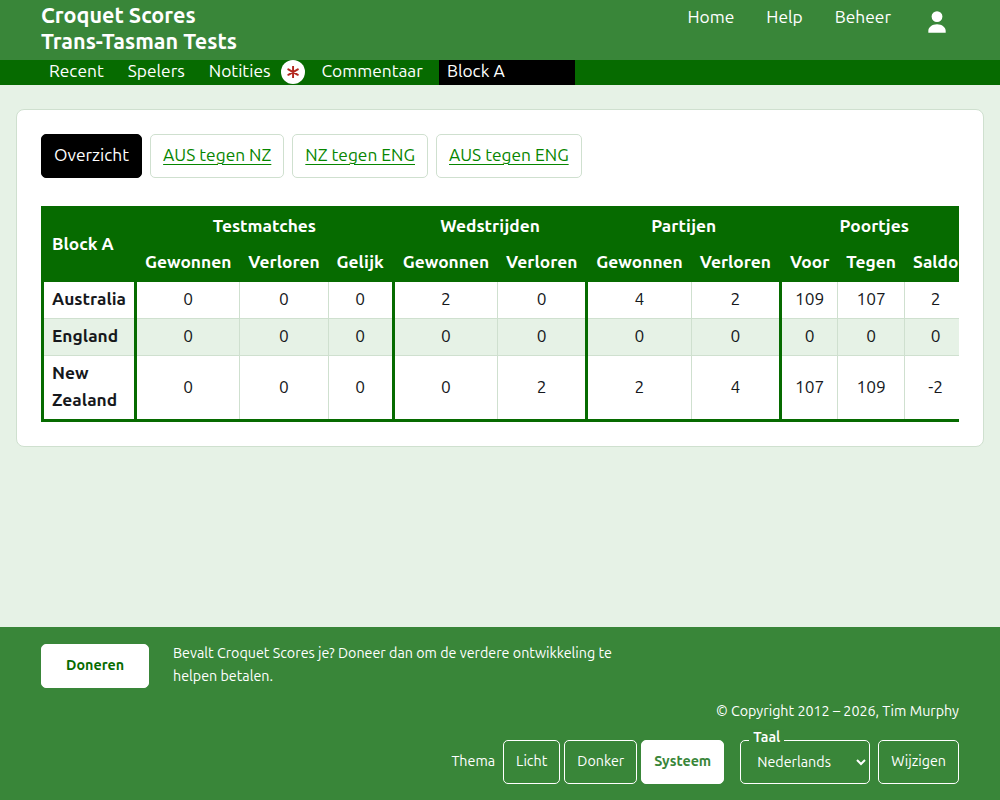
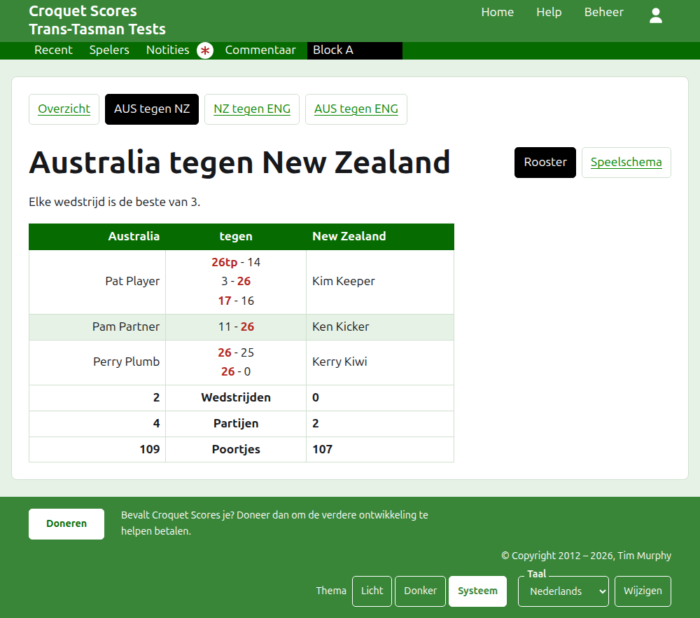
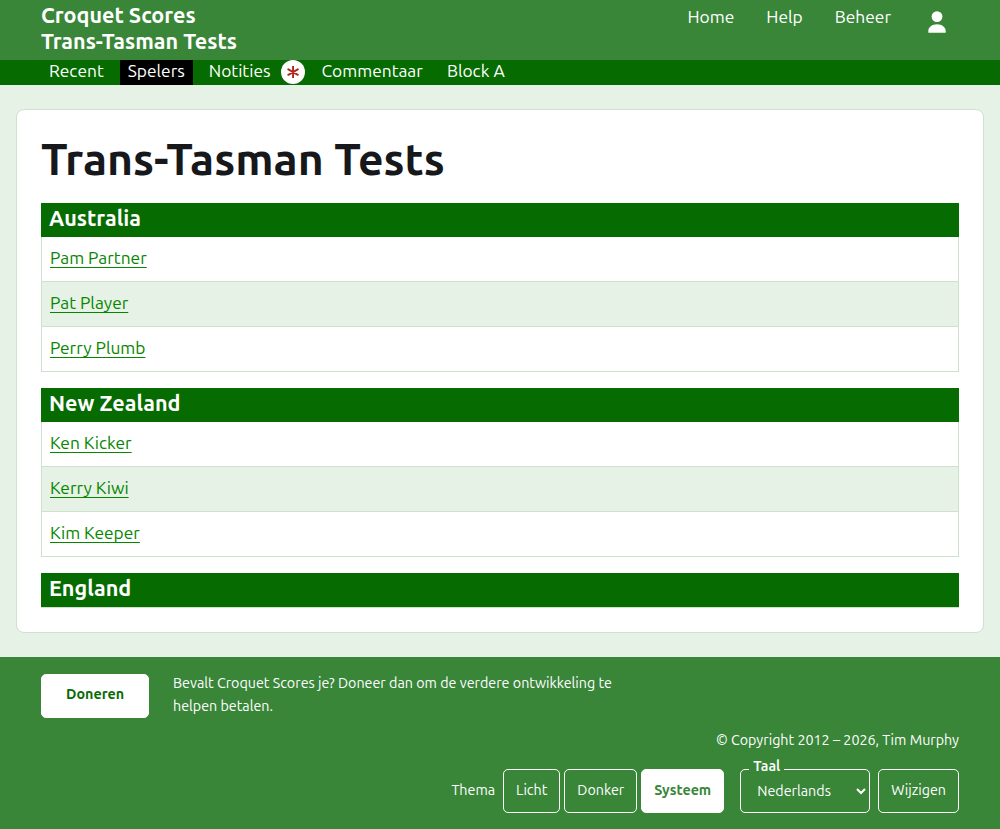

# Wat het publiek ziet

Er wordt niets gepubliceerd: de openbare pagina's worden opgebouwd uit wat het beheer bevat, dus een ingevoerde score staat er meteen op. Ze hebben geen account en geen scripts nodig, en zijn ingedeeld voor een telefoon.

## De pagina van het toernooi

De pagina van het toernooi staat op zijn jaar, zijn sport en zijn naam, als `/2026/ac/trans-tasman-tests`. Ze heeft de naam van het toernooi als kop, met de ondertitel eronder. Ze toont elke partij in gebruik, de laatst toegevoegde eerst, zodat een lezer die terugkomt ziet wat er sindsdien is gebeurd. Elke partij noemt de winnaar, zijn team en zijn score, dan de verliezer en de zijne, met de test waarin ze is gespeeld en hoe lang geleden ze is toegevoegd.

De donkergroene balk biedt de onderdelen van het toernooi: **Recent**, wat deze pagina is, **Overzicht**, **Spelers**, **Notities** en **Commentaar**, dan de tests. Een test wordt gezegd als de korte namen van haar teams met "vs" ertussen, als "AUS vs NZ". Tests in een groep worden niet een voor een aangeboden: de groep is één onderdeel, genoemd zoals de groep heet, op de plaats waar haar eerste test zou staan. Notities is gemarkeerd met een rood sterretje zolang er een notitie is die de lezer niet heeft gelezen.

## Het overzicht

Een toernooi waarvan de tests in geen groep zitten, heeft een **Overzicht**: één tabel van elk team, gerangschikt, met de tests die het heeft gewonnen, verloren en gelijkgespeeld, zijn gewonnen en verloren partijen, en zijn poortjes voor, tegen en saldo. Waar de wedstrijden van een test de beste van meer dan één zijn, komen de gewonnen en verloren wedstrijden na de tests. Het overzicht is waar een lezer elk team als geheel zoekt.

Een toernooi met een test in een groep heeft geen Overzicht. De pagina van elke groep toont in plaats daarvan hoe de teams van die groep ervoor staan, omdat één tabel van teams uit verschillende groepen die nooit tegen elkaar hebben gespeeld niets zou rangschikken.

## Een groep

De pagina van een groep toont hoe de teams van de groep ervoor staan, alleen de tests van de groep meegerekend, in de tabel die het overzicht gebruikt. Boven de tabel, in een eigen rij, biedt ze **Overzicht**, wat deze pagina is, en elk van de tests van de groep, met een link naar de pagina van de test.

## Een test

De pagina van een test heeft de volledige namen van haar teams als kop, als "Australia vs New Zealand", en zegt waarvan elke wedstrijd de beste is. Haar tabel heeft de twee teams als kop, het eerste links. Elke gespeelde wedstrijd is een rij, in de volgorde waarin ze begon, met de speler van het eerste team links, die van het tweede team rechts, en de partijen van de wedstrijd ertussen, elk eerst de score van de eerste kant en dan die van de tweede, met die van de winnaar gemarkeerd. Onder de wedstrijden staan de partijen en poortjes van elk team, en, waar elke wedstrijd de beste van meer dan één is, zijn gewonnen wedstrijden, elk aan zijn eigen kant.

Een test wordt op twee manieren getoond, aangeboden op de regel van haar naam: **Schema**, wat deze tabel is, en **Speelvolgorde**, dat elke partij van de test toont, oudste eerst. Een test in een groep biedt het Overzicht en de tests van haar groep in een rij boven haar kop, met deze test gemarkeerd.

## Spelers

De pagina Spelers toont de spelers team voor team: elk team onder een kop met zijn naam, in de volgorde van de teams in het toernooi, en zijn spelers eronder op alfabetische volgorde.

## Notities

De pagina Notities toont de notities van het toernooi, de laatst geschreven eerst, elk met een link naar haar eigen pagina en met hoe lang geleden ze is geschreven. Een notitie die de lezer niet heeft gelezen, is gemarkeerd met een rood sterretje totdat die haar opent.

## Adressen die verhuizen

Een toernooi houdt zijn adres wanneer zijn naam wordt gecorrigeerd. Waar het verhuist, omdat zijn jaar of zijn sport is veranderd, leidt het oude adres naar het nieuwe, zodat een link van vroeger nog werkt. De pagina's van een gearchiveerd toernooi worden niet gevonden totdat het is hersteld.
