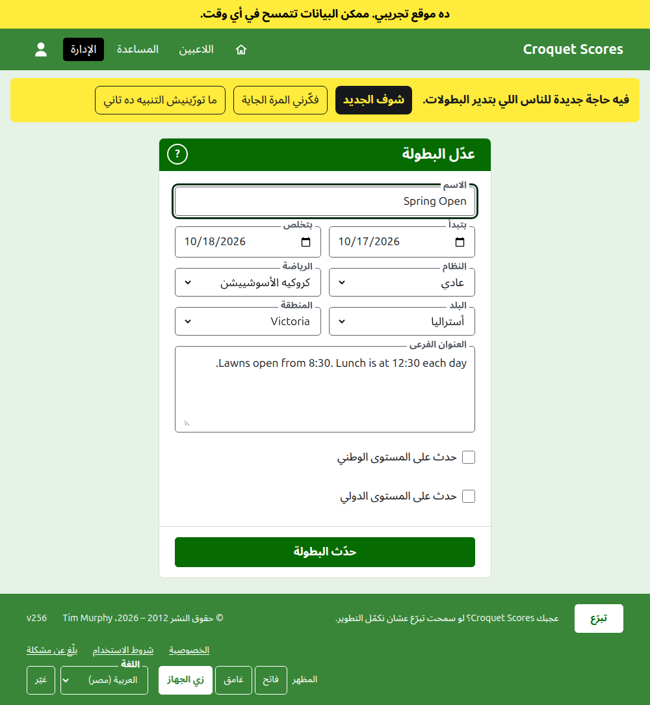
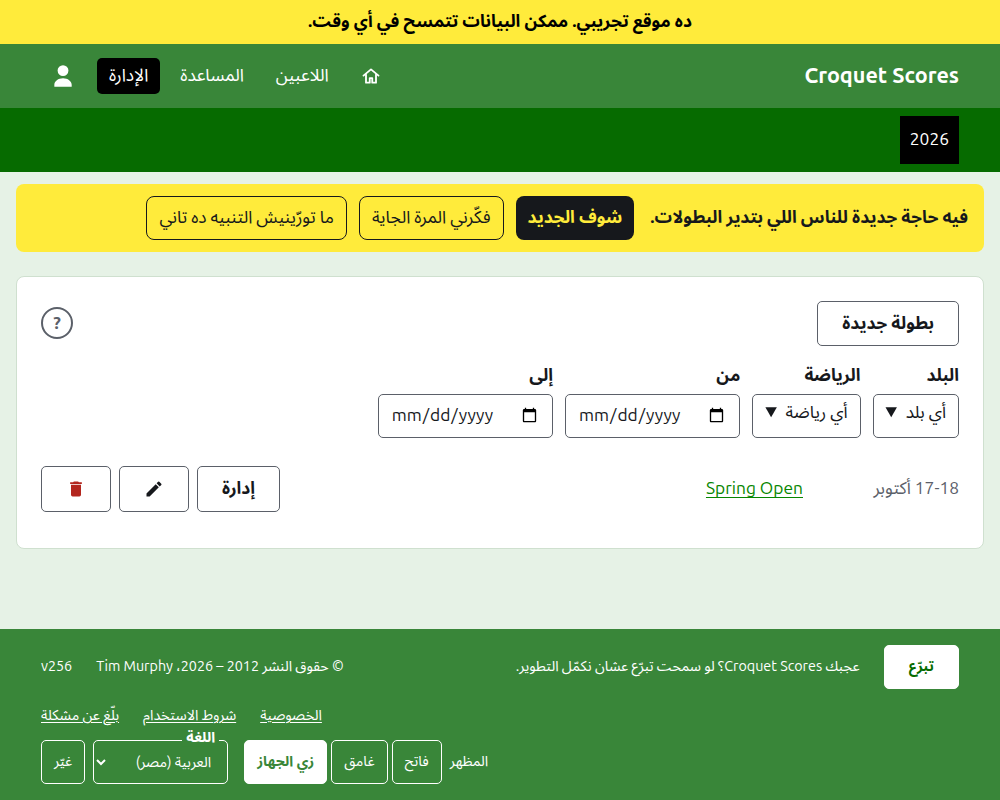
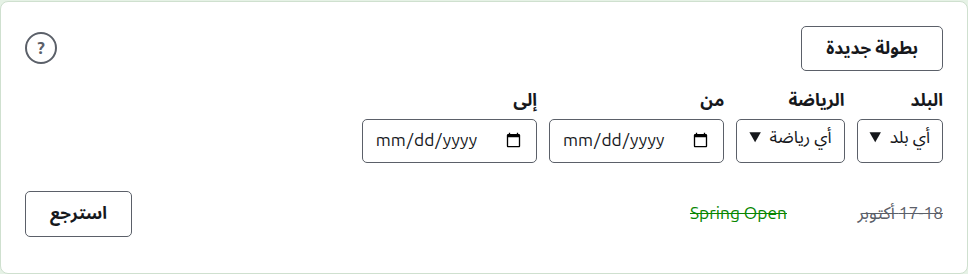

# تغيير بطولة وأرشفتها ورجوعها

## تغيير بيانات البطولة

في قايمة البطولات في الإدارة، دوس على **عدّل** على البطولة. الفورم هو نفس اللي أنشأها، بادئ على حال البطولة. غيّر اللي غلط ودوس على **حدّث البطولة**.

أول ما البطولة يبقى فيها أي لاعب أو منافسة، واللي في الأرشيف بيتحسبوا، نظامها مينفعش يتغيّر لنظام بيتلعب بفرق، لأن ده فيه فرق ولقاءات بدالهم.

البطولة بتحافظ على عنوانها لما اسمها يتصلّح، علشان الرابط اللي حد بعته قبل كده يفضل يوصّل لها. وما بتتنقلش غير لما السنة اللي بتبدأ فيها أو رياضتها تتغيّر، وساعتها عنوانها القديم بيوصّل للجديد. الحفظ بيوصّلك للبطولة في أي مكان هي فيه دلوقتي.

المدير بس هو اللي يقدر يغيّر البطولة. مسجّل النتايج، أو أي حد تاني، بيتقال له كده بدل ما يتعرض عليه الفورم.

## قايمة البطولات

الإدارة بتعرض سنة واحدة كل مرة، بادئة بالسنة دي، وأحدث بطولة الأول. السنين اللي ليك فيها بطولة تبويبات في الشريط الأخضر الغامق، الأحدث الأول؛ ولو فيه أكتر مما يسع على الموبايل، الأقدم بيبقوا في قايمة منسدلة في آخر الصف. السنة في العنوان، فينفع تعمل رابط لسنة.

فوق القايمة، **البلد** و**المنطقة** و**الرياضة** و**من** و**إلى** بتضيّقها أول ما تختار، من غير زرار تدوسه. بيتعرض بس الاختيارات اللي هتطلّع حاجة في القايمة، والمنطقة بتتعرض لما تختار بلد. **من** و**إلى** أيام: القايمة بتبقى للبطولات اللي بتبدأ من واحد للتاني، الاتنين داخلين فيها، ولازم تختار الاتنين علشان القايمة تتضيّق بالأيام. اللي اخترته بيبقى في العنوان، فالقايمة المتضيّقة تتبعت كرابط، واختيار سنة تانية بيمسحه. السنة اللي فيها أكتر من مية بطولة بتتعرض مية في الصفحة، مع **السابق** و**التالي** تحتها. البطولة الوطنية أو الدولية بتتكتب بخط غامق على طول صفها.

## أرشفة بطولة

**أرشف** على بطولة في القايمة بينحّيها. بتفضل معروضة، وعليها خط، وبعد البطولات الشغّالة، لكن ما بتعرضش غير **استرجع**: صفحتها في الإدارة، وصفحاتها العامة، مقفولة لحد ما ترجع. الأرشفة ما بتسألش الأول، لأن الرجوع بيتراجع عنها.

بعدين: [اللي الجمهور بيشوفه](what-the-public-sees.md).
