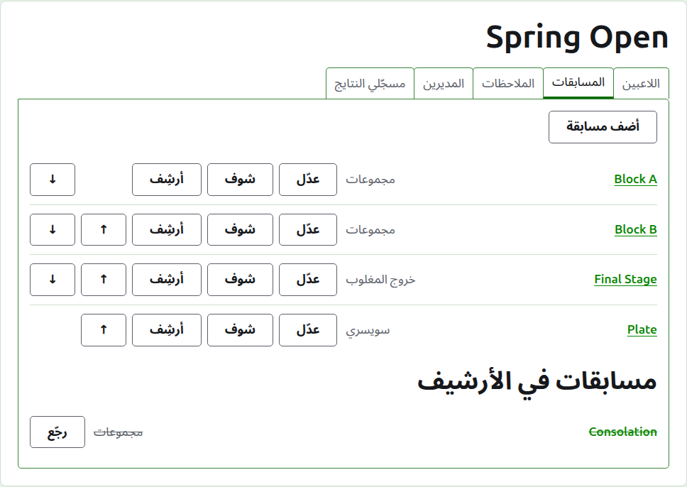
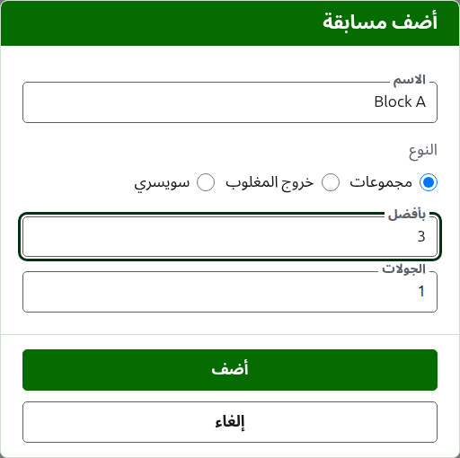
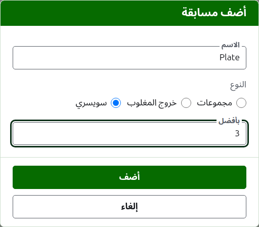
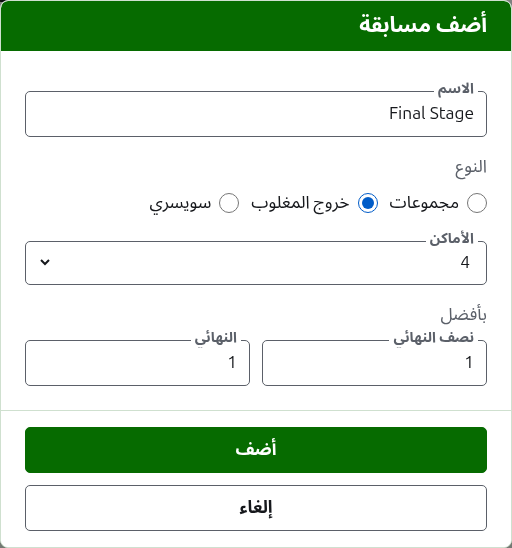

# المسابقات

تبويب **المسابقات** في صفحة البطولة هو المكان اللي مسابقاتها بتتضاف فيه، وتترتّب، وتتنحّى. المسابقة يا مجموعات يا خروج المغلوب يا سويسري. وكل مسابقة ليها صفحة خاصة بها، لاعبينها بيدخلوا فيها ونتايجها بتتكتب فيها.

## إضافة مسابقة

دوس على **أضف مسابقة**، فوق القايمة. ديالوج بيفتح فوق الصفحة، بيطلب اسم المسابقة، ونوعها، والشكل اللي نوعها بياخده.

**الاسم** هو اللي اللاعبين بيدوّروا عليه في صفحة البطولة علشان يلاقوا جيماتهم. بين 1 و254 حرف، وحرف واحد لوحده يكفي، لأن المجموعة كتير بتتسمّى بحرف. مسابقتين في نفس البطولة مينفعش يكون ليهم نفس الاسم.

**النوع** يا مجموعات يا خروج المغلوب يا سويسري. الديالوج بيبدأ على مجموعات، وده نوع أغلب المسابقات.

### مجموعات أو سويسري

المجموعات والسويسري بيطلبوا حاجة واحدة بس، كل ماتش **بأفضل** كام، وده بيبدأ على 1. بأفضل 3 بيكسبه اللي يكسب جيمين. وممكن يكون عدد زوجي، لأن في المجموعات والسويسري اللاعب بيترتّب بالجيمات اللي كسبها، والماتش اللي من جيمين واتقسم واحد لكل واحد نتيجة زي أي نتيجة.

### خروج المغلوب

خروج المغلوب بيطلب عدد **الأماكن** في جدوله، وكل دور بأفضل كام. الأماكن المعروضة 2 و4 و8 و16 و32 و64 و128، لأن أي عدد تاني ما ينفعش يتنصّف دور ورا دور لحد النهائي، والديالوج بيبدأ على 8. الأماكن اللي بتفضل بعد ما اللاعبين يدخلوا بتتملى بإعفاءات، ودي بتتضاف في نفس المكان اللي اللاعبين بيتضافوا فيه.

الجدول فيه أدوار بعدد المرات اللي الأماكن محتاجاها لحد ما تتنصّف لمكان واحد، فجدول 8 أماكن فيه تلات أدوار. الديالوج بيطلب كل دور بأفضل كام، كلهم مع بعض تحت **بأفضل**، بترتيب لعبهم. آخر تلاتة متسمّيين زي ما أدوار الجدول بتتقال، **ربع النهائي** و**نصف النهائي** و**النهائي**، واللي قبلهم برقمهم، الدور 1 الأول. لما تختار أماكن أكتر، أدوار بتتضاف في أول الجدول، ولما تختار أقل، أدوار بتتشال من أوله، فاللي كتبته للنهائي يفضل بتاع النهائي. كل دور بأفضل عدد فردي من الجيمات، لأن ماتش خروج المغلوب لازم يطلع له فايز.

### إضافة كام مسابقة مرة واحدة

دوس على **أضف**. المسابقة بتتضاف، والديالوج بيقول كده، والاسم بيفضى للمسابقة اللي بعدها، والنوع وشكله بيفضلوا زي ما هما: المسابقات اللي بتتضاف مع بعض غالباً شبه بعض، فـ "Block B" بعد "Block A" محتاجة اسمها وبس. دوس على **إلغاء** علشان تقفل الديالوج لما يخلصوا كلهم.

## تغيير مسابقة

**عدّل** بيفتح نفس الديالوج على المسابقة، بعنوان عدّل المسابقة، وفيه اسمها وشكلها زي ما هما. نوعها ما بيتطلبش، لأن المجموعات ما بتتحوّلش خروج مغلوب بالتعديل: المسابقة اللي نوعها غلط بتتأرشف وتتضاف من جديد. دوس على **احفظ** علشان تحفظ التغيير وتقفل الديالوج.

خروج المغلوب اللي فيه جيم لاعبينه محطوطين في جدوله، وتغيير أماكنه هيحرّكهم، فالتغيير ده بيترفض أول ما نتيجة تتكتب. لكن بأفضل كام لكل دور لسه ينفع يتغيّر.

## الترتيب

المسابقات بتتعرض بترتيب البطولة، وده الترتيب اللي بتظهر بيه على الصفحات العامة وفي الشريط الأخضر الغامق. **فوق** و**تحت** بيحرّكوا المسابقة مكان واحد.

## الروحة لمسابقة

اسم المسابقة، أو **شوف**، بيفتح صفحتها، اللي لاعبينها بيدخلوا فيها ونتايجها بتتكتب فيها. الشريط الأخضر الغامق تحت الهيدر بيوصّل لها كمان، من أي صفحة في البطولة.

## أرشفة مسابقة

**أرشِف** بينحّي المسابقة، سواء فيها جيمات أو لأ، والجيمات بتتحفظ معاها وترجع لما ترجّعها. المسابقة اللي في الأرشيف بتتعرض تحت **مسابقات في الأرشيف**، وعليها خط، ومش بتعرض غير **رجّع**، ومش موجودة على الصفحات العامة. الأرشفة ما بتسألش الأول، لأن الرجوع بيتراجع عنها.

بعدين: [إدخال لاعبين في مسابقة](entering-players-in-a-competition.md).
