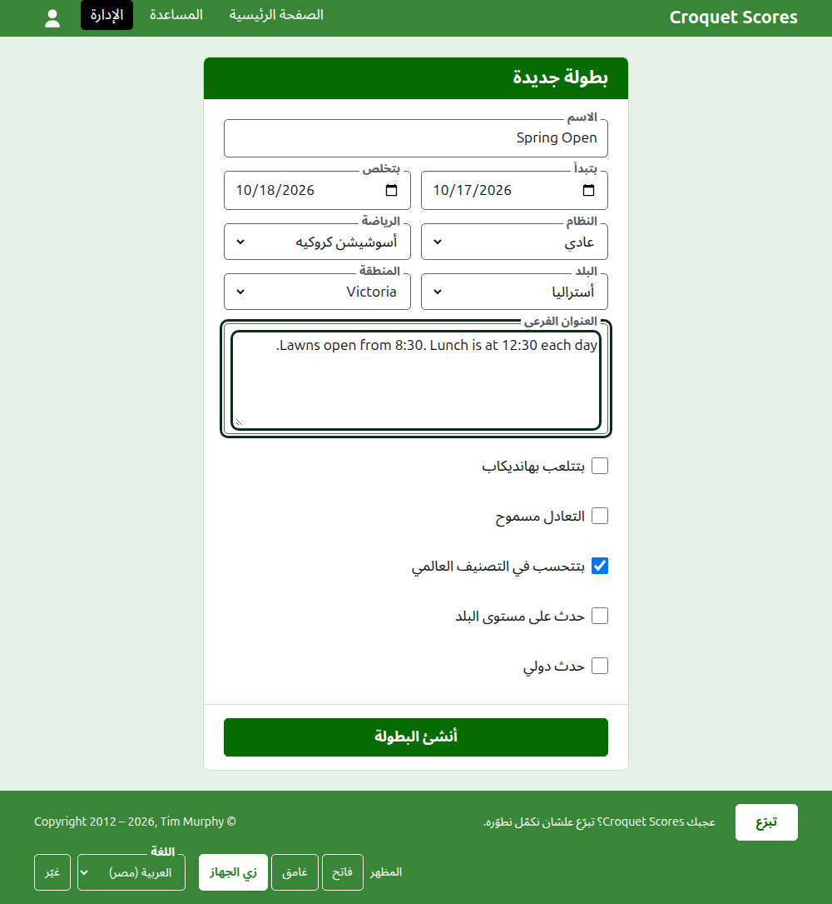

# إنشاء بطولة

دوس على **بطولة جديدة** فوق قايمة البطولات في الإدارة. الزرار فوق القايمة مش تحتها، علشان القايمة الطويلة ما تزقّهش برّه شاشة الموبايل.

الفورم بيطلب كل اللي البطولة بتبدأ بيه. البطولة من النوع العادي محتاجة اسم ويومين وبلد وبس: كل حاجة تانية بتتحدّد لك وتقدر تغيّرها.

## الفورم بيطلب إيه

**الاسم.** اللي القرّاء بيدوّروا عليه علشان يلاقوا البطولة، زي "Spring Open". بين 3 و254 حرف. الاسم اللي كله حروف صغيرة، أو كله حروف كبيرة، بيترفض، لأنه هيبان غلطة على كل صفحة بيظهر فيها. ممكن بطولتين يكون ليهم نفس الاسم، لأن نفس البطولة بتتلعب كل سنة.

**بتبدأ** و**بتخلص.** الأيام اللي البطولة بتتلعب فيها. البطولة مينفعش تخلص قبل ما تبدأ، ومينفعش تبدأ أو تخلص بعد آخر السنة الجاية. البطولة بتتبع السنة اللي بتبدأ فيها، ودي كمان السنة اللي في عنوانها، فالبطولة اللي بتعدّي رأس السنة بتتعرض في السنة اللي بدأت فيها.

**النظام.** اختار **عادي** لبطولة بتتلعب بين لاعبين. الأنظمة التانية لبطولات بتتلعب بين فرق، وليها دليل خاص بها.

**الرياضة.** الرياضات اللي الموقع بيعرضها، بترتيبها: أسوشيشن كروكيه، وجولف كروكيه، والكروكيه الأمريكي بستة أطواق، وريكوشيه على Croquet Scores. Gateball Scores ما بيطلبش رياضة ولا نظام، لأن كل بطولة هناك بطولة عادية جيت بول.

**البلد** و**المنطقة.** مكان لعب البطولة. المنطقة بتتطلب بس لو البلد اللي اختارته مقسّم مناطق، زي ولايات أستراليا؛ البلد اللي هو نفسه منطقة واحدة ما بيطلبش منطقة. ومش لازم تختار منطقة حتى لو اتعرضت عليك.

**العنوان الفرعي.** أي حاجة عايز القرّاء يعرفوها ومالهاش خانة خاصة بها: تركن فين، الغدا إمتى، تتصل بمين. بيظهر تحت اسم البطولة على كل صفحة عامة. بيتكتب بـ Markdown، فممكن تخلّي كلمة غامقة بنجمتين حواليها وتعمل قايمة بشرطة في أول كل سطر. ممكن يوصل لحد 2000 حرف، وممكن تسيبه فاضي.

**بتتلعب بهانديكاب.** علّم ده لبطولة هانديكاب.

**التعادل مسموح.** علّم ده لو الجيم ممكن يخلص من غير فايز. أغلب البطولات ما بتسمحش بده. لو معلّم، النتيجة اللي بتتكتب بنقاط متساوية ومن غير علامة بتتحفظ تعادل؛ ولو مش معلّم، الجيم اللي بنقاط متساوية لازم يقول مين كسبه بعلامة بعد نقاط الفايز، زي "6w".

**بتتحسب في التصنيف العالمي.** بتتطلب بس لو ممكن تتحسب: بطولة أسوشيشن كروكيه أو جولف كروكيه أو الكروكيه الأمريكي بستة أطواق مش بتتلعب بهانديكاب ولا بتسمح بالتعادل. بتبدأ معلّمة، فشيل العلامة لو البطولة مش هتتحسب.

**حدث على مستوى البلد** و**حدث دولي.** البطولة ممكن تكون ده أو ده أو ولا واحد منهم، لكن مش الاتنين أبداً: لما تعلّم واحد التاني علامته بتتشال.

## إنشاءها

دوس على **أنشئ البطولة**. هتروح على صفحة البطولة في الإدارة، اللي بتتدار منها، وإنت أول مدير ليها. وبتتعرض في الإدارة تحت السنة اللي بتبدأ فيها.

عنوان البطولة العام متكوّن من سنتها ورياضتها واسمها، زي `/2026/ac/spring-open`. وبتحافظ على العنوان ده لما اسمها يتصلّح بعدين، علشان اللينك اللي اتبعت قبل كده يفضل يوصّل لها؛ وما بتتنقلش غير لما السنة اللي بتبدأ فيها، أو رياضتها، تتغيّر.

## لو حاجة اترفضت

اللي بيترفض بيتقال تحت الخانة اللي هو عنها، واللي كتبته بيفضل مكتوب. مفيش حاجة بتتحفظ لحد ما كل خانة تتقبل. أكتر الحاجات اللي بتترفض: اسم مكتوب كله بحروف صغيرة، ونهاية قبل البداية، وبلد ما اتختارش.

بعدين: [اللاعبين](players.md).
