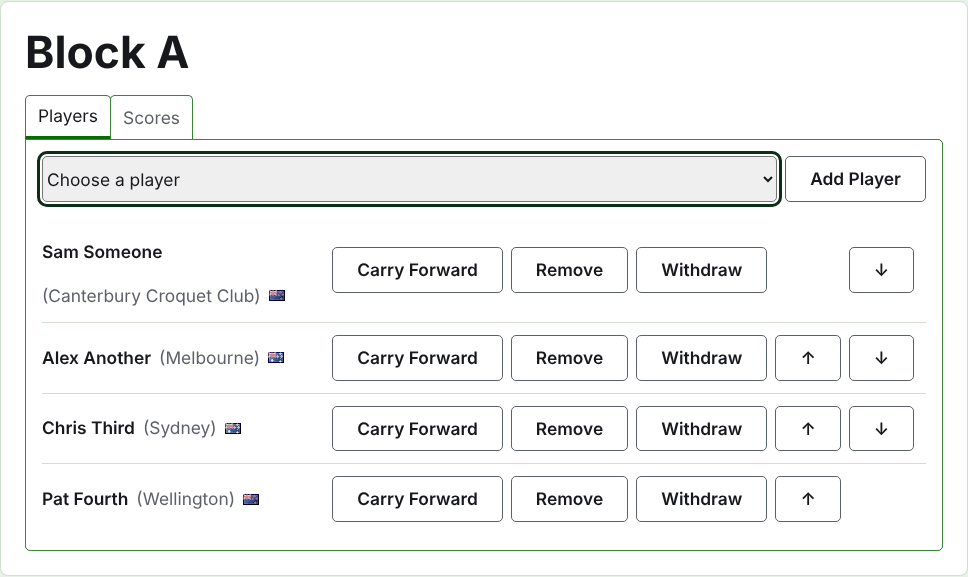
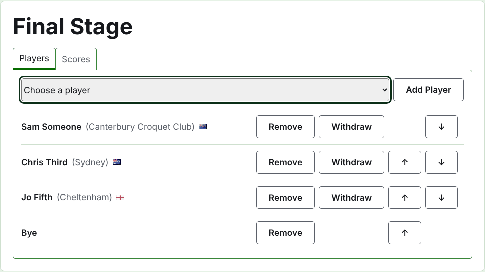
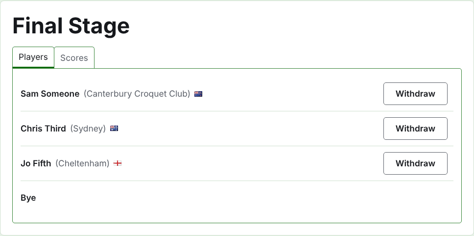
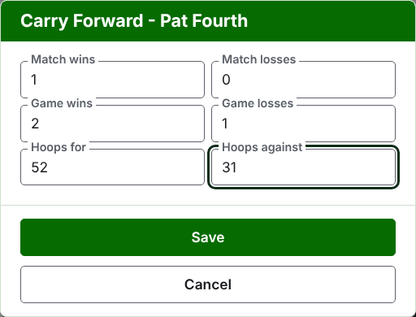
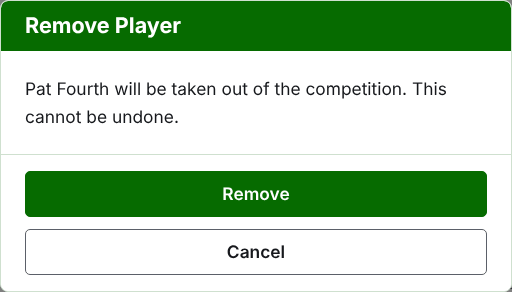
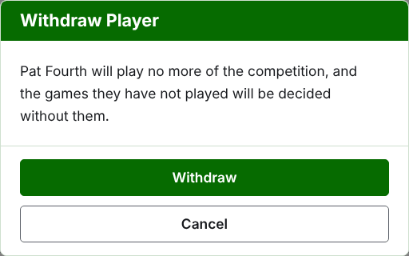
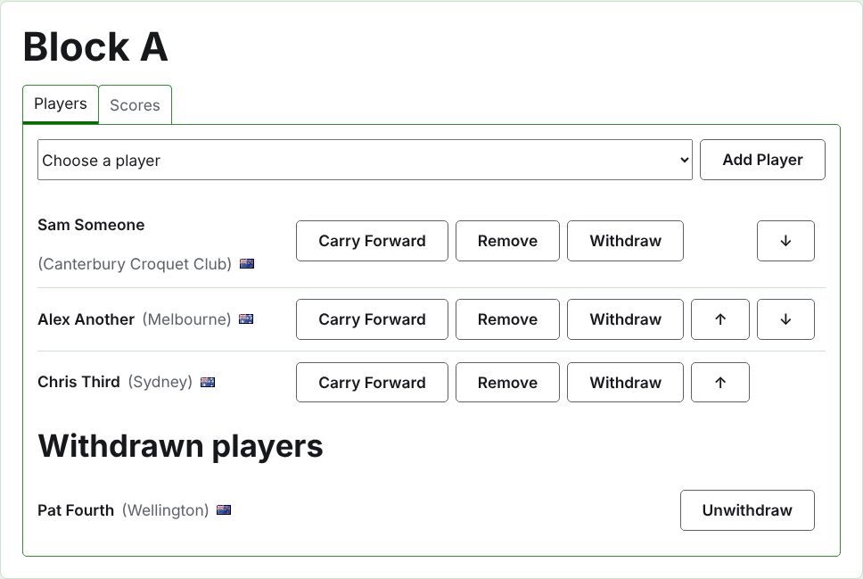

# إدخال لاعبين في مسابقة

صفحة المسابقة بتتفتح من اسمها في تبويب المسابقات، أو من الشريط الأخضر الغامق. عنوانها اسم المسابقة، وتحته تبويبين: **اللاعبين** و**النتايج**. بتفتح على اللاعبين، لأن اللاعبين بيدخلوا قبل ما أي حاجة تتلعب.

اللاعب في المسابقة واحد من لاعبين البطولة، فبيدخل بالاختيار مش بالكتابة. وكل حاجة عنه، غير مكانه في المسابقة واللي بيرحّله لها، بتتغيّر في تبويب اللاعبين بتاع البطولة.

## إضافة لاعب

فوق القايمة، قايمة منسدلة بتعرض كل لاعب في البطولة مش في المسابقة أصلاً، بترتيب البطولة. اختار واحد ودوس على **أضف لاعب**. اللاعب بيتحط بترتيب البطولة وسط اللي داخلين قبله، والقايمة المنسدلة ما بتعرضهوش تاني، والمؤشر بيرجع للقايمة المنسدلة علشان تختار اللي بعده من الكيبورد. ولما كل لاعبين البطولة يبقوا في المسابقة، القايمة المنسدلة ما بتظهرش والتبويب بيقول كده.

لاعبين البطولة اللي في الأرشيف ما بيتعرضوش.

## الإعفاءات في خروج المغلوب

خروج المغلوب ما بيتلعبش غير لما كل مكان في جدوله يتملى، والأماكن اللي لاعبينه بيسيبوها بتتملى بإعفاءات. فعلشان كده في خروج المغلوب القايمة المنسدلة بتعرض **إعفاء** الأول، قبل اللاعبين، وتفضل تعرضه مهما اتضاف إعفاءات، لأن الجدول ممكن يحتاج كذا واحد.

الإعفاء بيتحط في الجدول زي اللاعب: ينفع يتحرّك فوق وتحت ويتشال، لكن مينفعش ينسحب، لأنه مش بيلعب حاجة. واللاعب اللي بيدخل خروج مغلوب كل أماكنه مليانة بيترفض، والتبويب بيقول كده تحت القايمة المنسدلة.

ترتيب لاعبين خروج المغلوب هو جدوله. أول مكانين بيتقابلوا في أول ماتش، والمكانين اللي بعدهم في الماتش اللي بعده، وهكذا. حط اللاعبين بالترتيب اللي الجدول هيتلعب بيه قبل ما أي نتيجة تتكتب، لأن أول ما خروج المغلوب يبقى فيه جيم شغّال لاعبينه بيتثبّتوا: محدش يتضاف ولا يتشال ولا يتحرّك. لكن اللاعب لسه يقدر ينسحب.

## الترتيب

اللاعبين بيتعرضوا بترتيب المسابقة، وده الترتيب اللي قرعة خروج المغلوب بتتعمل بيه والمجموعات بتتعرض بيه على صفحتها العامة. **فوق** و**تحت** بيحرّكوا اللاعب مكان واحد.

## الترحيل

**ترحيل** بيقول اللاعب جايب إيه معاه للمسابقة من لعب ما اتسجّلش فيها: نتايج مرحلة قبلها، أو جيمات اتلعبت قبل ما المسابقة تتسجّل هنا. بيتعرض في المجموعات والسويسري، لأن فيهم ترتيب يتحسب فيه، ومش في خروج المغلوب.

الديالوج بيطلب ست أعداد: ماتشات مكسوبة ومخسورة، وجيمات مكسوبة ومخسورة، وأطواق له وعليه. كل عدد اختياري. العدد اللي بيتساب فاضي ما بيرحّلش حاجة، وده مش زي ترحيل 0، علشان اللي يغيّره بعدين يشوفه زي ما اتساب. دوس على **احفظ** علشان تحفظ الستة.

## شيل لاعب

**شيل** بيطلّع لاعب دخل بالغلط. بيفضل واحد من لاعبين البطولة، وبيتعرض تاني في القايمة المنسدلة، لكن مفيش حاجة بتتحفظ من مكانه في المسابقة، فشيل بيسأل الأول.

اللاعب اللي له أي جيم شغّال في المسابقة مينفعش يتشال، لأن الجيمات ساعتها هتبقى ضد حد مش موجود، فما بيتعرضش عليه شيل. واللاعب اللي كل جيماته في الأرشيف ينفع، ونتايجه اللي في الأرشيف بتمشي معاه.

## سحب لاعب

**اسحب** للاعب مش هيلعب في المسابقة تاني. بيفضل فيها، بالجيمات اللي لعبها، وبيتعرض تحت **لاعبين مسحوبين** بعد اللي لسه بيلعبوا. وفي خروج المغلوب، خصمه في ماتش ما اتحسمش بيعدّي.

اسحب بيسأل الأول، لأنه بيغيّر نتيجة المسابقة: الجيمات اللي اللاعب ما لعبهاش بتتحسم من غيره.

اللاعب المسحوب ما بيعرضش غير **الغي السحب**، وده بيرجّعه وسط اللي بيلعبوا، بعد اللي فضلوا، من غير سؤال.

بعدين: [النتايج](scores.md).
