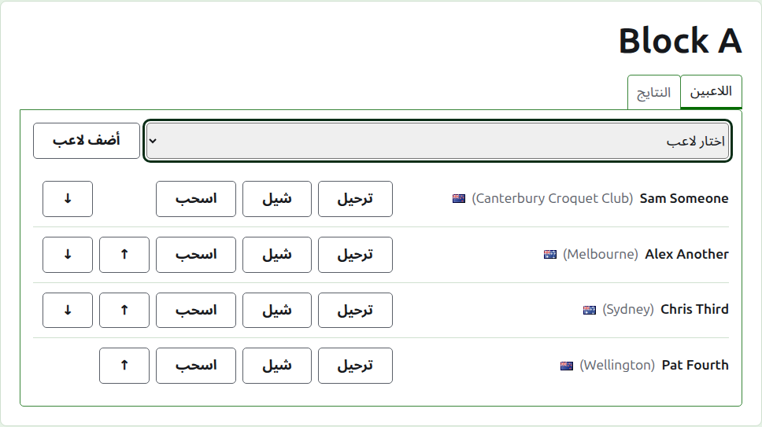
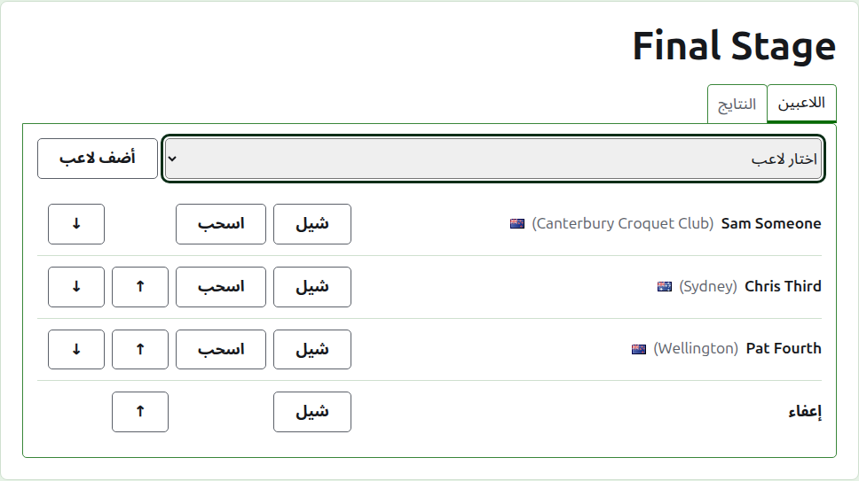
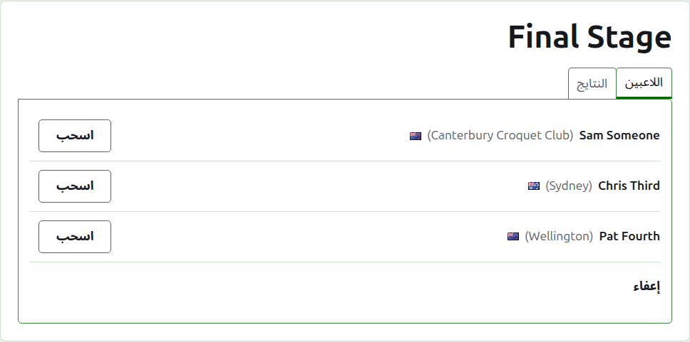
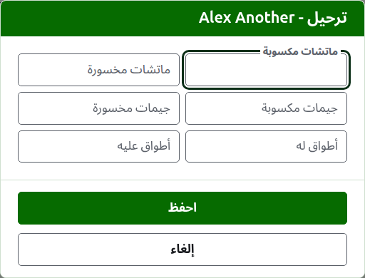
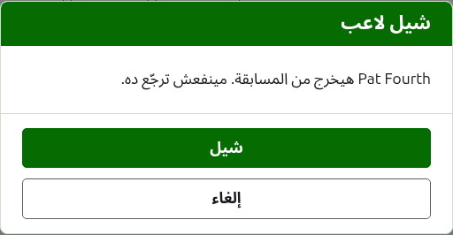
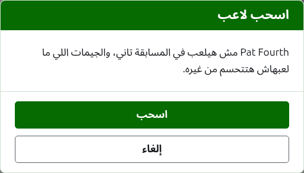
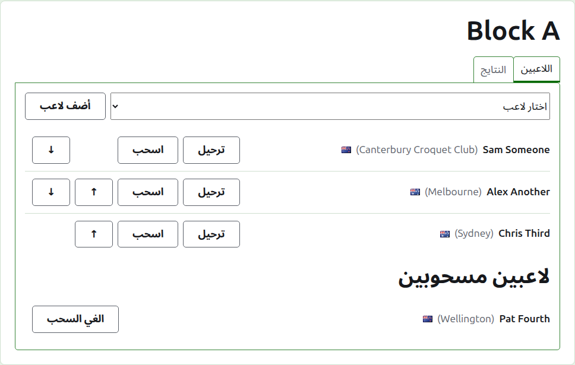

# إدخال لاعبين في منافسة

صفحة المنافسة بتتفتح من اسمها في تبويب المنافسات، أو من الشريط الأخضر الغامق. عنوانها اسم المنافسة، وتحته تبويبين: **اللاعبين** و**النتايج**. بتفتح على اللاعبين، لأن اللاعبين بيدخلوا قبل ما أي حاجة تتلعب.

اللاعب في المنافسة واحد من لاعبين البطولة، فبيدخل بالاختيار مش بالكتابة. وكل حاجة عنه، غير مكانه في المنافسة واللي بيرحّله لها، بتتغيّر في تبويب اللاعبين بتاع البطولة.

## إضافة لاعب

فوق القايمة، قايمة منسدلة بتعرض كل لاعب في البطولة مش في المنافسة أصلاً، بترتيب البطولة. اختار واحد ودوس على **ضيف لاعب**. اللاعب بيتحط بترتيب البطولة وسط اللي داخلين قبله، والقايمة المنسدلة ما بتعرضهوش تاني، والمؤشر بيرجع للقايمة المنسدلة علشان تختار اللي بعده من الكيبورد. ولما كل لاعبين البطولة يبقوا في المنافسة، القايمة المنسدلة ما بتظهرش والتبويب بيقول كده.

لاعبين البطولة اللي في الأرشيف ما بيتعرضوش.

## الـ Bye في خروج المغلوب

خروج المغلوب ما بيتلعبش غير لما كل مكان في جدوله يتملى، والأماكن اللي لاعبينه بيسيبوها بتتملى بـ Bye. فعلشان كده في خروج المغلوب القايمة المنسدلة بتعرض **Bye** الأول، قبل اللاعبين، وتفضل تعرضه مهما اتضاف Bye، لأن الجدول ممكن يحتاج كذا واحد.

الـ Bye بيتحط في الجدول زي اللاعب: ينفع يتحرّك فوق وتحت ويتشال، لكن مينفعش ينسحب، لأنه مش بيلعب حاجة. واللاعب اللي بيدخل خروج مغلوب كل أماكنه مليانة بيترفض، والتبويب بيقول كده تحت القايمة المنسدلة.

ترتيب لاعبين خروج المغلوب هو جدوله. أول مكانين بيتقابلوا في أول مباراة، والمكانين اللي بعدهم في المباراة اللي بعدها، وهكذا. حط اللاعبين بالترتيب اللي الجدول هيتلعب بيه قبل ما أي نتيجة تتكتب، لأن أول ما خروج المغلوب يبقى فيه لعبة شغّالة لاعبينه بيتثبّتوا: محدش يتضاف ولا يتشال ولا يتحرّك. لكن اللاعب لسه يقدر ينسحب.

## الترتيب

اللاعبين بيتعرضوا بترتيب المنافسة، وده الترتيب اللي قرعة خروج المغلوب بتتعمل بيه والمجموعات بتتعرض بيه على صفحتها العامة. **لفوق** و**لتحت** بيحرّكوا اللاعب مكان واحد.

## الترحيل

**رحّل** بيقول اللاعب جايب إيه معاه للمنافسة من لعب ما اتسجّلش فيها: نتايج مرحلة قبلها، أو ألعاب اتلعبت قبل ما المنافسة تتسجّل هنا. بيتعرض في المجموعات والسويسري، لأن فيهم ترتيب يتحسب فيه، ومش في خروج المغلوب.

الديالوج بيطلب ست أعداد: مباريات مكسوبة ومخسورة، وألعاب مكسوبة ومخسورة، وأطواق له وعليه. كل عدد اختياري. العدد اللي بيتساب فاضي ما بيرحّلش حاجة، وده مش زي ترحيل 0، علشان اللي يغيّره بعدين يشوفه زي ما اتساب. دوس على **احفظ** علشان تحفظ الستة.

## شيل لاعب

**شيل** بيطلّع لاعب دخل بالغلط. بيفضل واحد من لاعبين البطولة، وبيتعرض تاني في القايمة المنسدلة، لكن مفيش حاجة بتتحفظ من مكانه في المنافسة، فشيل بيسأل الأول.

اللاعب اللي له أي لعبة شغّالة في المنافسة مينفعش يتشال، لأن الألعاب ساعتها هتبقى ضد حد مش موجود، فما بيتعرضش عليه شيل. واللاعب اللي كل ألعابه في الأرشيف ينفع، ونتايجه اللي في الأرشيف بتمشي معاه.

## سحب لاعب

**اسحب** للاعب مش هيلعب في المنافسة تاني. بيفضل فيها، بالألعاب اللي لعبها، وبيتعرض تحت **اللاعبين المنسحبين** بعد اللي لسه بيلعبوا. وفي خروج المغلوب، خصمه في مباراة ما اتحسمتش بيعدّي.

اسحب بيسأل الأول، لأنه بيغيّر نتيجة المنافسة: الألعاب اللي اللاعب ما لعبهاش بتتحسم من غيره.

اللاعب المسحوب ما بيعرضش غير **رجّع**، وده بيرجّعه وسط اللي بيلعبوا، بعد اللي فضلوا، من غير سؤال.

بعدين: [النتايج](scores.md).
