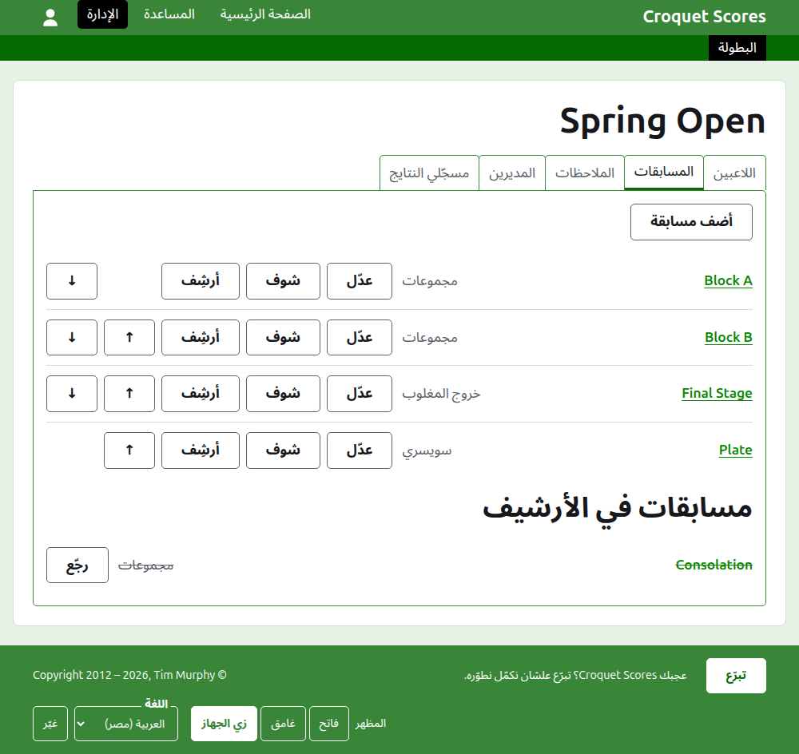

# إدارة بطولة عادية

البطولة العادية هي اللي بتتلعب بين لاعبين بيتسجّلوا واحد واحد: ويك إند في نادي، بطولة مفتوحة، بطولة رسمية. لاعبينها بيتسجّلوا في مجموعات وخروج المغلوب وسويسري، ونتايجها بتطلع أول ما تتلعب. الدليل ده بيمشي مع المدير من تسجيل الدخول لحد بطولة نتايجها متاحة للجمهور.

الدليل قايم بذاته. مفيش حاجة فيه بتعتمد على دليل البطولة اللي بتتلعب بفرق، وده مكتوب لوحده.

## قبل ما تبدأ

لازم يكون عندك حساب. دوس [هنا](/account/register) علشان تسجّل حساب.

كل اللي المدير بيعمله بيعمله في قسم الإدارة في الموقع. الصفحات العامة، اللي اللاعبين والمتفرّجين بيتابعوا منها البطولة، بتترسم من اللي الإدارة فيها، فمفيش حاجة لازم تتنشر: النتيجة اللي بتتكتب بتظهر على الصفحات العامة في نفس اللحظة.

## الصفحات بالترتيب

1. [إنشاء بطولة](creating-a-tournament.md): اسمها، وأيامها، ورياضتها، ومكان لعبها، وفي إيه بتتحسب.
2. [اللاعبين](players.md): تسجيل لاعبين البطولة، وتصحيحهم، وتنحية اللي اتسجّلوا بالغلط.
3. [المسابقات](competitions.md): إضافة مجموعات وخروج المغلوب وسويسري، وترتيبهم.
4. [إدخال لاعبين في مسابقة](entering-players-in-a-competition.md): مين بيلعب في كل مسابقة، والإعفاءات في خروج المغلوب، والترحيل، والشيل والسحب.
5. [النتايج](scores.md): كتابة النتايج، وتصحيحها، وتنحية اللي اتكتبت بالغلط.
6. [الملاحظات](notes.md): إبلاغ اللاعبين باللي محتاجين يعرفوه والبطولة ماشية.
7. [المديرين ومسجّلي النتايج](managers-and-scorers.md): مشاركة إدارة البطولة، وإن حد يقدر يكتب النتايج من غير ما يقدر يغيّر أي حاجة تانية.
8. [التصنيفات](rankings.md): الملف اللي بيتبعت للتصنيف العالمي، واللي فاضل عليك تكمّله.
9. [تغيير بطولة وأرشفتها ورجوعها](changing-and-archiving.md): تصحيح بيانات البطولة، وتنحية بطولة.
10. [اللي الجمهور بيشوفه](what-the-public-sees.md): الصفحات اللي لاعبينك بيتابعوها، وإزاي اللي بتكتبه بيظهر عليها.

## شكل الإدارة

باب الإدارة بيعرض البطولات اللي ليك دور فيها، سنة سنة.

لما تدوس على اسم بطولة، أو على **إدارة**، صفحتها بتفتح. كل اللي في إيدك تديره موجود في ست تبويبات تحت اسمها: **اللاعبين** و**المسابقات** و**الملاحظات** و**المديرين** و**مسجّلي النتايج** و**التصنيفات**. الصفحة بتفتح على اللاعبين، لأن اللاعبين هما أول حاجة بتتسجّل.

الشريط الأخضر الغامق تحت الهيدر للتنقّل بين الصفحات. بيوصّل للبطولة، باسم **البطولة**، ولكل مسابقة من مسابقاتها بالاسم، فتقدر تروح من البطولة لمسابقة ومن مسابقة لمسابقة من غير ما ترجع من تبويب المسابقات. الصفحة اللي إنت فيها معلّمة بالأسود.

## حاجات سارية في كل مكان

**مفيش حاجة بتتمسح نهائي غير الملاحظة.** اللاعبين والمسابقات والنتايج والبطولة نفسها بتتأرشف مش بتتمسح: بتتنحّى، ويتعمل عليها خط، وتتعرض تحت عنوان خاص بها، ومعاها **رجّع** علشان ترجّعها. الأرشفة والرجوع والتحريك فوق وتحت عمرهم ما بيطلبوا منك تأكيد، لأن كل واحد منهم بيتراجع لما تدوس على العكس. الحاجات اللي ما ينفعش تتراجع، زي شيل لاعب من مسابقة أو مسح ملاحظة، بتسأل الأول.

**الديالوج اللي بيفتح فوق الصفحة ما بيحفظش حاجة لحد ما تدوس على زراره.** إلغاء، أو زرار Escape، بيقفله ويسيب كل حاجة زي ما كانت. الديالوجات اللي بتضيف حاجات، زي أضف لاعب وأضف نتيجة، بتفضل مفتوحة بعد كل إضافة، علشان تقدر تكتب قايمة كلها واحدة ورا التانية.

**اللي بيترفض بيتقال جنب الخانة اللي هو عنها.** مفيش حاجة مرفوضة بتتحفظ، واللي كتبته بيفضل مكتوب، علشان تصلّحه بدل ما تكتبه من جديد.

**الإدارة شغّالة على الموبايل.** كل زرار كبير بما يكفي إنك تدوس عليه بإبهامك، ومفيش حاجة أعرض من الشاشة.

بعدين: [إنشاء بطولة](creating-a-tournament.md).
