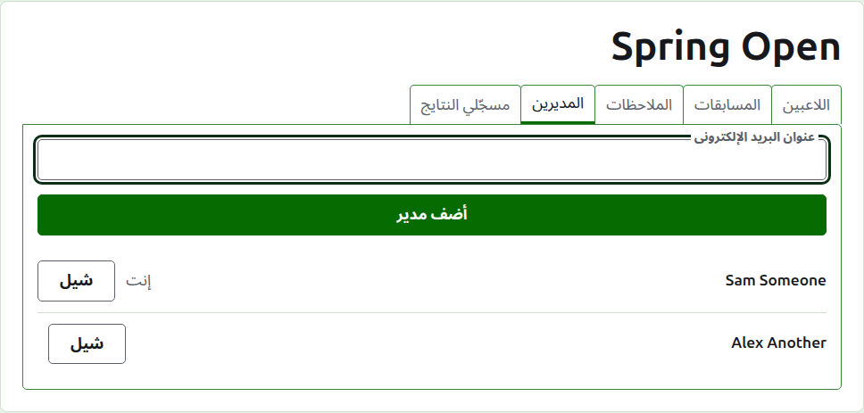
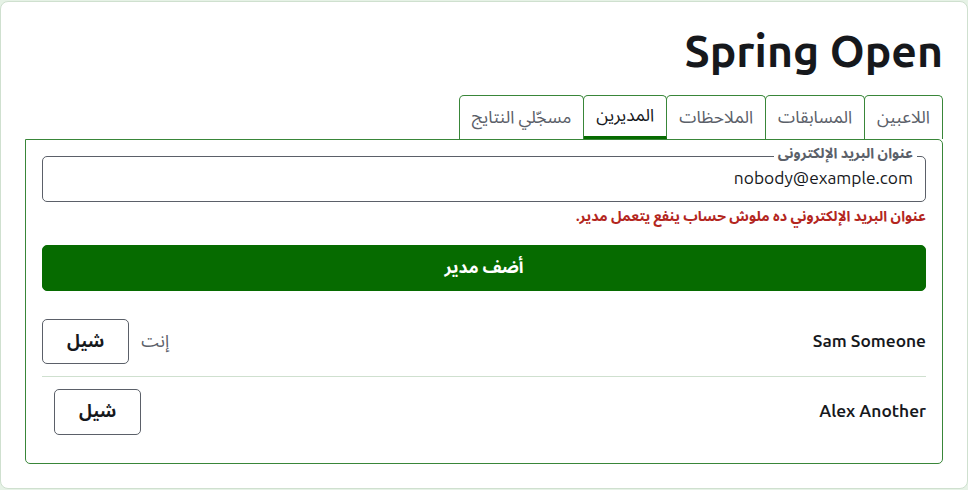
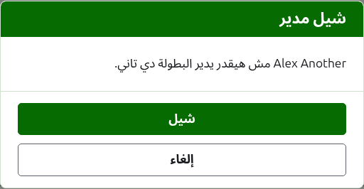
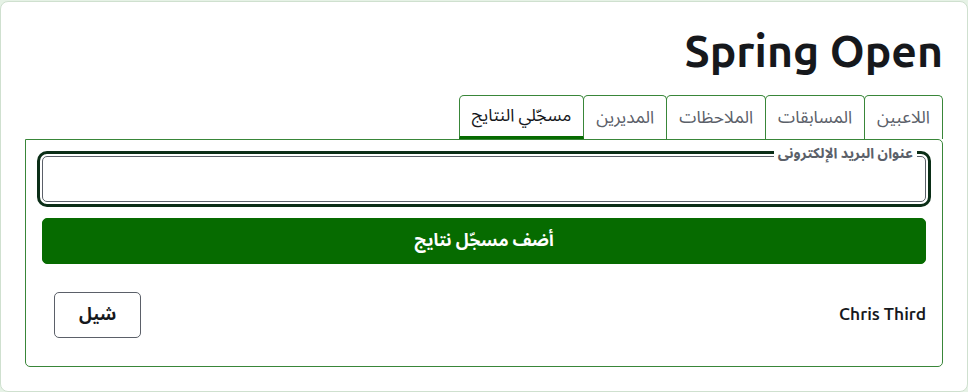
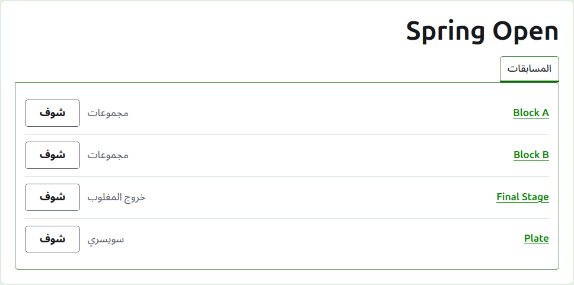

# المديرين ومسجّلي النتايج

البطولة ليها مديرين، يقدروا يعملوا كل اللي ممكن يتعمل فيها، وممكن يكون ليها مسجّلي نتايج، بيكتبوا نتايجها ومفيش غير كده. اللي أنشأ البطولة هو أول مدير ليها.

## المديرين

تبويب **المديرين** بيعرض مين بيدير البطولة، بترتيب ما اتعملوا مديرين، واسمك إنت معلّم إنه بتاعك. وهو المكان اللي البطولة بتتشارك فيه، أو تتسلّم لحد تاني.

الشخص بيتعمل مدير بعنوان بريده الإلكتروني. اكتبه في الخانة فوق القايمة ودوس على **أضف مدير**. العنوان لازم يكون بتاع حساب مسجّل ومتأكّد؛ والعنوان اللي ملوش حساب بيترفض تحت الخانة، والموقع ما بيقولش عنه أكتر من كده. ومسجّل النتايج اللي بيتعمل مدير بيبطّل يكون مسجّل نتايج.

**شيل** بيشيل مدير. مفيش حاجة بتتحفظ من المدير اللي اتشال، فشيل بيسأل الأول؛ ولو عايزينه تاني بيتعمل مدير من جديد بعنوانه. البطولة دايماً ليها مدير، فآخر مدير ما بيتعرضش عليه شيل.

تقدر تشيل نفسك. السؤال ساعتها بيقول ده معناه إيه: هتخسر طريقك إنت للبطولة، ومحدش على الصفحة يقدر يرجّعها لك. مدير تاني يقدر يخليك مدير من جديد.

## مسجّلي النتايج

تبويب **مسجّلي النتايج** هو تبويب المديرين بس لمسجّلي النتايج، وشغّال بنفس الطريقة: عنوان بريد إلكتروني و**أضف مسجّل نتايج** فوق القايمة، و**شيل** على كل واحد.

مسجّل النتايج بيشوف البطولة في قايمته هو في الإدارة، ومعاها **النتايج** بدل إدارة، وبيتعرض عليه مسابقاتها وبس: لا لاعبين ولا ملاحظات ولا مديرين ولا مسجّلي نتايج. وعلى صفحة المسابقة بيشوف تبويب النتايج لوحده، وفيه يقدر يكتب النتايج ويصلّحها ويأرشفها ويرجّعها زي المدير. أما مين بيلعب في المسابقة فده كلام المديرين.

المدير ما بيتعملش مسجّل نتايج، لأن المدير أصلاً يقدر يعمل كل اللي مسجّل النتايج بيعمله. والبطولة مش محتاجة مسجّل نتايج، فكل مسجّل نتايج ينفع يتشال، وآخرهم كمان.

بعدين: [تغيير بطولة وأرشفتها ورجوعها](changing-and-archiving.md).
