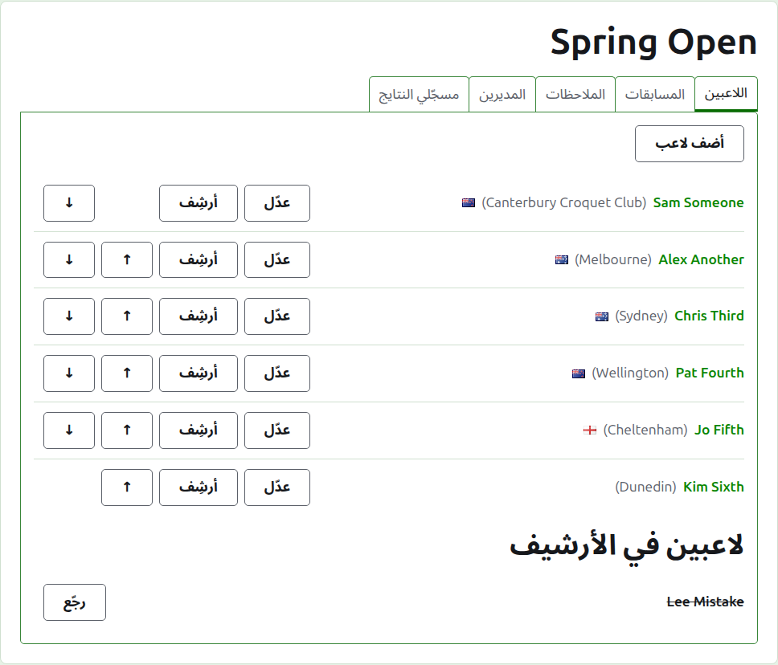
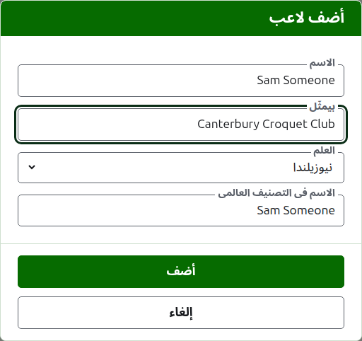
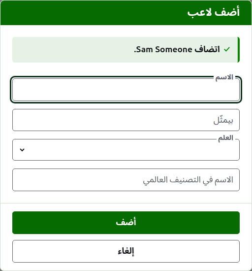
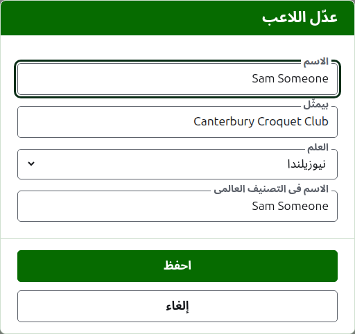
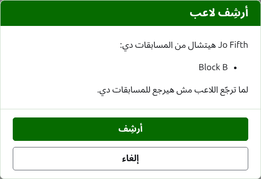

# اللاعبين

تبويب **اللاعبين** في صفحة البطولة هو المكان اللي لاعبينها بيتسجّلوا فيه، ويتصلّحوا، ويترتّبوا، ويتنحّوا. وهو التبويب اللي الصفحة بتفتح عليه، لأن تسجيل اللاعبين أول حاجة بتتعمل في البطولة.

اللاعبين بيتسجّلوا هنا مرة واحدة، في البطولة. وأي لاعب بيلعب في أنهي منافسات بيتختار بعدين، على صفحة كل منافسة، من اللاعبين اللي اتسجّلوا هنا. شوف [إدخال لاعبين في منافسة](entering-players-in-a-competition.md).



## إضافة لاعبين {#add-a-player}

دوس على **ضيف لاعب**، فوق القايمة. ديالوج بيفتح فوق الصفحة.



**الاسم** مطلوب. هو اسم اللاعب زي ما هيظهر على كل صفحة، بين 3 و254 حرف. لاعبين اتنين في نفس البطولة مينفعش يكون ليهم نفس الاسم، مهما اختلفت الحروف الكبيرة والصغيرة؛ ولو فعلاً لاعبين ليهم نفس الاسم، فرّق بينهم في الاسم نفسه، زي "Andrew Hobbs (2)".

**بيمثّل** هو اللي اللاعب بيلعب باسمه، مكتوب زي ما القارئ هيقوله: نادي أو منطقة أو بلد، زي "Canterbury Croquet Club". بيظهر بين قوسين بعد الاسم. وممكن تسيبه فاضي.

**العلم** هو العلم اللي بيظهر جنب اسم اللاعب. ممكن تسيبه من غير علم، وده حال أغلب اللاعبين. اللي اللاعب بيمثّله والعلم اللي بيرفعه حاجتين منفصلتين، لأن اللاعب ممكن يلعب لنادي في بلد ويرفع علم بلد تانية.

**اسم اللاعب في التصنيف العالمي** هو الاسم اللي التصنيف العالمي يعرف اللاعب بيه. بيتطلب بس في بطولة كروكيه الأسوشييشن أو كروكيه الجولف، الرياضتين اللي التصنيف العالمي عنده قايمة بلاعبيهم. أما لاعبين الكروكيه الأمريكي بستة أطواق فالتصنيف عارفهم بأسمائهم، فالخانة دي مش بتتطلب هناك، واسم كل لاعب في التصنيف العالمي هو اسمه دايمًا. وإنت بتضيف لاعب، الخانة دي بتمشي ورا الاسم وإنت بتكتبه، لأن أغلب اللاعبين التصنيف عارفهم بأسمائهم، وبتبطّل تمشي وراه أول ما تكتب فيها. لو سبتها فاضية، بتتحفظ باسم اللاعب.

وإنت بتكتب الاسم، اللاعبين اللي التصنيف العالمي يعرفهم وأسماؤهم بتبدأ كده بيتعرضوا عليك، علشان تاخد الاسم زي ما التصنيف كاتبه بدل ما تكتبه كله. وجنب الاسم في التصنيف العالمي، علامة صح معناها إن التصنيف يعرف الاسم، وعلامة استفهام معناها إنه ما يعرفهوش: ممكن يكون مكتوب غلط، أو اللاعب جديد على التصنيف. ده مجرد نصيحة. الاسم اللي التصنيف ما يعرفهوش بيتحفظ زي اللي يعرفه بالظبط.

دوس على **ضيف**. اللاعب بيتضاف، والديالوج بيقول كده، وخاناته بتفضى للاعب اللي بعده، والمؤشر بيرجع للاسم. ضيف القايمة كلها بالطريقة دي، وبعدين دوس على **إلغاء** علشان تقفل الديالوج. إلغاء ما بيحفظش أي حاجة ما كانتش اتضافت أصلاً.



اللاعب عمره ما بيتسمّى "Bye". Bye خروج المغلوب بتتضاف في خروج المغلوب نفسه، في المكان اللي لاعبينه بيتسجّلوا فيه، فأي اسم أول كلمة فيه هي الكلمة الإنجليزية "bye" بيترفض، والديالوج بيوضّح ليه.

## إضافة لاعبين كتير مرة واحدة {#adding-multiple-players}

علشان تضيف قايمة كاملة مرة واحدة، دوس على **ضيف لاعبين**، جنب **ضيف لاعب**. ديالوج بيفتح فوق الصفحة فيه خانة واحدة، بتاخد كذا سطر نص. ممكن تنسخ القايمة من جدول بيانات وتلزقها في الخانة.

**السطر الأول بيسمّي الخانات**، مفصولة بفواصل أو بعلامات تاب: **Name**، وأي حاجة من **Representing** و**Flag** و**Handicap** و**WorldRankingPlayerName**، بأي ترتيب. الأسماء دي بتتكتب بالإنجليزي، أيًّا كانت لغة الموقع. **Name** لازم تكون واحدة منهم. **كل سطر بعده هو لاعب**، وفيه قيمة لكل خانة بنفس الترتيب، ومفصولة بنفس الطريقة. اللاعب اللي مفيش عنده حاجة في خانة بيسيبها فاضية، بس بيسيب الفاصلة أو التاب. مثلًا، بالفواصل:

```
Name,Representing,Flag
Sam Someone,Canterbury Croquet Club,New Zealand
Alex Another,,England
```

- **الاسم وبيمثّل واسم اللاعب في التصنيف العالمي** ليهم نفس القواعد زي لما تضيف لاعب واحد (شوف [إضافة لاعبين](players.md#add-a-player)). الاسم بين 3 و254 حرف، ومش موجود في البطولة قبل كده، مهما اختلفت الحروف الكبيرة والصغيرة، ومش "Bye".
- **العلم** هو اسم البلد أو المكان، بلغتك، زي ما القايمة في ديالوج ضيف لاعب بتعرضه، زي نيوزيلندا.
- **الهانديكاب** رقم بعلامة، لحد رقمين وكسر من رقم واحد، زي 4 أو +4 أو -1.5.
- اللاعب اللي مفيش له **WorldRankingPlayerName** بيتعرف باسمه، زي لما بيتضاف لوحده.
- **فواصل أو تاب.** الخلايا المنسوخة من جدول بيانات بتتفصل بتاب، والقايمة اللي بتتكتب بإيد بتتفصل في الغالب بفواصل. الاتنين شغالين. لو السطر الأول فيه تاب، القايمة كلها بتتقري بالتاب، ولو مفيهوش تاب بتتقري بالفواصل.
- القيمة اللي فيها علامة الفصل بتتكتب بين علامتين تنصيص، زي ما جدول البيانات بيكتبها: "Smith, John" في قايمة مفصولة بفواصل. وعلامة التنصيص جوه القيمة بتتكتب مرتين.
- كل قيمة بتتشال المسافات من طرفيها، والسطر الفاضي بيتتجاهل.
- القايمة فيها 500 لاعب على الأكتر. ضيف الباقي في قايمة تانية.

دوس على **ضيف**. القايمة كلها بتتراجع قبل ما أي حاجة منها تتحفظ، فالقايمة اللي فيها أي غلطة ما بتضيف حد. الغلط بيتقال تحت الخانة، عند السطر اللي هو فيه، والسطر الأول بيتحسب سطر 1. كل غلطة بتتعرض، مش الأولى بس، واللي كتبته بيفضل زي ما هو علشان تصلّحه. أول ما القايمة تتحفظ، الديالوج بيتقفل وتبويب اللاعبين بيعرض اللاعبين الجداد، بالترتيب اللي كتبتهم بيه. وعلى عكس **ضيف لاعب**، اللي بيفضل مفتوح للاعب اللي بعده، هنا مفيش بعده: القايمة هي اللي بعده.

علامة **؟** في شريط عنوان الديالوج بتوديك هنا.

## تصحيح لاعب {#correcting-a-player}

دوس على اسم لاعب، أو على **عدّل** بتاعه، علشان تفتح نفس الديالوج على اللاعب ده، بعنوان عدّل اللاعب. غيّر اللي غلط ودوس على **احفظ**، وده بيحفظ التغيير ويقفل الديالوج. اللاعب اللي اسمه بيتصلّح بيحتفظ باسمه في التصنيف العالمي زي ما كان، لأن التصنيف لسه عارفه بيه. وفي الكروكيه الأمريكي بستة أطواق اسم اللاعب في التصنيف العالمي هو اسمه دايمًا، فتصحيح الاسم بيصلّحه هو كمان.



اللاعب اللي بيتصلّح هنا بيتصلّح في كل مكان: في كل منافسة هو فيها، وعلى كل صفحة عامة.

## ترتيب اللاعبين

اللاعبين بيتعرضوا بترتيب البطولة، وده الترتيب اللي بيتعرضوا بيه لما بيتسجّلوا في المنافسات، والترتيب اللي قرعة خروج المغلوب بتتعمل بيه. **لفوق** و**لتحت**، السهمين في آخر كل صف، بيحرّكوا اللاعب مكان واحد. أول لاعب ما بيتعرضش عليه فوق وآخر لاعب ما بيتعرضش عليه تحت.

## أرشفة لاعب {#archiving-a-player}

**أرشف** بينحّي لاعب: اتسجّل بالغلط، أو انسحب من البطولة كلها. اللاعب اللي في الأرشيف بيتعرض تحت **اللاعبين المؤرشفين**، وعليه خط، بعد اللاعبين الشغّالين، ومش بيعرض غير **استرجع**. اللاعب اللي في الأرشيف مش في أي منافسة ومش بيظهر على أي صفحة عامة.

اللاعب اللي لعب أي لعبة مينفعش يتأرشف، لأن الألعاب ساعتها هتبقى ضد حد مش موجود، فاللاعب ده ما بيتعرضش عليه أرشف. واللاعب اللي كل ألعابه في الأرشيف ينفع.

أرشفة لاعب مش في أي منافسة ما بتسألش الأول، لأن رجوعه بيرجّع كل حاجة. أرشفة لاعب في أي منافسة بتسأل الأول، لأن الأرشفة بتشيله من كل منافسة هو فيها، ورجوعه ما بيرجّعهوش فيها.



بعدين: [المنافسات](competitions.md).
