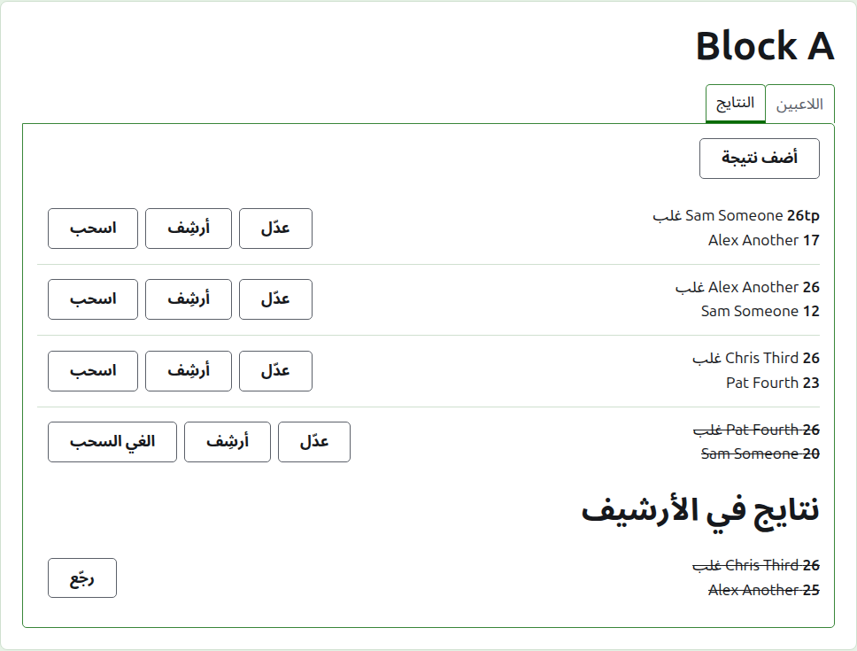
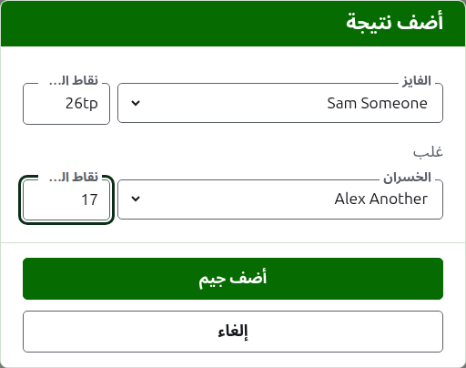
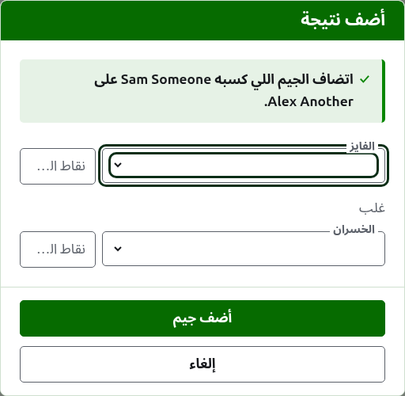
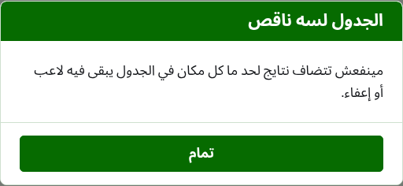
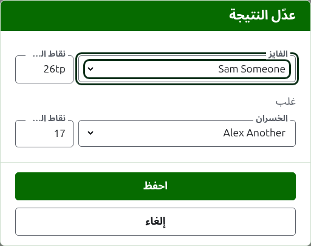

# النتايج

تبويب **النتايج** في صفحة المسابقة هو المكان اللي جيماتها بتتكتب فيه، وتتصلّح، وتتنحّى. مسجّل النتايج بيشوف التبويب ده لوحده، ويقدر يعمل فيه كل اللي المدير بيعمله.

## كتابة نتيجة

دوس على **أضف نتيجة**، فوق القايمة. الديالوج بيتقرا زي ما النتيجة بتتقال: الفايز ونقاطه، وبعدين "غلب"، وبعدين الخسران ونقاطه.

الفايز والخسران كل واحد بيتختار من لاعبين المسابقة اللي بيلعبوا، بترتيب المسابقة. مفيش حد مختار في الأول، علشان الجيم عمره ما يتسجّل على لاعب إنت ما اختارتهوش. وفي خروج المغلوب، اختيار الفايز بيختار اللي القرعة جابته قصاده كخسران، في مكان تقدر تشوفه وتختار غيره.

النقاط بتتكتب زي ما مسجّل النتايج كتبها: عدد النقاط، وأي حاجة بعده، ودي بتتحفظ وتظهر زي ما اتكتبت، زي "26tp" لـ 26 طوق وتريبل بيل. العدد هو الأرقام اللي النقاط بتبدأ بها؛ والنقاط اللي ما تبدأش برقم بتترفض.

الجيم اللي اتكسب بنقاط متساوية، زي لما يوقف بالوقت ويتحسم بطريقة تانية، بيقول مين كسبه بعلامة بعد نقاط الفايز: "6w" غلب "6". على Croquet Scores العلامات هي "w" و"won" و"winner"؛ وGateball Scores بيقبل كمان "cb" و"so". نقاط الفايز لازم تكون أكتر من نقاط الخسران، أو معلّمة، إلا لو البطولة بتسمح بالتعادل، وساعتها النقاط المتساوية من غير علامة بتتحفظ تعادل.

دوس على **أضف جيم**. الجيم بيتضاف، والديالوج بيقول أنهي جيم، والخانات بتفضى للجيم اللي بعده، لأن النتايج بتيجي مجموعة واحدة متقرية من لوحة في آخر الدور. دوس على **إلغاء** لما يخلصوا كلهم.

اللي بيترفض بيتقال تحت الخانة اللي هو عنها: فايز أو خسران ما اتختارش، ونقاط ما اتكتبتش أو ما بتبدأش برقم، ونفس اللاعب في الاتنين، ونقاط خسران معلّمة إنها مكسوبة، ونقاط فايز أقل من الخسران. وفي خروج المغلوب، لاعبين اتنين القرعة ما جابتهمش مع بعض بيترفضوا فوق الخانات.

## جدول خروج المغلوب لازم يتملى الأول

خروج المغلوب ما بيتلعبش غير لما كل مكان في جدوله يبقى فيه لاعب أو إعفاء. وقبل كده، أضف نتيجة بيوضّح ليه النتايج مينفعش تتضاف بدل ما يفتح الديالوج.

## قايمة النتايج

النتايج الشغّالة بتتعرض بترتيب كتابتها، الأقدم الأول، علشان القايمة تتقرا زي ما المسابقة اتلعبت. كل نتيجة بتقول الفايز ونقاطه، وبعدين الخسران ونقاطه، وبتعرض **عدّل** و**أرشِف**.

## تصحيح نتيجة

**عدّل** بيفتح نفس الديالوج على النتيجة دي، بعنوان عدّل النتيجة، ولاعبينها مختارين ونقاطها زي ما اتكتبت. دوس على **احفظ** علشان تحفظ التصحيح وتقفل الديالوج.

التصحيح بيحافظ على النتيجة: الجيم المكسوب يفضل مكسوب، والمتعادل يفضل متعادل. الجيم اللي نتيجته كانت غلط بيتأرشف ويتكتب من جديد.

لو النتيجة ينفع تتأرشف، لاعبينها ينفع يتغيّروا زي نقاطها. وفي خروج المغلوب، النتيجة اللي فايزها لعب في الدور اللي بعده بتحتفظ بلاعبينها، لأن تغيير مين كسبها هيسيب الجيم اللي بعده ملعوب من حد ما وصلش له؛ نقاطها بس اللي ينفع تتصلّح.

## أرشفة نتيجة

**أرشِف** بينحّي النتيجة فما تتحسبش في أي حاجة. بتتعرض تحت **نتايج في الأرشيف**، وعليها خط، ومش بتعرض غير **رجّع**. ولا واحد منهم بيسأل الأول، لأن كل واحد بيتراجع عن التاني.

في خروج المغلوب، فايز الماتش بيعدّي للدور اللي بعده، فنتيجة ماتش فايزه لعب في الدور اللي بعده ما بيتعرضش عليها أرشِف. الجيم اللي في الدور اللي بعده بيتأرشف الأول، وبعدين اللي قبله ينفع. ولو الدور بأفضل 3 أو 5، كل جيم في الماتش بيتعامل بنفس الطريقة. المجموعات والسويسري مفيهمش أدوار بتعتمد على بعض، فكل نتيجة فيهم ينفع تتأرشف.

## سحب نتيجة

اللاعب اللي بيسيب المسابقة عادةً بيتسحب منها، في تبويب اللاعبين، وده كل المطلوب: ما بيلعبش تاني، والجيمات اللي لعبها بتفضل لكن ما بتتحسبش في الفوز والخسارة والأطواق. سحب النتيجة للحالة الأندر اللي فيها جيم اتلعب ومش هيتحسب. في Australian President's Eights مثلاً، نتايج الدور الأول بتفضل لما لاعب ينسحب، وجيمات الدور التاني بتاعته بس هي اللي بتتشال من الحساب: اسحب الجيمات دي.

في المجموعات والسويسري، النتيجة اللي اتلعبت ومش هتتحسب بتتسحب مش بتتأرشف. **اسحب** بيسيبها وسط النتايج الشغّالة، في مكانها، لكن عليها خط ومش بتتحسب في أي حاجة على الصفحات العامة. **الغي السحب** بيخلّيها تتحسب تاني. ولا واحد منهم بيسأل الأول. نتايج خروج المغلوب ما بيتعرضش عليها اسحب، لأن النتيجة هناك بتحسم أكتر من الترتيب.

بعدين: [الملاحظات](notes.md).
