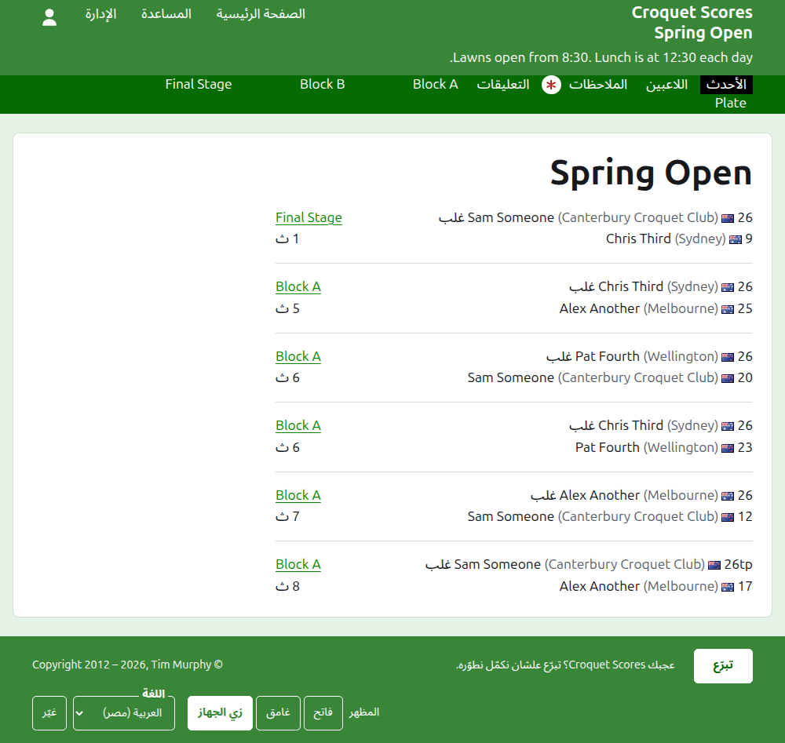
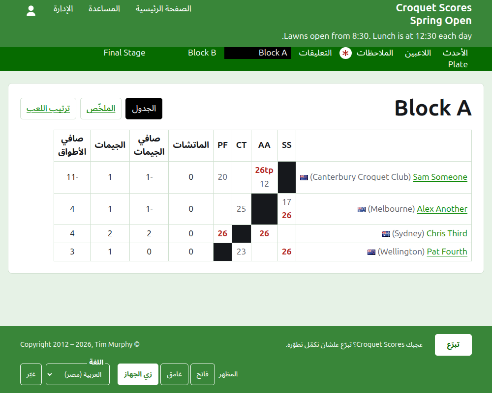
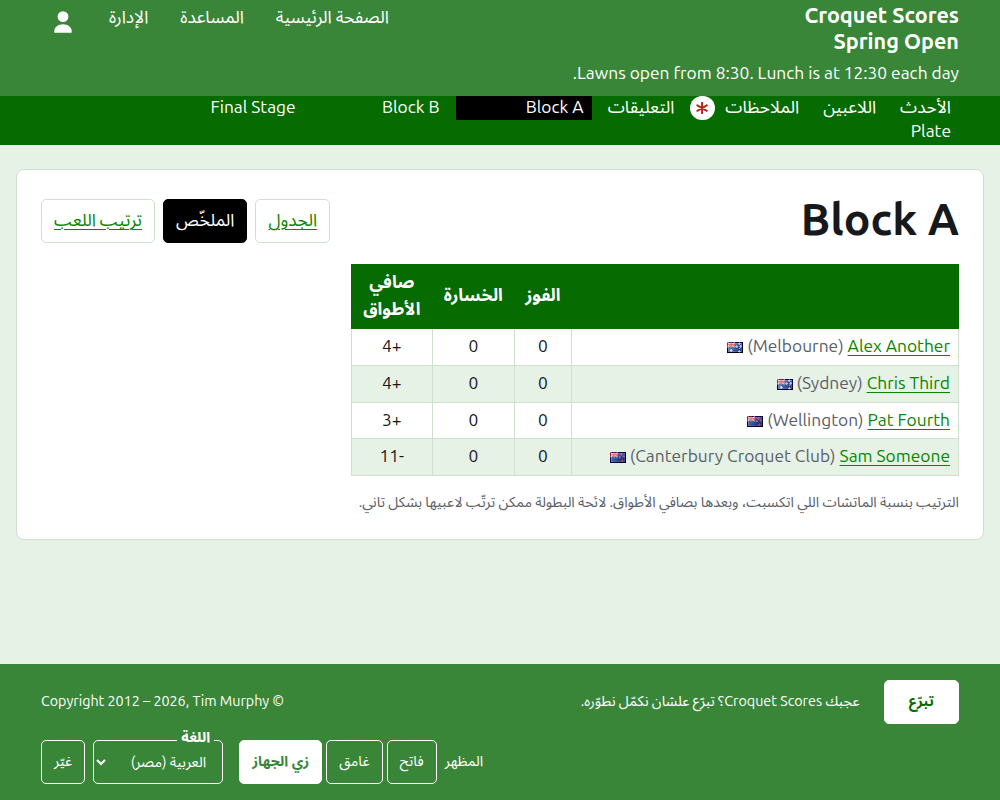
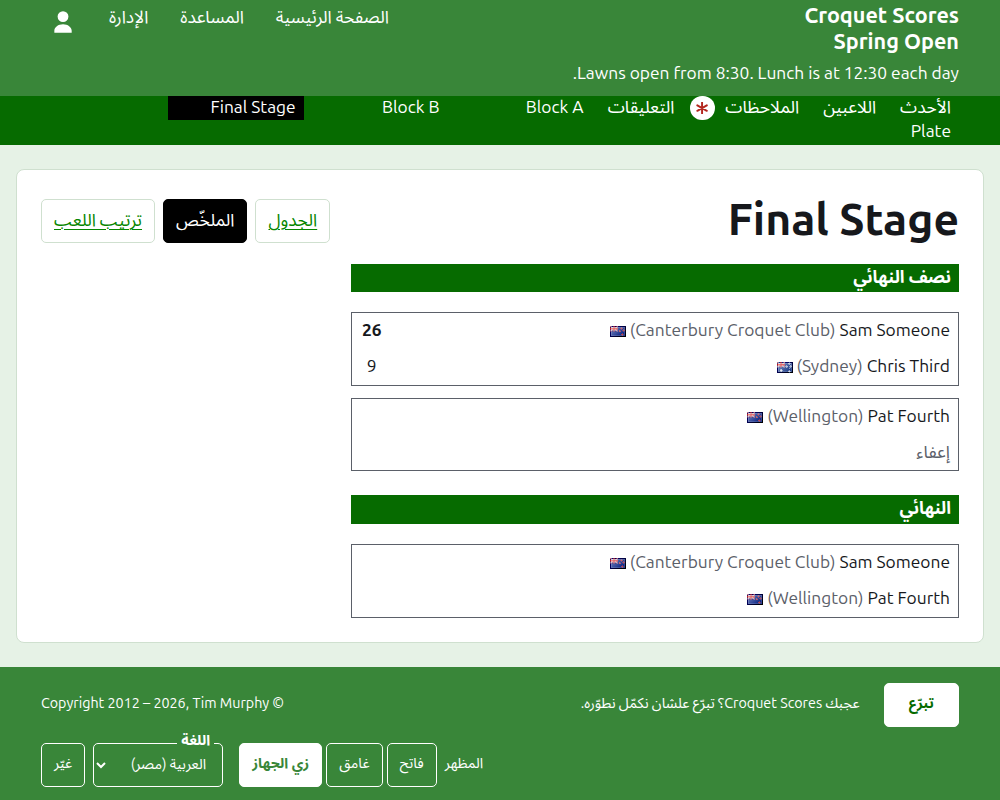
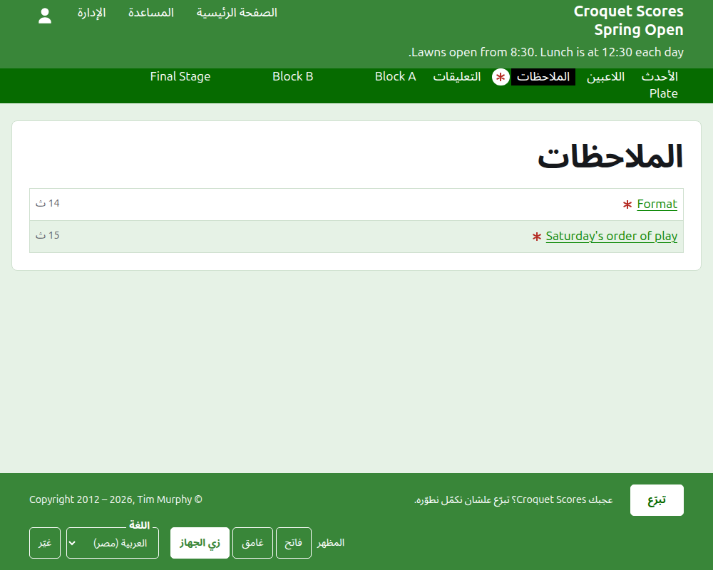

# اللي الجمهور بيشوفه

مفيش حاجة بتتنشر: الصفحات العامة بتترسم من اللي الإدارة فيها، فالنتيجة اللي بتتكتب بتظهر عليها في نفس اللحظة. ما بتحتاجش حساب ولا JavaScript، ومتصمّمة للموبايل.

## صفحة البطولة

صفحة البطولة على سنتها ورياضتها واسمها، زي `/2026/ac/spring-open`. عنوانها اسم البطولة، وتحته عنوانها الفرعي. بتعرض كل لعبة شغّالة، الأحدث إضافة الأول، علشان القارئ اللي بيرجع يشوف اللي حصل من ساعتها. كل لعبة بتقول الفايز، واللي بيمثّله، وعلمه، ونقاطه، وبعدين الخسران ونقاطه، ومعاهم المنافسة اللي اتلعبت فيها ومن قد إيه اتضافت.

الشريط الأخضر الغامق بيعرض أقسام البطولة: **الأحدث**، وهي الصفحة دي، و**اللاعبين** و**الملاحظات** و**التعليق**، وبعدين كل منافسة شغّالة، بالترتيب اللي في تبويب المنافسات. الملاحظات بتتعلّم بنجمة حمرا طول ما فيه ملاحظة القارئ ما قراهاش.

## المجموعات

صفحة المجموعات بتعرض نتايجها في جدول: صف وعمود لكل لاعب بترتيب المجموعة، والألعاب بين لاعبين اتنين في المكان اللي الصف بيقابل فيه العمود، وكل لعبة معلّمة فوز أو خسارة أو تعادل للاعب الصف. وبعد أعمدة اللاعبين، مجاميع كل لاعب. لو كل مباراة لعبة واحدة، المجاميع هي الفوز وصافي الأطواق؛ ولو المباراة بأفضل أكتر من لعبة، فهي المباريات وصافي الألعاب والألعاب وصافي الأطواق.

المجموعات بتتعرض بتلات طرق، معروضة على سطر اسمها: **الجدول** و**الملخّص** و**ترتيب اللعب**. الملخّص هو بتاع الموبايل: اللاعبين مرتّبين، بالفوز والخسارة وصافي الأطواق. ترتيب اللعب بيعرض كل لعبة، الأقدم الأول. والقارئ اللي بيختار عرض بيفضل على نفس العرض في كل منافسة لحد ما يختار غيره.

صف اللاعب المسحوب بيقول كده. والنتيجة المسحوبة بتظهر وعليها خط ومش بتتحسب في أي حاجة. والنتيجة اللي في الأرشيف ما بتظهرش.

## خروج المغلوب

صفحة خروج المغلوب بترسم جدوله دور دور، عمود لكل دور من الأول لحد النهائي، وكل مباراة طرفيها واحد فوق التاني وخلية لكل لعبة من اللي المباراة بأفضلهم. ومباراة الدور اللي بعده واقفة جنب المباراتين اللي هي بين فايزينهم. وعلى الموبايل الجدول بيتزحلق بالعرض، بسهمين للنهائي والرجوع.

## السويسري

صفحة السويسري بترتّب لاعبينه في جدول: ألعابهم، وفوزهم، ونسبة فوزهم، ونتايجهم، وكل نتيجة متقولة بالخصم والفرق، زي "+4" للعبة اتكسبت بأربعة.

## اللاعبين

صفحة اللاعبين بتعرض كل لاعب في البطولة مش في الأرشيف، بالترتيب الأبجدي، ومعاه اللي بيمثّله وعلمه.

## الملاحظات

صفحة الملاحظات بتعرض ملاحظات البطولة، الأحدث كتابة الأول، وكل واحدة بتوصّل لصفحتها وبتقول من قد إيه اتكتبت. والملاحظة اللي القارئ ما قراهاش بتتعلّم بنجمة حمرا لحد ما يفتحها.

## العناوين اللي بتتنقل

البطولة بتحافظ على عنوانها لما اسمها يتصلّح. ولما تتنقل، لأن سنتها أو رياضتها اتغيّرت، عنوانها القديم بيوصّل للجديد، علشان الرابط اللي محفوظ من قبل كده يفضل شغّال. وصفحات البطولة اللي في الأرشيف مش بتتلاقى لحد ما ترجع.
