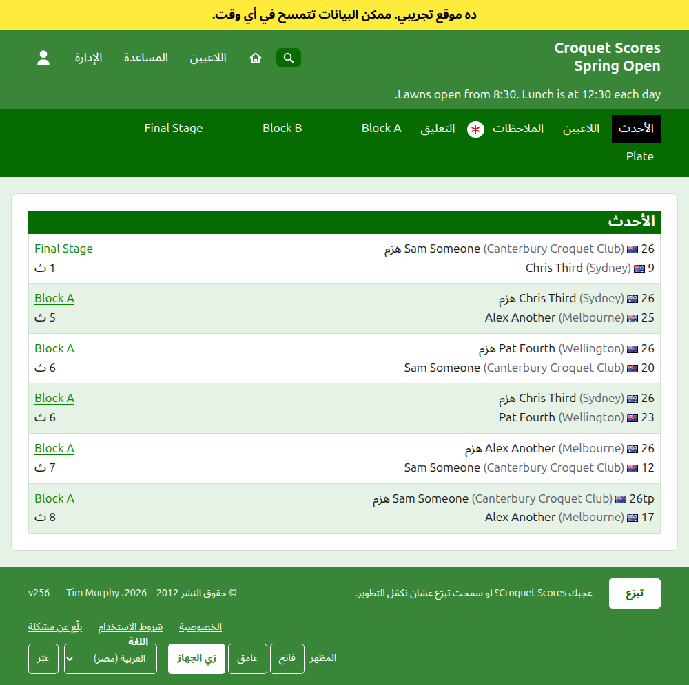
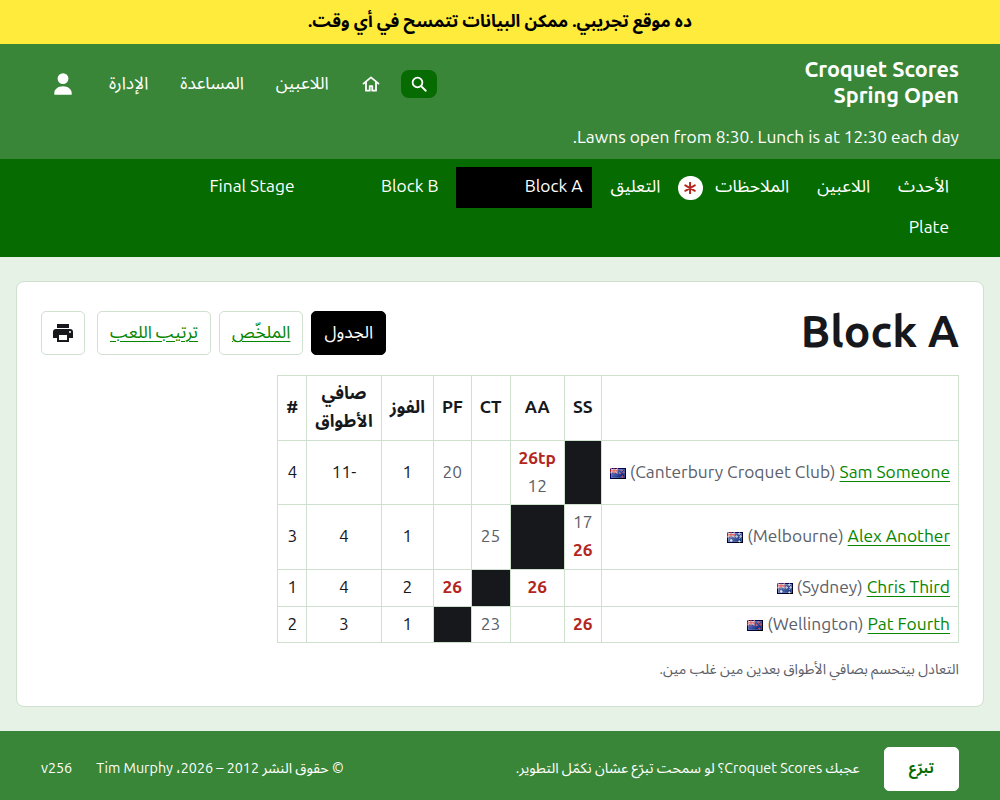
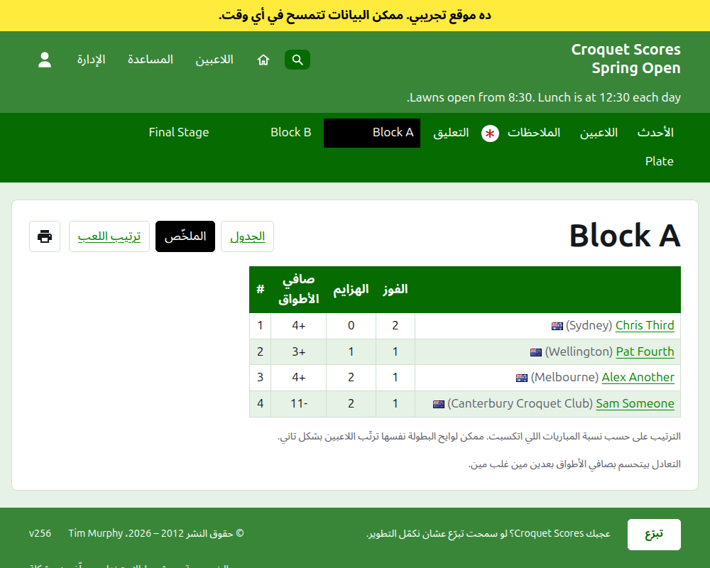
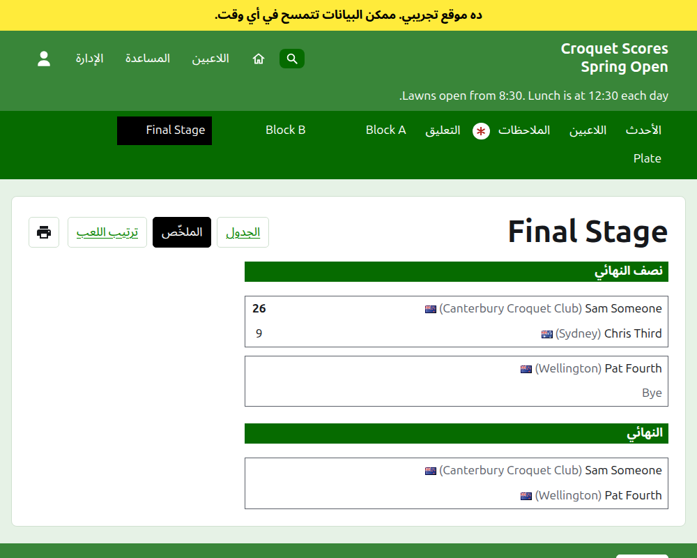
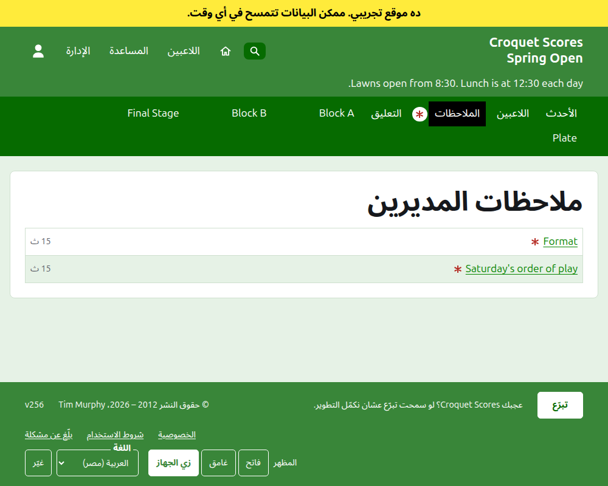

# اللي الجمهور بيشوفه

مفيش حاجة بتتنشر: الصفحات العامة بتترسم من اللي الإدارة فيها، فالنتيجة اللي بتتكتب بتظهر عليها في نفس اللحظة. ما بتحتاجش حساب ولا سكريبت، ومتصمّمة للموبايل.

## صفحة البطولة

صفحة البطولة على سنتها ورياضتها واسمها، زي `/2026/ac/spring-open`. عنوانها اسم البطولة، وتحته عنوانها الفرعي. بتعرض كل لعبة شغّالة، الأحدث إضافة الأول، علشان القارئ اللي بيرجع يشوف اللي حصل من ساعتها. كل لعبة بتقول الفايز، وهانديكابه، واللي بيمثّله، وعلمه، ونقاطه، وبعدين الخسران ونقاطه، ومعاهم المنافسة اللي اتلعبت فيها ومن قد إيه اتضافت.

الشريط الأخضر الغامق بيعرض أقسام البطولة: **الأحدث**، وهي الصفحة دي، و**اللاعبين** و**الملاحظات** و**التعليق**، وبعدين كل منافسة شغّالة، بالترتيب اللي في تبويب المنافسات. الملاحظات بتتعلّم بنجمة حمرا طول ما فيه ملاحظة القارئ ما قراهاش.

## المجموعات

صفحة المجموعات بتعرض نتايجها في جدول: صف وعمود لكل لاعب بترتيب المجموعة، والألعاب بين لاعبين اتنين في المكان اللي الصف بيقابل فيه العمود، وكل لعبة معلّمة فوز أو خسارة أو تعادل للاعب الصف. وبعد أعمدة اللاعبين، مجاميع كل لاعب. لو كل مباراة لعبة واحدة، المجاميع هي الفوز وصافي الأطواق؛ ولو المباراة بأفضل أكتر من لعبة، فهي المباريات وصافي الألعاب والألعاب وصافي الأطواق. العمود الأخير، عنوانه **#**، هو مركز كل لاعب: 1 للأول، و=2 لما لاعبين ما ينفعش يتفرّقوا ويتشاركوا في التاني. ولو في لاعبين كسبوا نفس نسبة مبارياتهم، بيظهر سطر تحت الجدول بيقول إزاي بيتفرّقوا، حسب كسر التعادل بتاع المجموعة (شوف المنافسات).

المجموعة وخروج المغلوب والسويسري كل واحد بيتعرض بتلات طرق، معروضة على سطر اسم المنافسة: **الجدول** و**الملخّص** و**ترتيب اللعب**. جنبهم زرار طابعة، بيطبع اسم البطولة واسم المنافسة ونتايجها، ومفيش غير كده. الملخّص هو بتاع الموبايل: للمجموعة، اللاعبين مرتّبين، بالفوز والخسارة وصافي الأطواق والمركز؛ ولخروج المغلوب، الماتشات دور دور؛ وللسويسري، جدول الجدول من غير نتايجه. ترتيب اللعب بيعرض كل لعبة، الأقدم الأول في الأول. عناوينه **اللعبة** و**التاريخ**: دوس **اللعبة** علشان الألعاب تترتّب باسم الفايز وبعده الخسران، ودوس **التاريخ** علشان تترتّب الأقدم أو الأحدث الأول، ودوس العنوان اللي القايمة مترتّبة بيه علشان تعكس الترتيب. والطريقة اللي القارئ رتّب بيها بتتحفظ على جهازه. والقارئ اللي بيختار عرض بيفضل على نفس العرض في كل منافسة لحد ما يختار غيره.

المنافسة اللي بتتلعب لغير العدد المعتاد من الأطواق لرياضتها بتقول كده تحت اسمها، زي "بتتلعب لحد 14 حلقة" (شوف [المنافسات](competitions.md#adding-a-competition)).

صف اللاعب المسحوب بيقول كده. والنتيجة المسحوبة بتظهر وعليها خط ومش بتتحسب في أي حاجة. والنتيجة اللي في الأرشيف ما بتظهرش.

## خروج المغلوب

صفحة خروج المغلوب بترسم جدوله دور دور، عمود لكل دور من الأول لحد النهائي، وكل مباراة طرفيها واحد فوق التاني وخلية لكل لعبة من اللي المباراة بأفضلهم. ومباراة الدور اللي بعده واقفة جنب المباراتين اللي هي بين فايزينهم. وعلى الموبايل الجدول بيتزحلق بالعرض، بسهمين للنهائي والرجوع.

## السويسري

صفحة السويسري بترتّب لاعبينه في جدول: ألعابهم، وفوزهم، ونسبة فوزهم، ونتايجهم، وكل نتيجة متقولة بالخصم والفرق، زي "+4" للعبة اتكسبت بأربعة.

## اللاعبين

صفحة اللاعبين بتعرض كل لاعب في البطولة مش في الأرشيف، بالترتيب الأبجدي، ومعاه هانديكابه واللي بيمثّله بين قوسين، وعلمه.

## الملاحظات

صفحة الملاحظات، وعنوانها ملاحظات المديرين، بتعرض ملاحظات البطولة، الأحدث كتابة الأول، وكل واحدة بتوصّل لصفحتها وبتقول من قد إيه اتكتبت. والملاحظة اللي القارئ ما قراهاش بتتعلّم بنجمة حمرا لحد ما يفتحها. والبطولة اللي ملهاش ملاحظات بتقول "لسه مفيش ملاحظات."

## فين البطولة بتتعرض

البطولة بتبقى في الصفحة الرئيسية وهي بتتلعب أو على وشك تبدأ. صفحة سنتها، زي `/2026`، بتعرض شهور السنة، وكل شهر، لما تدوس عليه، بيعرض البطولات اللي بتبدأ فيه. زرار تحت العنوان، **اعرض الكل** وبعده **اخفي الكل**، بيفتح كل الشهور أو يقفلها. والبطولة المعلّم عليها وطنية أو دولية بتتكتب بخط غامق على طول صفها.

## العناوين اللي بتتنقل

البطولة بتحافظ على عنوانها لما اسمها يتصلّح. ولما تتنقل، لأن سنتها أو رياضتها اتغيّرت، عنوانها القديم بيوصّل للجديد، علشان الرابط اللي محفوظ من قبل كده يفضل شغّال. وصفحات البطولة اللي في الأرشيف مش بتتلاقى لحد ما ترجع.
