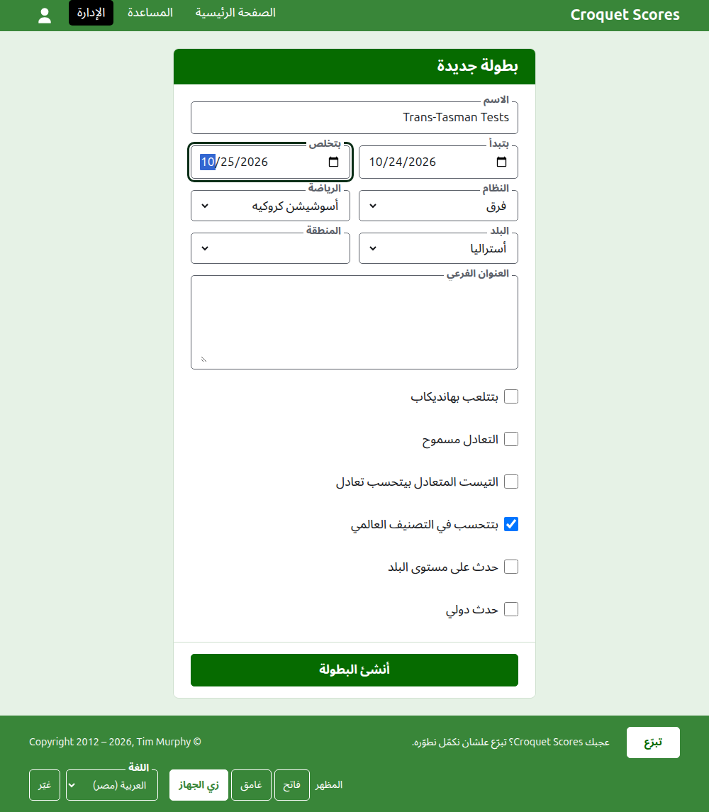
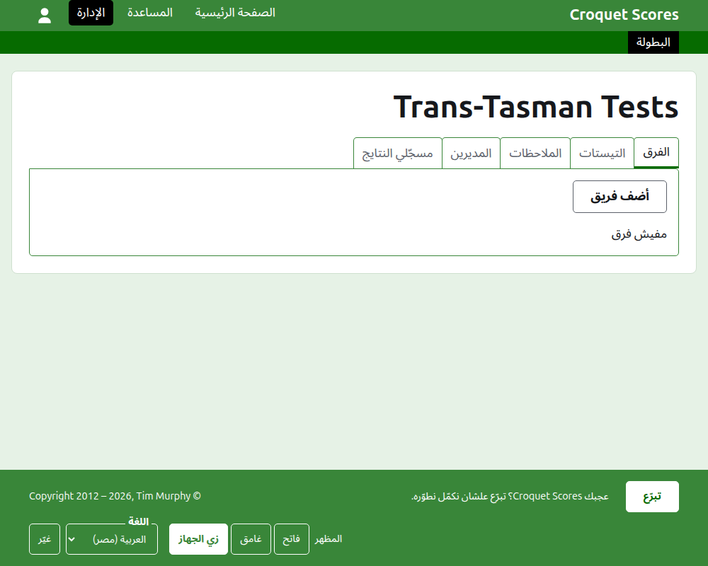

# إنشاء بطولة

دوس على **بطولة جديدة** فوق قايمة البطولات في الإدارة. الزرار فوق القايمة مش تحتها، علشان القايمة الطويلة ما تزقّهش برّه شاشة الموبايل.

الفورم بيطلب كل اللي البطولة بتبدأ بيه. أهم حاجة هنا **النظام**، لأنه هو اللي بيخلّي البطولة بطولة بتتلعب بفرق.

## الفورم بيطلب إيه

**الاسم.** اللي القرّاء بيدوّروا عليه علشان يلاقوا البطولة، زي "Trans-Tasman Tests". بين 3 و254 حرف. الاسم اللي كله حروف صغيرة، أو كله حروف كبيرة، بيترفض، لأنه هيبان غلطة على كل صفحة بيظهر فيها. ممكن بطولتين يكون ليهم نفس الاسم، لأن نفس البطولة بتتلعب كل سنة.

**بتبدأ** و**بتخلص.** الأيام اللي البطولة بتتلعب فيها. كل تيست بيتلعب جواهم، فاضبطهم علشان يغطّوا الحدث كله. البطولة مينفعش تخلص قبل ما تبدأ، ومينفعش تبدأ أو تخلص بعد آخر السنة الجاية. البطولة بتتبع السنة اللي بتبدأ فيها، ودي كمان السنة اللي في عنوانها.

**النظام.** اختار واحد من الأنظمة اللي بتتلعب بفرق:

- **فرق** هو النظام العام لأي حدث بين فرق.
- **Eire Cup** و**Interstate Shield** و**GC World Team Championship** أحداث بعينها، كل واحد محفوظ كنظام لوحده علشان يتدار بالطريقة اللي الحدث ده بيتدار بها.

عادي هو النظام الوحيد اللي ما بيتلعبش بفرق، ومش هو اللي عايزه هنا. Gateball Scores ما بيعرضش نظام، لأن كل بطولة هناك بطولة عادية جيت بول؛ والبطولة اللي بتتلعب بفرق بتتعمل على Croquet Scores.

**الرياضة.** الرياضات اللي الموقع بيعرضها، بترتيبها: أسوشيشن كروكيه، وجولف كروكيه، والكروكيه الأمريكي بستة أطواق، وريكوشيه.

**البلد** و**المنطقة.** مكان لعب البطولة. المنطقة بتتطلب بس لو البلد اللي اختارته مقسّم مناطق، زي ولايات أستراليا، ومش لازم تختارها حتى ساعتها.

**العنوان الفرعي.** أي حاجة عايز القرّاء يعرفوها ومالهاش خانة خاصة بها: تركن فين، الغدا إمتى، تتصل بمين. بيظهر تحت اسم البطولة على كل صفحة عامة. بيتكتب بـ Markdown، فممكن تخلّي كلمة غامقة بنجمتين حواليها وتعمل قايمة بشرطة في أول كل سطر. ممكن يوصل لحد 2000 حرف، وممكن تسيبه فاضي.

**بتتلعب بهانديكاب.** علّم ده لحدث هانديكاب.

**التعادل مسموح.** علّم ده لو الجيم ممكن يخلص من غير فايز. لو معلّم، النتيجة اللي بتتكتب بنقاط متساوية ومن غير علامة بتتحفظ تعادل؛ ولو مش معلّم، الجيم اللي بنقاط متساوية لازم يقول مين كسبه بعلامة بعد نقاط الفايز، زي "6w".

**التيست المتعادل بيتحسب تعادل.** بيتطلب بس بعد ما تختار نظام بيتلعب بفرق. التيست بيكسبه الفريق اللي يكسب ماتشات أكتر، والتيست المتساوي في الماتشات بيتحسم بصافي الجيمات، وبعدين بصافي الأطواق، إلا لو ده معلّم، وساعتها التيست المتساوي في الماتشات بيبقى تعادل، زي ما بعض أحداث الفرق بتعمل. بيبدأ مش معلّم لنظام فرق، ومعلّم لـ GC World Team Championship، اللي من زمان بيحسب التيست المتساوي تعادل.

**بتتحسب في التصنيف العالمي.** بتتطلب بس لو ممكن تتحسب: بطولة أسوشيشن كروكيه أو جولف كروكيه مش بتتلعب بهانديكاب ولا بتسمح بالتعادل. بتبدأ معلّمة.

**حدث على مستوى البلد** و**حدث دولي.** البطولة ممكن تكون ده أو ده أو ولا واحد منهم، لكن مش الاتنين أبداً: لما تعلّم واحد التاني علامته بتتشال.

## إنشاءها

دوس على **أنشئ البطولة**. هتروح على صفحة البطولة في الإدارة، مفتوحة على تبويب الفرق، وإنت أول مدير ليها. وبتتعرض في الإدارة تحت السنة اللي بتبدأ فيها.

عنوان البطولة العام متكوّن من سنتها ورياضتها واسمها، زي `/2026/ac/trans-tasman-tests`. وبتحافظ على العنوان ده لما اسمها يتصلّح بعدين، علشان اللينك اللي اتبعت قبل كده يفضل يوصّل لها؛ وما بتتنقلش غير لما السنة اللي بتبدأ فيها، أو رياضتها، تتغيّر.

## لو حاجة اترفضت

اللي بيترفض بيتقال تحت الخانة اللي هو عنها، واللي كتبته بيفضل مكتوب. مفيش حاجة بتتحفظ لحد ما كل خانة تتقبل. أكتر الحاجات اللي بتترفض: اسم مكتوب كله بحروف صغيرة، ونهاية قبل البداية، وبلد ما اتختارش.

بعدين: [الفرق](teams.md).
