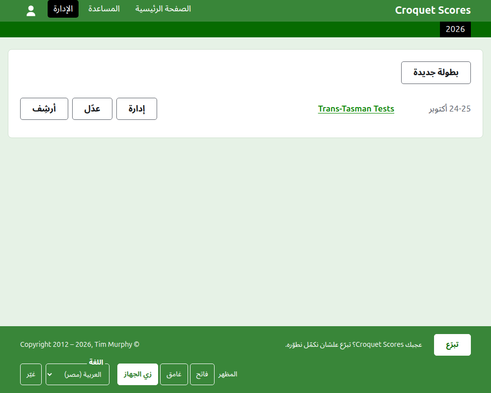
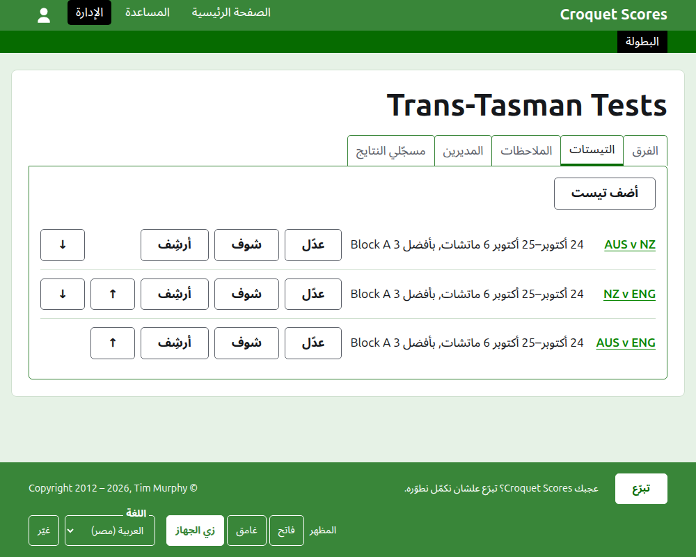

# إدارة بطولة بتتلعب بفرق

البطولة اللي بتتلعب بفرق هي اللي فيها فرق بتتقابل، مش لاعبين بيتسجّلوا واحد واحد: سلسلة تيستات بين بلدين، درع بين ولايات، بطولة عالم للفرق. فرقها بتتجهّز بلاعبينها، والتيستات بين الفرق بتتضاف، وجيمات كل تيست بتطلع أول ما تتلعب. الدليل ده بيمشي مع المدير من تسجيل الدخول لحد بطولة نتايجها متاحة للجمهور.

الدليل قايم بذاته. مفيش حاجة فيه بتعتمد على دليل البطولة العادية، وده مكتوب لوحده.

## قبل ما تبدأ

لازم يكون عندك حساب. دوس [هنا](/account/register) علشان تسجّل حساب.

كل اللي المدير بيعمله بيعمله في قسم الإدارة في الموقع. الصفحات العامة، اللي اللاعبين والمتفرّجين بيتابعوا منها البطولة، بتترسم من اللي الإدارة فيها، فمفيش حاجة لازم تتنشر: النتيجة اللي بتتكتب بتظهر على الصفحات العامة في نفس اللحظة.

## الكلمات

**الفريق** طرف، زي أستراليا، له اسم، واسم مختصر زي "AUS"، وعلم. والفريق له **لاعبين** بتوعه، بيلعبوا له ومش لأي حد غيره. **التيست** مواجهة بين فريقين، بتتسمّى بأسمائهم المختصرة، زي "AUS v ENG"، ومتكوّنة من عدد من **الماتشات** بين لاعب من كل فريق، وكل ماتش بأفضل عدد معيّن من **الجيمات**. والتيستات ممكن تتحط في **مجموعات**، زي "Block A"، لما فرق كتير تلعب مع بعض.

## الصفحات بالترتيب

1. [إنشاء بطولة](creating-a-tournament.md): اسمها، وأيامها، ورياضتها، ونظامها، ومكان لعبها.
2. [الفرق](teams.md): إضافة الفرق، بأسمائها المختصرة وأعلامها.
3. [لاعبين الفريق](team-players.md): إدخال لاعبين كل فريق على صفحة الفريق نفسه.
4. [التيستات](tests.md): إضافة التيستات بين الفرق، وأيامها، وكل واحد فيه كام ماتش، ومجموعاتها.
5. [النتايج](scores.md): كتابة جيمات التيست، وتصحيحها، وتنحية اللي اتكتبت بالغلط.
6. [الملاحظات](notes.md): إبلاغ اللاعبين باللي محتاجين يعرفوه والبطولة ماشية.
7. [المديرين ومسجّلي النتايج](managers-and-scorers.md): مشاركة إدارة البطولة، وإن حد يقدر يكتب النتايج من غير ما يقدر يغيّر أي حاجة تانية.
8. [التصنيفات](rankings.md): الملف اللي بيتبعت للتصنيف العالمي، واللي فاضل عليك تكمّله.
9. [تغيير بطولة وأرشفتها ورجوعها](changing-and-archiving.md): تصحيح بيانات البطولة، وتنحية بطولة.
10. [اللي الجمهور بيشوفه](what-the-public-sees.md): الصفحات اللي لاعبينك بيتابعوها، وإزاي اللي بتكتبه بيظهر عليها.

## شكل الإدارة

باب الإدارة بيعرض البطولات اللي ليك دور فيها، سنة سنة.

لما تدوس على اسم بطولة، أو على **إدارة**، صفحتها بتفتح. كل اللي في إيدك تديره موجود في ست تبويبات تحت اسمها: **الفرق** و**التيستات** و**الملاحظات** و**المديرين** و**مسجّلي النتايج** و**التصنيفات**. الصفحة بتفتح على الفرق، لأن الفرق هي أول حاجة بتتجهّز.

الشريط الأخضر الغامق تحت الهيدر للتنقّل بين الصفحات. على صفحة البطولة وعلى صفحة التيست بيوصّل للبطولة، باسم **البطولة**، ولكل تيست باسمه. وعلى صفحة الفريق بيوصّل للبطولة ولكل فريق باسمه المختصر بدل كده، لأن المدير اللي على صفحة فريق بيدخل اللاعبين فريق فريق. الصفحة اللي إنت فيها معلّمة بالأسود.

## حاجات سارية في كل مكان

**مفيش حاجة بتتمسح نهائي غير الملاحظة.** الفرق واللاعبين والتيستات والنتايج والبطولة نفسها بتتأرشف مش بتتمسح: بتتنحّى، ويتعمل عليها خط، وتتعرض تحت عنوان خاص بها، ومعاها **رجّع** علشان ترجّعها. الأرشفة والرجوع والتحريك فوق وتحت عمرهم ما بيطلبوا منك تأكيد، لأن كل واحد منهم بيتراجع لما تدوس على العكس. الحاجات اللي ما ينفعش تتراجع، زي مسح ملاحظة أو شيل مدير، بتسأل الأول.

**الديالوج اللي بيفتح فوق الصفحة ما بيحفظش حاجة لحد ما تدوس على زراره.** إلغاء، أو زرار Escape، بيقفله ويسيب كل حاجة زي ما كانت. الديالوجات اللي بتضيف حاجات، زي أضف فريق وأضف نتيجة، بتفضل مفتوحة بعد كل إضافة، علشان تقدر تكتب قايمة كلها واحدة ورا التانية.

**اللي بيترفض بيتقال جنب الخانة اللي هو عنها.** مفيش حاجة مرفوضة بتتحفظ، واللي كتبته بيفضل مكتوب، علشان تصلّحه بدل ما تكتبه من جديد.

**الإدارة شغّالة على الموبايل.** كل زرار كبير بما يكفي إنك تدوس عليه بإبهامك، ومفيش حاجة أعرض من الشاشة.

بعدين: [إنشاء بطولة](creating-a-tournament.md).
