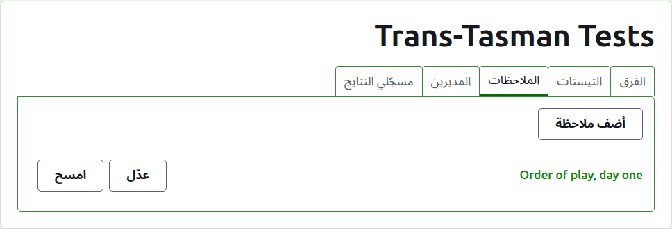
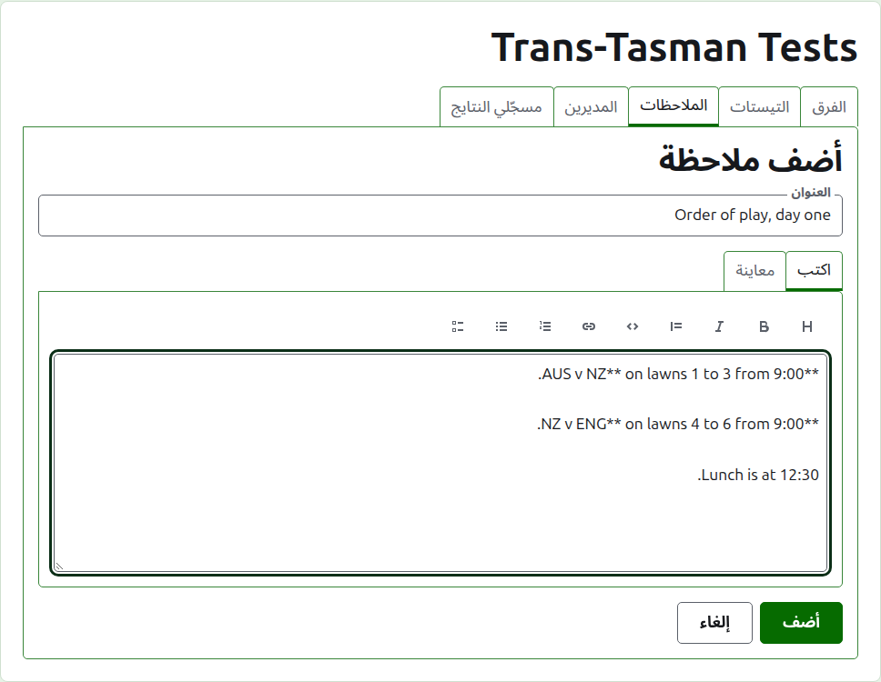
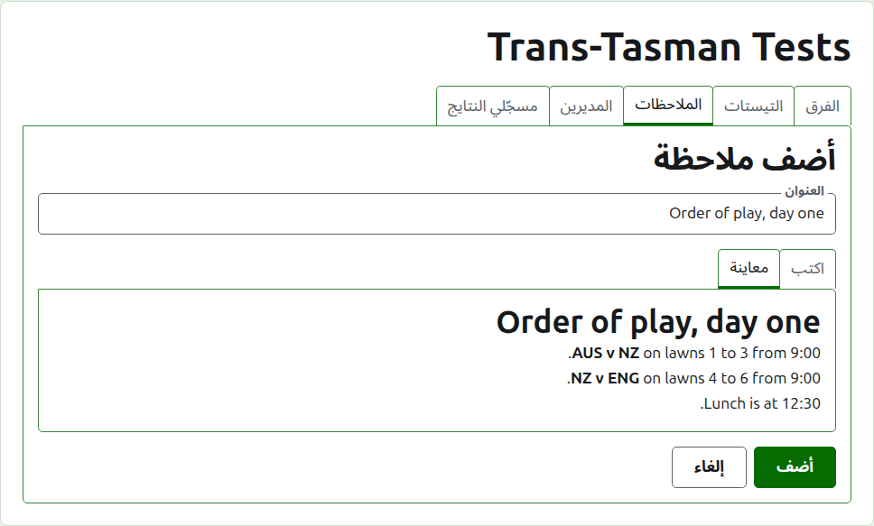
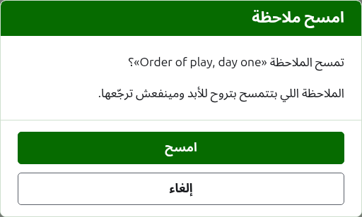

# الملاحظات

تبويب **الملاحظات** في صفحة البطولة هو المكان اللي مديرينها بيكتبوا فيه اللي اللاعبين محتاجين يعرفوه والبطولة ماشية: ترتيب اللعب، تغيير في الملاعب، وقت الغدا. القرّاء بيلاقوها في صفحة الملاحظات العامة بتاعة البطولة، والملاحظة اللي ما قروهاش بتتعلّم هناك بنجمة حمرا، ونفس النجمة بتعلّم قسم الملاحظات على كل صفحة في البطولة لحد ما يفتحوها.

## كتابة ملاحظة

دوس على **ضيف ملاحظة**، فوق القايمة. لوحة بتاخد مكان القايمة، لأن الملاحظة بتتكتب بالطول ومحتاجة مكان.

**العنوان** مطلوب، وهو اللي الملاحظة بتتعرض بيه. نص عادي.

**الوصف** بيتكتب بـ Markdown وممكن تسيبه فاضي لو العنوان قال كل اللي فيها. شريط الأدوات فوق الخانة بيكتب لك الـ Markdown: عنوان، وغامق، ومائل، واقتباس، وكود، ورابط، وقايمة مرقّمة، وقايمة بنقط، وقايمة مهام. كل واحد بيشتغل على اللي محدّد، أو في أول كل سطر محدّد، أو بيحط المؤشر في المكان اللي الكلام بيروح فيه.

**معاينة** بتعرض الملاحظة زي ما القارئ هيشوفها على صفحتها.

دوس على **ضيف**. الملاحظة بتتحفظ، والقايمة بترجع وهي في أولها، وبتظهر على صفحة الملاحظات العامة في نفس اللحظة.

## تعديل ملاحظة

دوس على عنوان ملاحظة، أو على **عدّل** بتاعها، علشان تفتح اللوحة على الملاحظة دي. دوس على **احفظ** علشان تحفظ التغيير. الملاحظة اللي اتعدّلت بعد ما القارئ قراها بتتعلّم له من جديد.

## مسح ملاحظة {#deleting-a-note}

الملاحظة اللي ما بقتش تنطبق بتتمسح. والملاحظة اللي بتتمسح بتروح للأبد، فـ **امسح** بيسأل الأول.

بعدين: [المديرين ومسجّلي النتايج](managers-and-scorers.md).
