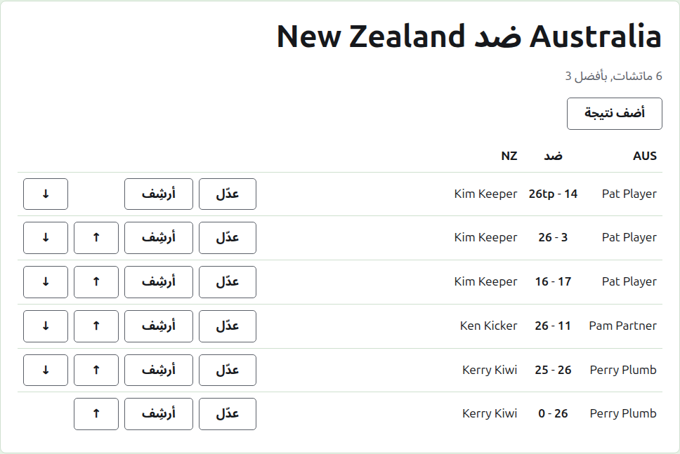
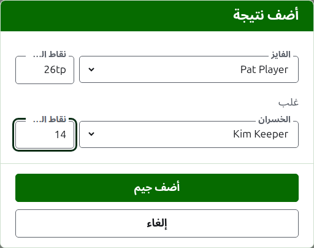

# النتايج

صفحة اللقاء بتتفتح من اسمه في تبويب اللقاءات، أو من الشريط الأخضر الغامق. عنوانها الأسماء الكاملة لفرقه، زي "Australia v New Zealand"، وتحته كام مباراة متوقّعة فيه وكل مباراة بأفضل كام. نتايجه هي الصفحة، من غير تبويبات. المدير ومسجّل النتايج بيشوفوا نفس الصفحة، لأن مسجّل النتايج يقدر يعمل في النتيجة كل اللي المدير بيعمله.

## شكل النتايج

النتايج مرتّبة بالفريق مش بمين كسب، في جدول عنوانه الاسم المختصر للفريق الأول، و"v"، والاسم المختصر للفريق التاني. كل نتيجة صف: لاعب الفريق الأول، وبعدين النقاط الاتنين ونقاط الفريق الأول الأول، زي "26tp - 14"، وبعدين لاعب الفريق التاني، أياً كان مين فيهم كسب. والنتايج اللي في الأرشيف مرتّبة بنفس الطريقة تحتها.

## كتابة نتيجة {#entering-a-score}

دوس على **ضيف نتيجة**، فوق القايمة. الديالوج بيتقرا زي ما النتيجة بتتقال: الفايز ونقاطه، وبعدين "غلب"، وبعدين الخسران ونقاطه.

الفايز بيتختار من لاعبين الفريقين الشغّالين، تحت اسم كل فريق، لاعبين الفريق الأول الأول ولاعبين كل فريق بترتيب الفريق. مفيش حد مختار في الأول. وأول ما الفايز يتختار، الخسران بيتعرض من الفريق التاني لوحده، لأن اللعبة بين لاعبين من نفس الفريق مش لعبة بين الفريقين. واللاعب اللي في الأرشيف ما بيتعرضش.

النقاط بتتكتب زي ما مسجّل النتايج كتبها: عدد النقاط، وأي حاجة بعده، ودي بتتحفظ وتظهر زي ما اتكتبت، زي "26tp" لـ 26 طوق وتريبل بيل. العدد هو الأرقام اللي النقاط بتبدأ بها؛ والنقاط اللي ما تبدأش برقم بتترفض.

اللعبة اللي اتكسبت بنقاط متساوية، زي لما توقف بالوقت وتتحسم بطريقة تانية، بتقول مين كسبها بعلامة بعد نقاط الفايز: "6w" غلب "6". العلامات هي "w" و"won" و"winner". نقاط الفايز لازم تكون أكتر من نقاط الخسران، أو معلّمة، إلا لو البطولة بتسمح بالتعادل، وساعتها النقاط المتساوية من غير علامة بتتحفظ تعادل.

دوس على **ضيف اللعبة**. اللعبة بتتضاف، والديالوج بيقول أنهي لعبة، والخانات بتفضى لللعبة اللي بعدها، لأن النتايج بتيجي مجموعة واحدة متقرية من لوحة في آخر الجلسة. دوس على **إلغاء** لما يخلصوا كلهم.

## المباريات

لاعبين اتنين بيتقابلوا بيلعبوا مباراة بأفضل كام بتاع اللقاء. الألعاب بينهم هي ألعاب المباراة دي، واللعبة بين لاعبين مباراتهم اتحسمت خلاص بتترفض: واحد منهم كسب ألعاب أكتر مما التاني لسه يقدر يكسب، أو كل ألعابه اتلعبت.

المباراة بتبدأ لما لاعبيها الاتنين يبقى بينهم لعبة شغّالة. واللقاء ما بيبدأش مباريات أكتر من المتوقّع فيه: أول ما يبدأ العدد ده، اللعبة بين لاعبين ما اتقابلوش بتترفض، واللعبة التانية في مباراة بدأت خلاص بتتقبل. ولو اللقاء هيبقى فيه مباريات أكتر، غيّره في تبويب اللقاءات علشان يتوقّعهم.

## تصحيح نتيجة {#correcting-a-score}

**عدّل** بيفتح نفس الديالوج على النتيجة دي، بعنوان عدّل النتيجة، ولاعبينها مختارين ونقاطها زي ما اتكتبت. لاعبينها ينفع يتغيّروا زي نقاطها، وبيتختاروا زي وقت الإضافة. دوس على **احفظ** علشان تحفظ التصحيح وتقفل الديالوج. التصحيح بيحافظ على النتيجة: اللعبة المكسوبة تفضل مكسوبة، والمتعادل يفضل متعادل. اللعبة اللي نتيجتها كانت غلط بتتأرشف وتتكتب من جديد.

## ترتيب النتايج

النتايج بتيجي بأي ترتيب اتكتبت بيه، فكل نتيجة شغّالة بتعرض **لفوق** و**لتحت**، وهما بيبدّلوها بالنتيجة اللي جنبها، علشان القايمة تترتّب بالترتيب اللي الألعاب اتلعبت بيه.

## أرشفة نتيجة

**أرشف** بينحّي النتيجة فما تتحسبش في أي حاجة. بتتعرض تحت **النتايج المؤرشفة**، وعليها خط، ومش بتعرض غير **استرجع**. ولا واحد منهم بيسأل الأول، لأن كل واحد بيتراجع عن التاني. كل نتيجة في اللقاء ينفع تتأرشف، لأن اللقاء مفيهوش أدوار بتعتمد على بعض.

النتيجة اللي لاعبها اتأرشف بعد كده ما بترجعش لحد ما اللاعب يرجع، والصفحة بتقول كده.

بعدين: [الملاحظات](notes.md).
