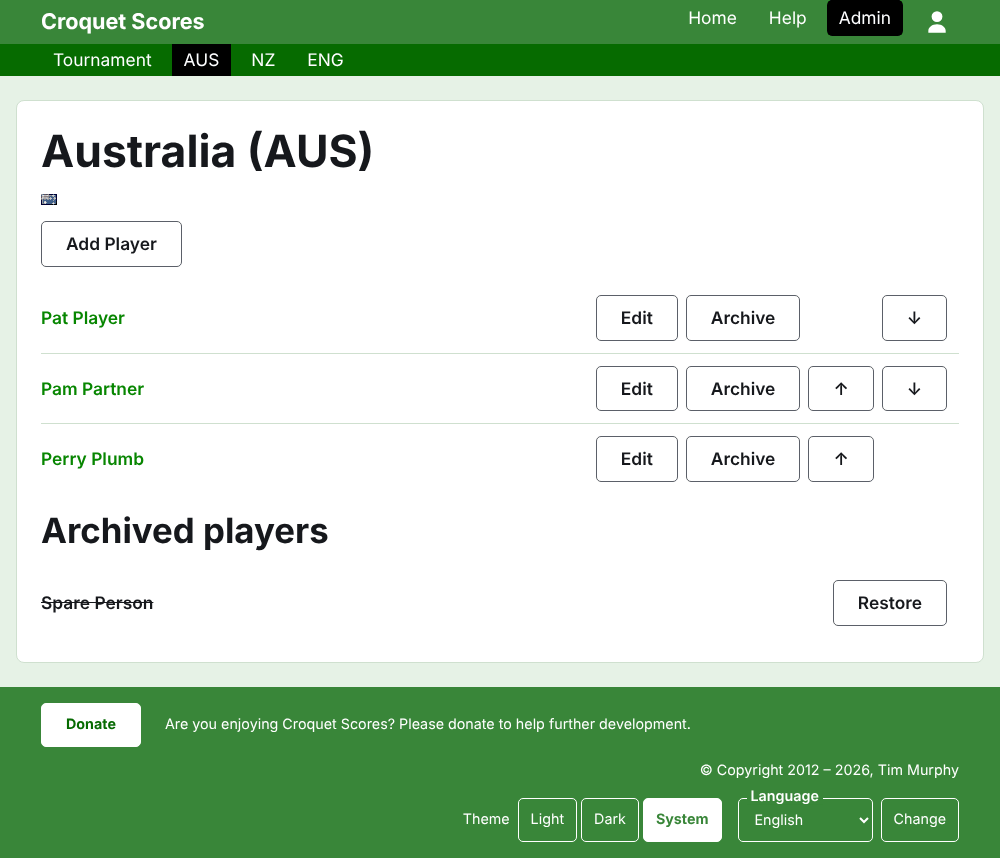
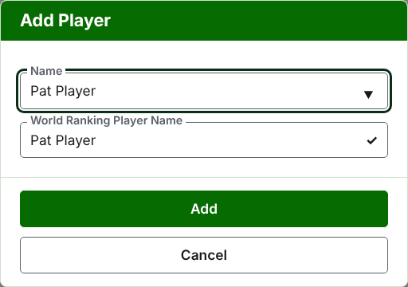

# لاعبين الفريق

صفحة الفريق بتتفتح من اسمه، أو من **شوف** بتاعه، في تبويب الفرق. عنوانها اسم الفريق واسمه المختصر بين قوسين، وعلمه، علشان المدير اللي جه لفريق غلط يشوف كده على طول. وفيها حاجة واحدة تتعرض، لاعبين الفريق، فالقايمة هي الصفحة.

الشريط الأخضر الغامق على صفحة الفريق بيوصّل للبطولة ولكل فريق شغّال باسمه المختصر، علشان اللاعبين يدخلوا فريق فريق من غير رجوع لتبويب الفرق.

اللاعب في فريق بيتبع الفريق ده لوحده، وبيمثّل الفريق، وبيرفع علم الفريق مش علم بتاعه. ونفس الشخص لما يلعب لفريقين، أو في بطولتين، بيبقى لاعب في كل واحد.

## إضافة لاعب

دوس على **أضف لاعب**، فوق القايمة. ديالوج بيفتح فوق الصفحة.

**الاسم** مطلوب، بين 3 و254 حرف. لاعبين اتنين في نفس الفريق مينفعش يكون ليهم نفس الاسم، مهما اختلفت الحروف الكبيرة والصغيرة؛ لكن لاعب في فريق تاني ممكن يكون له نفس الاسم.

**الاسم في التصنيف العالمي** هو الاسم اللي التصنيف العالمي يعرف اللاعب بيه. بيتطلب بس في بطولة أسوشيشن كروكيه أو جولف كروكيه، الرياضتين اللي ليهم تصنيف عالمي. وإنت بتضيف لاعب، الخانة دي بتمشي ورا الاسم وإنت بتكتبه، وبتبطّل تمشي وراه أول ما تكتب فيها. لو سبتها فاضية، بتتحفظ باسم اللاعب. وإنت بتكتب، اللاعبين اللي التصنيف العالمي يعرفهم وأسماؤهم بتبدأ كده بيتعرضوا عليك، وجنب الاسم في التصنيف العالمي علامة صح معناها إن التصنيف يعرف الاسم وعلامة استفهام معناها إنه ما يعرفهوش. ده مجرد نصيحة: الاسم اللي التصنيف ما يعرفهوش بيتحفظ زي اللي يعرفه بالظبط.

اللاعب عمره ما بيتسمّى "Bye": أي اسم أول كلمة فيه هي الكلمة الإنجليزية "bye" بيترفض.

دوس على **أضف**. اللاعب بيتضاف، والديالوج بيقول كده، وخاناته بتفضى للاعب اللي بعده، والمؤشر بيرجع للاسم. ضيف الفريق كله بالطريقة دي، وبعدين دوس على **إلغاء** علشان تقفل الديالوج.

## تصحيح لاعب

دوس على اسم لاعب، أو على **عدّل** بتاعه، علشان تفتح نفس الديالوج على اللاعب ده، بعنوان عدّل اللاعب. دوس على **احفظ** علشان تحفظ التغيير. اللاعب اللي اسمه بيتصلّح بيحتفظ باسمه في التصنيف العالمي زي ما كان.

## الترتيب

اللاعبين بيتعرضوا بترتيب الفريق، وده الترتيب اللي بيتعرضوا بيه لما نتيجة تيست بتتكتب. **فوق** و**تحت** بيحرّكوا اللاعب مكان واحد جوه الفريق.

## أرشفة لاعب

**أرشِف** بينحّي لاعب: اتسجّل بالغلط، أو ما بقاش مع الفريق. اللاعب اللي في الأرشيف بيتعرض تحت **لاعبين في الأرشيف**، وعليه خط، بعد اللاعبين الشغّالين، ومش بيعرض غير **رجّع**. الأرشفة عمرها ما بتسأل الأول، لأن اللاعب في فريق مش داخل في أي حاجة تانية ورجوعه بيرجّع كل حاجة.

اللاعب اللي لعب أي جيم شغّال في تيست مينفعش يتأرشف، لأن الجيمات ساعتها هتبقى ضد حد مش موجود، فاللاعب ده ما بيتعرضش عليه أرشِف. واللاعب اللي كل جيماته في الأرشيف ينفع.

بعدين: [التيستات](tests.md).
