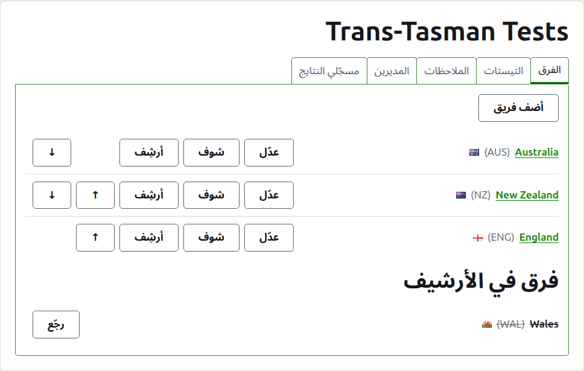
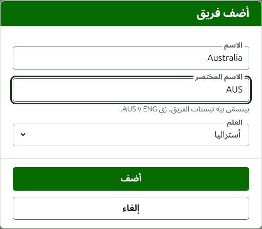
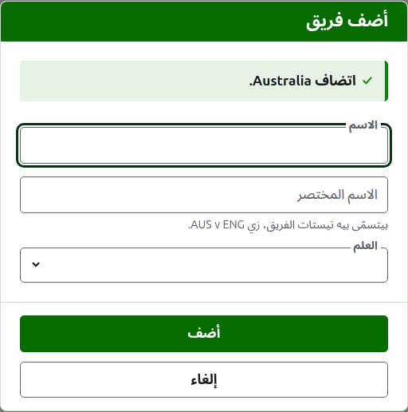
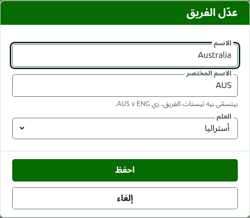

# الفرق

تبويب **الفرق** في صفحة البطولة هو المكان اللي فرقها بتتضاف فيه، وتتصلّح، وتترتّب، وتتنحّى. وهو التبويب اللي الصفحة بتفتح عليه، لأن الفرق أول حاجة بتتجهّز. اللقاء بين فريقين، فلازم فريقين على الأقل قبل ما أي لقاء يتضاف.

## إضافة فريق {#adding-a-team}

دوس على **ضيف فريق**، فوق القايمة. ديالوج بيفتح فوق الصفحة.

**الاسم** مطلوب: اسم الفريق الكامل، زي "Australia"، وهو اللي بيتصدّر صفحة الفريق وجداول الصفحات العامة. فريقين في نفس البطولة مينفعش يكون ليهم نفس الاسم.

**الاسم المختصر** مطلوب كمان: اللي لقاءات الفريق بتتسمّى بيه، زي "AUS v ENG"، واللي الشريط الأخضر الغامق بيسمّي الفريق بيه. أطول حاجة 10 حروف، ومش أطول من الاسم، لأن الاسم المختصر اللي أطول من الاسم اللي بيختصره معناه إن الاتنين اتكتبوا بالعكس. وفريقين مينفعش يكون ليهم نفس الاسم المختصر كمان.

**العلم** بيظهر جنب اسم الفريق في أي مكان بيظهر فيه. ممكن تسيبه من غير علم، زي فريق نادي أو منطقة.

دوس على **ضيف**. الفريق بيتضاف، والديالوج بيقول كده، وخاناته بتفضى للفريق اللي بعده. ضيف القايمة كلها بالطريقة دي، وبعدين دوس على **إلغاء** علشان تقفل الديالوج. إلغاء ما بيحفظش أي حاجة ما كانتش اتضافت أصلاً.

## تصحيح فريق {#correcting-a-team}

دوس على **عدّل** بتاع فريق علشان تفتح نفس الديالوج على الفريق ده، بعنوان عدّل الفريق. غيّر اللي غلط ودوس على **احفظ**. الفريق اللي اسمه المختصر بيتغيّر بيتسمّى بالجديد في كل مكان، فلقاءاته بتتسمّى معاه من جديد.

## الترتيب

الفرق بتتعرض بترتيب البطولة، وده الترتيب اللي بتتعرض بيه لما لقاء بيتضاف، والترتيب اللي الشريط الأخضر الغامق بيعرضها بيه، والترتيب اللي صفحة اللاعبين العامة بتعرضها بيه. **لفوق** و**لتحت**، السهمين في آخر كل صف، بيحرّكوا الفريق مكان واحد.

## الروحة لفريق

اسم الفريق، أو **اعرض**، بيفتح صفحة الفريق نفسه، اللي لاعبينه بيدخلوا فيها. شوف [لاعبين الفريق](team-players.md).

## أرشفة فريق

**أرشف** بينحّي الفريق. لاعبينه بيفضلوا معاه ويرجعوا لما يرجع، فالأرشفة ما بتسألش الأول. الفريق اللي في الأرشيف بيتعرض تحت **الفرق المؤرشفة**، وعليه خط، ومش بيعرض غير **استرجع**، وصفحته مقفولة لحد ما يرجع.

الفريق اللي بيلعب في لقاء شغّال مينفعش يتأرشف، لأن اللقاء ساعتها هيبقى ضد فريق مش موجود، فالفريق ده ما بيتعرضش عليه أرشف. والفريق اللي كل لقاءاته في الأرشيف ينفع.

بعدين: [لاعبين الفريق](team-players.md).
