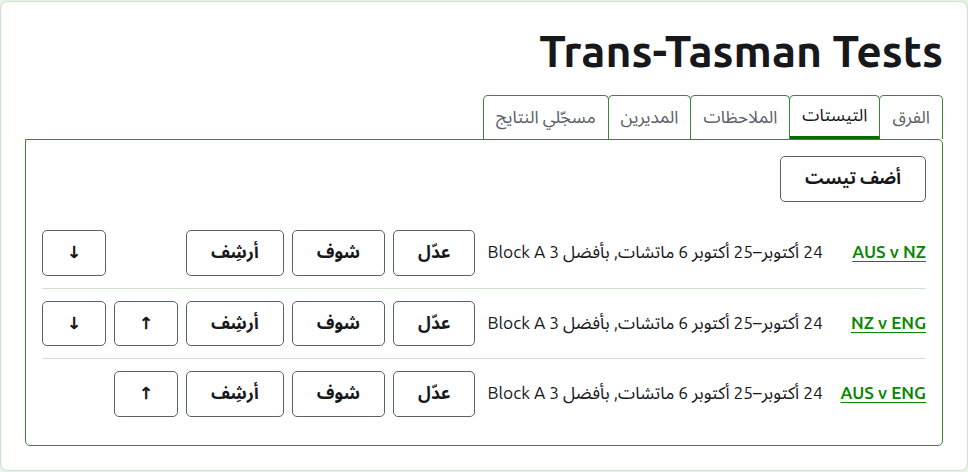
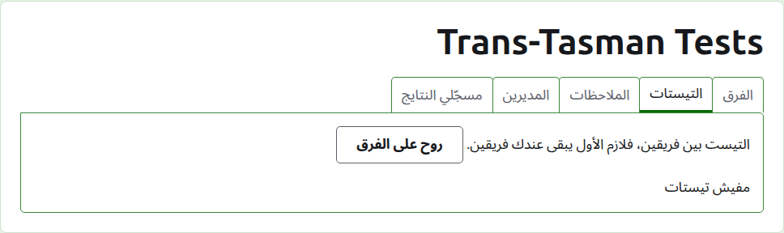
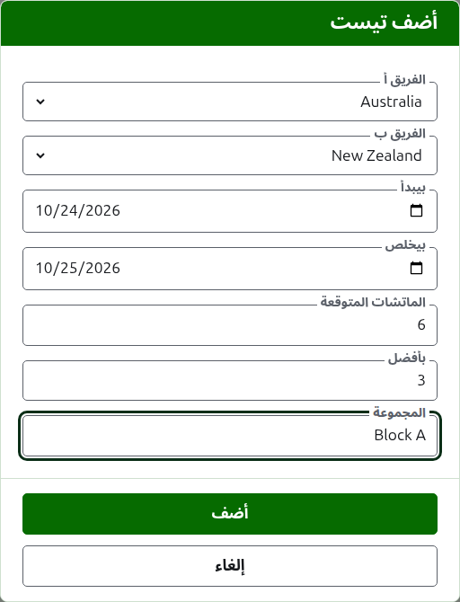
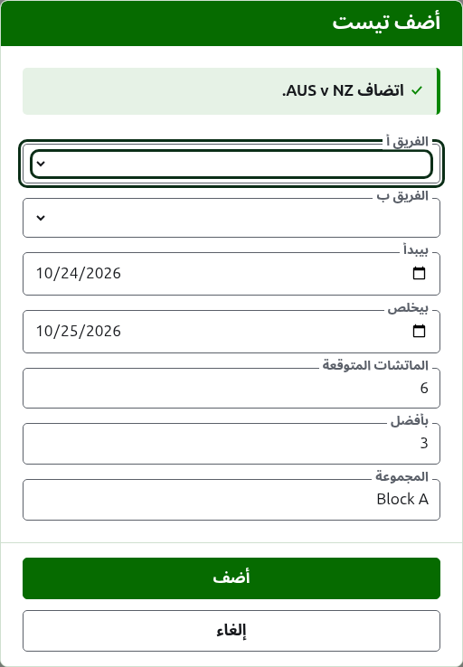
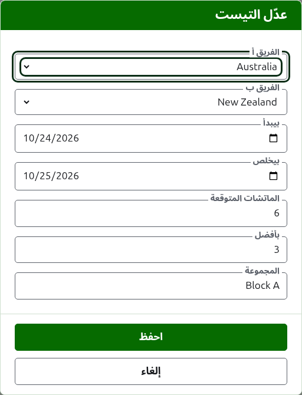

# اللقاءات

تبويب **اللقاءات** في صفحة البطولة هو المكان اللي اللقاءات بين فرقها بتتضاف فيه، وتتغيّر، وتترتّب، وتتنحّى. اللقاء واحد من منافسات البطولة: مواجهة بين فريقين، بتتسمّى بأسمائهم المختصرة، زي "AUS v NZ"، وبتتلعب على شكل عدد من المباريات بين لاعب من كل فريق. وكل لقاء له صفحة خاصة به، نتايجه بتتكتب فيها.

كل لقاء بيقول اسمه، والأيام اللي بيتلعب فيها، وكام مباراة متوقّعة فيه وكل مباراة بأفضل كام، زي "6 مباريات، بأفضل 3"، ومجموعته لو هو في مجموعة.

## فريقين الأول

اللقاء بين فريقين شغّالين، فطول ما البطولة فيها أقل من فريقين التبويب بيقول كده في المكان اللي ضيف لقاء كان هيبقى فيه، وبيوصّل لتبويب الفرق.

## إضافة لقاء

دوس على **ضيف لقاء**، فوق القايمة. ديالوج بيفتح فوق الصفحة، بيتقرا بالترتيب اللي اللقاء بيتقال بيه.

**الفريق أ** و**الفريق ب** كل واحد بيتختار من فرق البطولة الشغّالة، بالاسم، بترتيب البطولة. ولا واحد منهم مختار في الأول، علشان اللقاء عمره ما يتضاف بين فرق إنت ما اختارتهاش. الفريق ب بيعرض كل فريق غير اللي اختارته فريق أ، لأن الفريق ما بيلعبش لقاء ضد نفسه. الفريق أ هو الفريق الأول: لاعبينه على الشمال في صفحة اللقاء والصفحة العامة. اللقاء ملوش اسم تكتبه؛ بيتسمّى بالأسماء المختصرة لفرقه.

**بيبدأ** و**بيخلص** هما الأيام اللي اللقاء بيتلعب فيها، وبيبدأوا على أول يوم في البطولة. اللقاء بيتلعب جوه بطولته، فالأيام اللي قبل ما البطولة تبدأ أو بعد ما تخلص بتترفض.

**المباريات المتوقّعة** هي كام مباراة اللقاء هيبقى فيه، والحدث بيحدّدها قبل ما يبدأ، علشان اللي بيقرأ نتايجه يشوف وصل لفين. عدد صحيح من 1 وفوق. وهي كمان حد: أول ما يبدأ عدد مباريات بقدر اللي اللقاء متوقّع فيه، اللعبة اللي هتبدأ مباراة جديدة بتترفض، والمباريات اللي بدأت خلاص بتكمّل. واللقاء اللي هيبقى فيه أكتر بيتغيّر علشان يتوقّعهم.

**أحسن** هو كل مباراة بأفضل كام. وممكن يكون زوجي، لأن المباراة ممكن تتقسم.

**بتتلعب بالهانديكاب** و**التعادل مسموح** و**بتتحسب في التصنيف العالمي** بتتطلب زي أي منافسة. الأخيرة بتتطلب بس لو ممكن تتحسب: لقاء في كروكيه الأسوشييشن أو كروكيه الجولف مش بيتلعب بهانديكاب ولا بيسمح بالتعادل. بتبدأ معلّمة.

**المجموعة** هي المجموعة اللي اللقاء فيها، لو الحدث بيتلعب في مجموعات، زي "Block A". اختيارية: لو سبتها فاضية، اللقاء مش في أي مجموعة. ولقاءات المجموعة ليها صفحة خاصة بها على الموقع العام، بتعرض ترتيب فرق المجموعة. **كأس إيري** و**درع الولايات** ملهمش مجموعات، فالنافذة مبتسألش عن مجموعة فيهم.

دوس على **ضيف**. اللقاء بيتضاف، والديالوج بيقول أنهي واحد باسمه، والفرق بتفضى لللقاء اللي بعده، والأيام والمباريات المتوقّعة وبأفضل كام والمجموعة بيفضلوا زي ما هما: اللقاءات بتتضاف دور دور، بين فرق بتتقابل في نفس اليوم، فاللقاء اللي بعده في الدور محتاج فريقينه وبس. دوس على **إلغاء** لما يخلصوا كلهم.

## تغيير لقاء

**عدّل** بيفتح نفس الديالوج على اللقاء، بعنوان عدّل اللقاء، بادئ على حال اللقاء. دوس على **احفظ** علشان تحفظ التغيير.

اللقاء اللي فيه ألعاب شغّالة بيحتفظ بفرقه: الديالوج بيعرضها لكن مينفعش تتغيّر. الباقي ينفع يتغيّر، في حدود اللي اتلعب: مباريات متوقّعة أقل من المباريات اللي بدأت خلاص بتترفض، وكذلك بأفضل كام أقل من أكبر عدد ألعاب أي لاعبين اتنين لعبوها.

## الترتيب

اللقاءات بتتعرض بترتيب البطولة، وده الترتيب اللي بتظهر بيه على الصفحات العامة وفي الشريط الأخضر الغامق. **لفوق** و**لتحت** بيحرّكوا اللقاء مكان واحد.

## الروحة للقاء

اسم اللقاء، أو **اعرض**، بيفتح صفحته، اللي نتايجه بتتكتب فيها. الشريط الأخضر الغامق بيوصّل لها كمان، من صفحة البطولة أو من صفحة أي لقاء تاني.

## أرشفة لقاء

**أرشف** بينحّي اللقاء، و**استرجع** بيتراجع عنه، فولا واحد منهم بيسأل الأول. اللقاء اللي في الأرشيف بيتعرض تحت **اللقاءات المؤرشفة**، وعليه خط، ومش بيعرض غير رجّع، ومش موجود على الصفحات العامة.

اللقاء اللي فيه ألعاب شغّالة اتلعب، ومينفعش يتأرشف لحد ما ألعابه تتأرشف. واللقاء اللي كل ألعابه في الأرشيف ينفع، لأن اللعبة اللي في الأرشيف ما بتتحسبش في أي حاجة. واللقاء اللي فريقه اتأرشف بعد كده ما بيرجعش لحد ما الفريق يرجع، والتبويب بيقول كده.

بعدين: [النتايج](scores.md).
