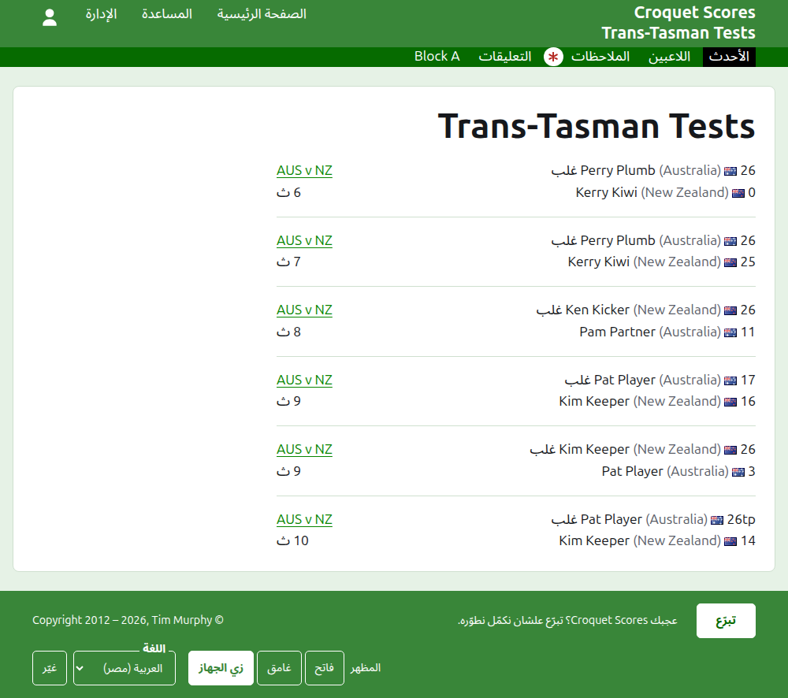
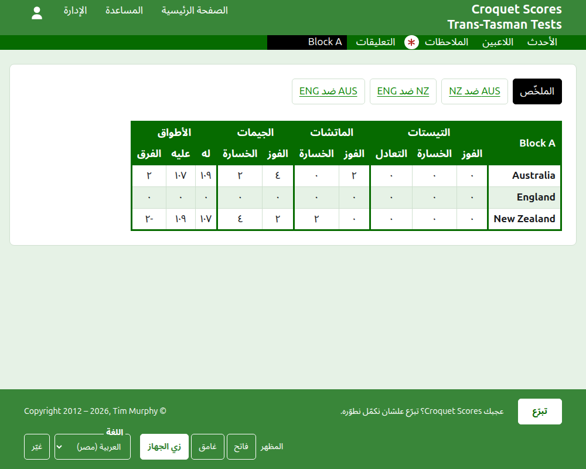
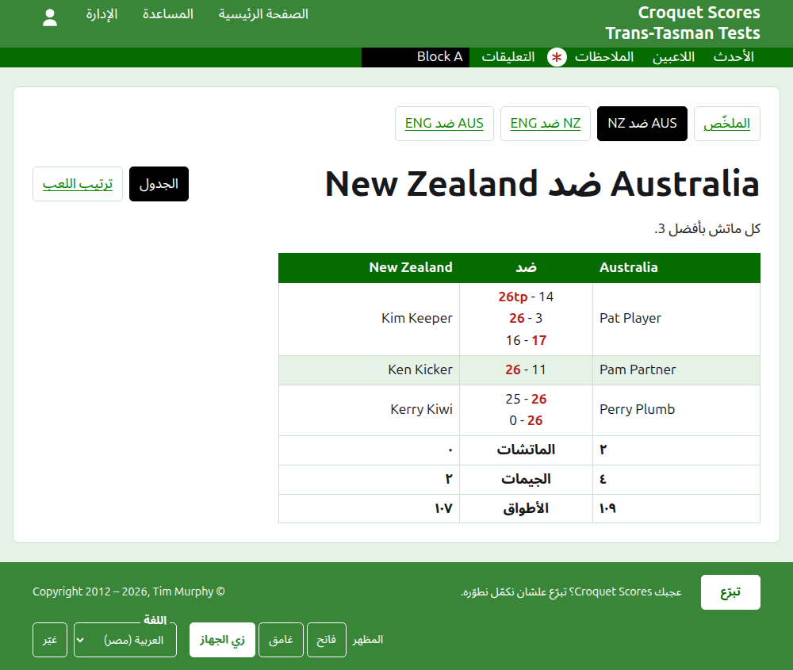
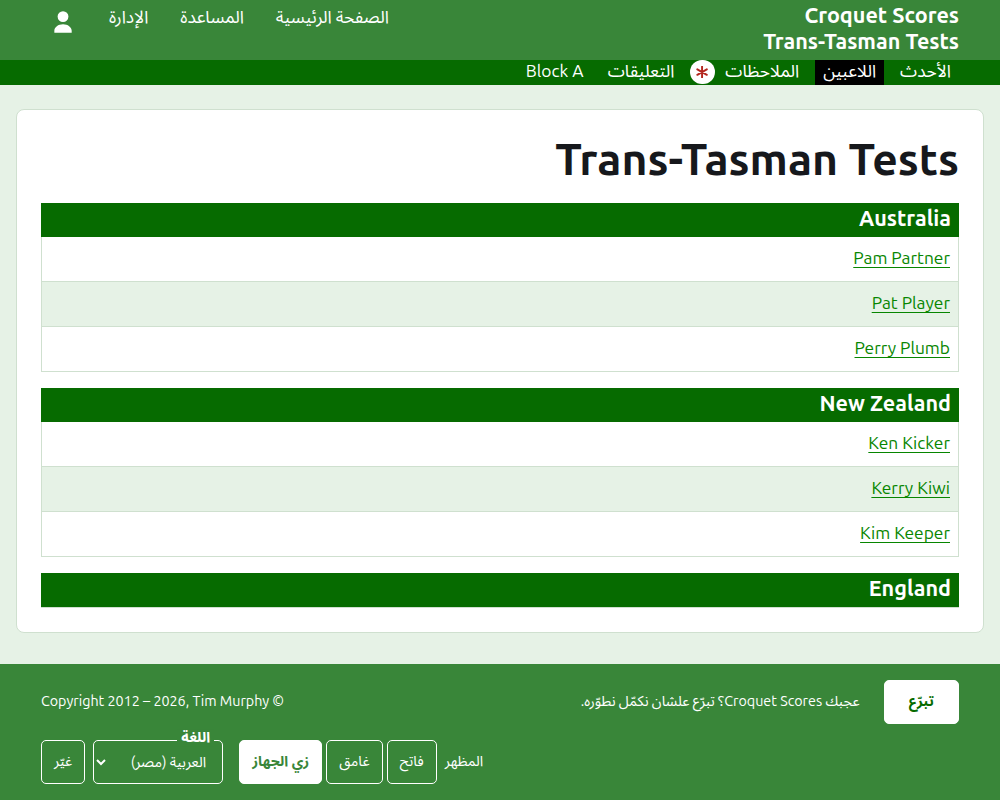

# اللي الجمهور بيشوفه

مفيش حاجة بتتنشر: الصفحات العامة بتترسم من اللي الإدارة فيها، فالنتيجة اللي بتتكتب بتظهر عليها في نفس اللحظة. ما بتحتاجش حساب ولا JavaScript، ومتصمّمة للموبايل.

## صفحة البطولة

صفحة البطولة على سنتها ورياضتها واسمها، زي `/2026/ac/trans-tasman-tests`. عنوانها اسم البطولة، وتحته عنوانها الفرعي. بتعرض كل جيم شغّال، الأحدث إضافة الأول، علشان القارئ اللي بيرجع يشوف اللي حصل من ساعتها. كل جيم بيقول الفايز، وفريقه، ونقاطه، وبعدين الخسران ونقاطه، ومعاهم التيست اللي اتلعب فيه ومن قد إيه اتضاف.

الشريط الأخضر الغامق بيعرض أقسام البطولة: **الأحدث**، وهي الصفحة دي، و**الملخّص** و**اللاعبين** و**الملاحظات** و**التعليقات**، وبعدين التيستات. التيست بيتقال بالأسماء المختصرة لفرقه وبينهم "ضد"، زي "AUS ضد NZ". والتيستات اللي في مجموعة ما بتتعرضش واحد واحد: المجموعة قسم واحد، باسم المجموعة، واقف في مكان أول تيست فيها. الملاحظات بتتعلّم بنجمة حمرا طول ما فيه ملاحظة القارئ ما قراهاش.

## الملخّص

البطولة اللي تيستاتها مش في أي مجموعة ليها **الملخّص**: جدول واحد بكل الفرق، مرتّبة، بالتيستات اللي كسبتها وخسرتها واتعادلت فيها، وجيماتها المكسوبة والمخسورة، وأطواقها ليها وعليها والفرق. ولو ماتشات أي تيست بأفضل أكتر من جيم، الماتشات المكسوبة والمخسورة بتيجي بعد التيستات. الملخّص هو المكان اللي القارئ بيدوّر فيه على كل فريق ككل.

البطولة اللي فيها تيست في مجموعة مالهاش ملخّص. صفحة كل مجموعة بتعرض ترتيب فرق المجموعة دي بدل كده، لأن جدول واحد لفرق من مجموعات مختلفة عمرها ما لعبت مع بعض مش هيرتّب حاجة.

## المجموعة

صفحة المجموعة بتعرض ترتيب فرق المجموعة، بحساب تيستات المجموعة لوحدها، في نفس الجدول اللي الملخّص بيستخدمه. وفوق الجدول، في صف لوحدهم، بتعرض **الملخّص**، وهو الصفحة دي، وكل تيست من تيستات المجموعة، بيوصّل لصفحة التيست.

## التيست

صفحة التيست عنوانها الأسماء الكاملة لفرقه، زي "Australia ضد New Zealand"، وبتقول كل ماتش بأفضل كام. جدولها عنوانه الفريقين، الأول على الشمال. كل ماتش اتلعب صف، بترتيب بدايته، لاعب الفريق الأول على الشمال، ولاعب الفريق التاني على اليمين، وجيمات الماتش بينهم، وكل جيم نقاط الطرف الأول وبعدين التاني، ونقاط الفايز معلّمة. وتحت الماتشات جيمات كل فريق وأطواقه، ولو كل ماتش بأفضل أكتر من جيم، ماتشاته المكسوبة، كل فريق في ناحيته.

التيست بيتعرض بطريقتين، معروضتين على سطر اسمه: **الجدول**، وهو الجدول ده، و**ترتيب اللعب**، اللي بيعرض كل جيم في التيست الأقدم الأول. والتيست اللي في مجموعة بيعرض ملخّص مجموعته وتيستاتها في صف فوق عنوانه، والتيست ده معلّم.

## اللاعبين

صفحة اللاعبين بتعرض اللاعبين فريق فريق: كل فريق تحت عنوان باسمه، بترتيب فرقه في البطولة، ولاعبينه تحته بالترتيب الأبجدي.

## الملاحظات

صفحة الملاحظات بتعرض ملاحظات البطولة، الأحدث كتابة الأول، وكل واحدة بتوصّل لصفحتها وبتقول من قد إيه اتكتبت. والملاحظة اللي القارئ ما قراهاش بتتعلّم بنجمة حمرا لحد ما يفتحها.

## العناوين اللي بتتنقل

البطولة بتحافظ على عنوانها لما اسمها يتصلّح. ولما تتنقل، لأن سنتها أو رياضتها اتغيّرت، عنوانها القديم بيوصّل للجديد، علشان اللينك اللي محفوظ من قبل كده يفضل شغّال. وصفحات البطولة اللي في الأرشيف مش بتتلاقى لحد ما ترجع.
