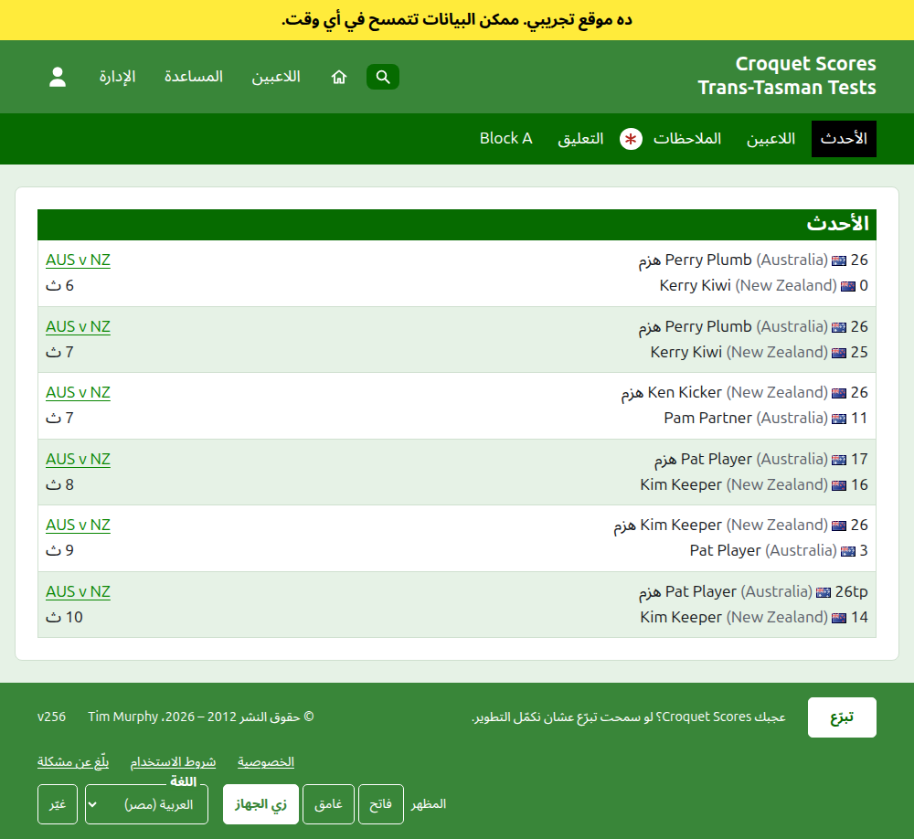
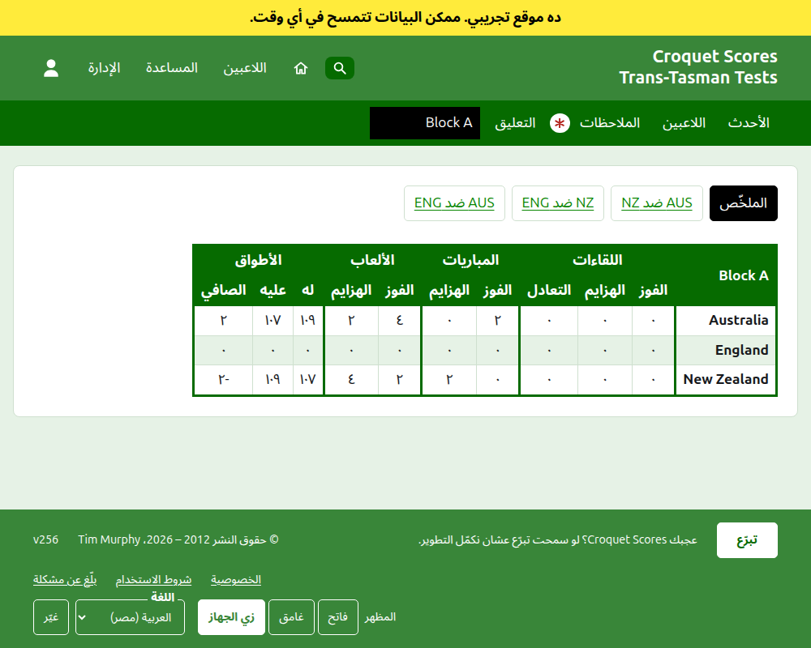
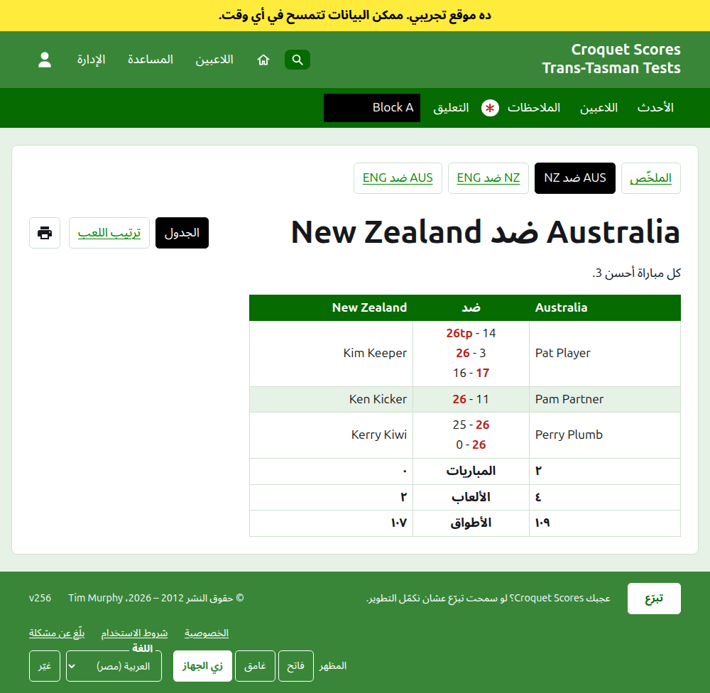
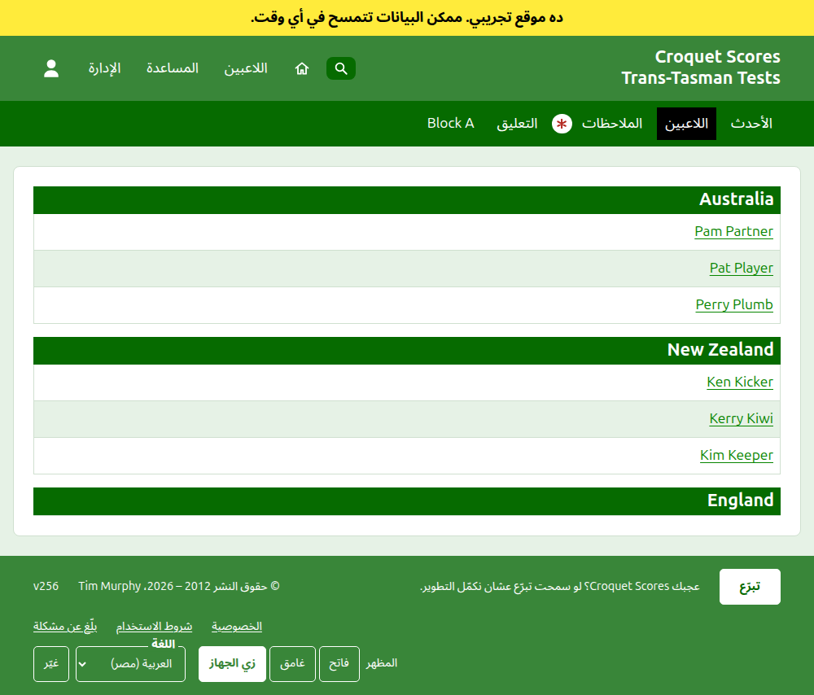

# اللي الجمهور بيشوفه

مفيش حاجة بتتنشر: الصفحات العامة بتترسم من اللي الإدارة فيها، فالنتيجة اللي بتتكتب بتظهر عليها في نفس اللحظة. ما بتحتاجش حساب ولا سكريبت، ومتصمّمة للموبايل.

## صفحة البطولة

صفحة البطولة على سنتها ورياضتها واسمها، زي `/2026/ac/trans-tasman-tests`. عنوانها اسم البطولة، وتحته عنوانها الفرعي. بتعرض كل لعبة شغّالة، الأحدث إضافة الأول، علشان القارئ اللي بيرجع يشوف اللي حصل من ساعتها. كل لعبة بتقول الفايز، وفريقه، ونقاطه، وبعدين الخسران ونقاطه، ومعاهم اللقاء اللي اتلعبت فيه ومن قد إيه اتضافت.

الشريط الأخضر الغامق بيعرض أقسام البطولة: **الأحدث**، وهي الصفحة دي، و**الملخّص** و**اللاعبين** و**الملاحظات** و**التعليق**، وبعدين اللقاءات. اللقاء بيتقال بالأسماء المختصرة لفرقه وبينهم "ضد"، زي "AUS ضد NZ". واللقاءات اللي في مجموعة ما بتتعرضش واحد واحد: المجموعة قسم واحد، باسم المجموعة، واقف في مكان أول لقاء فيها. الملاحظات بتتعلّم بنجمة حمرا طول ما فيه ملاحظة القارئ ما قراهاش.

## الملخّص

البطولة اللي لقاءاتها مش في أي مجموعة ليها **الملخّص**: جدول واحد بكل الفرق، مرتّبة، باللقاءات اللي كسبتها وخسرتها واتعادلت فيها، وألعابها المكسوبة والمخسورة، وأطواقها ليها وعليها والفرق. ولو مباريات أي لقاء بأفضل أكتر من لعبة، المباريات المكسوبة والمخسورة بتيجي بعد اللقاءات. الفرق بتترتّب باللقاءات اللي كسبتها، وبعدين الماتشات اللي كسبتها، وبعدين صافي ألعابها، وبعدين صافي أطواقها، وبعدين بترتيب البطولة. واللقاء اللي فرقه متعادلة في الماتشات بيتحسم بصافي الألعاب، وبعدين صافي الأطواق، أو بيتحسب تعادل لو البطولة معلّم فيها **اللقاءات المتعادلة بتتحسب تعادل**. الملخّص هو المكان اللي القارئ بيدوّر فيه على كل فريق ككل.

في **درع الولايات** الفرق بتترتّب باللقاءات اللي كسبتها، وبعدين صافي الماتشات بدل الماتشات المكسوبة، وبعدين صافي الألعاب، وبعدين صافي الأطواق. والفرق اللي لسه متعادلة بتترتّب باللقاءات اللي كسبتها ضد بعض. وملخّصه بيعرض عمود **الصافي** تحت الماتشات وتحت الألعاب كمان، زي ما تحت الأطواق، والدرع عمره ما بيتلعب في مجموعات.

البطولة اللي فيها لقاء في مجموعة مالهاش ملخّص. صفحة كل مجموعة بتعرض ترتيب فرق المجموعة دي بدل كده، لأن جدول واحد لفرق من مجموعات مختلفة عمرها ما لعبت مع بعض مش هيرتّب حاجة.

## المجموعة

صفحة المجموعة بتعرض ترتيب فرق المجموعة، بحساب لقاءات المجموعة لوحدها، في نفس الجدول اللي الملخّص بيستخدمه. وفوق الجدول، في صف لوحدهم، بتعرض **الملخّص**، وهو الصفحة دي، وكل لقاء من لقاءات المجموعة، بيوصّل لصفحة اللقاء.

## اللقاء

صفحة اللقاء عنوانها الأسماء الكاملة لفرقه، زي "Australia ضد New Zealand"، وبتقول كل مباراة بأفضل كام. جدولها عنوانه الفريقين، الأول على الشمال. كل مباراة اتلعبت صف، بترتيب بدايتها، لاعب الفريق الأول على الشمال، ولاعب الفريق التاني على اليمين، وألعاب المباراة بينهم، وكل لعبة نقاط الطرف الأول وبعدين التاني، ونقاط الفايز معلّمة. وتحت المباريات ألعاب كل فريق وأطواقه، ولو كل مباراة بأفضل أكتر من لعبة، مباريات كل فريق المكسوبة، كل فريق في ناحيته.

اللقاء بيتعرض بطريقتين، معروضتين على سطر اسمه: **الجدول**، وهو الجدول ده، و**ترتيب اللعب**، اللي بيعرض كل لعبة في اللقاء في جدول عناوينه **اللعبة** و**التاريخ**، الأقدم الأول في الأول. دوس على عنوان علشان تترتّب بيه، والموقع بيفتكر آخر ترتيب للقارئ. جنب العرضين زرار طابعة، بيظهر لما السكريبت شغّال، بيطبع الصفحة من غير الأشرطة. واللقاء اللي في مجموعة بيعرض ملخّص مجموعته ولقاءاتها في صف فوق عنوانه، واللقاء ده معلّم.

## اللاعبين

صفحة اللاعبين بتعرض اللاعبين فريق فريق: كل فريق تحت عنوان باسمه، بترتيب فرقه في البطولة، ولاعبينه تحته بالترتيب الأبجدي.

## الملاحظات

صفحة الملاحظات عنوانها **ملاحظات المديرين**، وبتقول "لسه مفيش ملاحظات." لو مفيش. وبتعرض ملاحظات البطولة، الأحدث كتابة الأول، وكل واحدة بتوصّل لصفحتها وبتقول من قد إيه اتكتبت. والملاحظة اللي القارئ ما قراهاش بتتعلّم بنجمة حمرا لحد ما يفتحها.

## العناوين اللي بتتنقل

البطولة بتحافظ على عنوانها لما اسمها يتصلّح. ولما تتنقل، لأن سنتها أو رياضتها اتغيّرت، عنوانها القديم بيوصّل للجديد، علشان الرابط اللي محفوظ من قبل كده يفضل شغّال. وصفحات البطولة اللي في الأرشيف مش بتتلاقى لحد ما ترجع.
