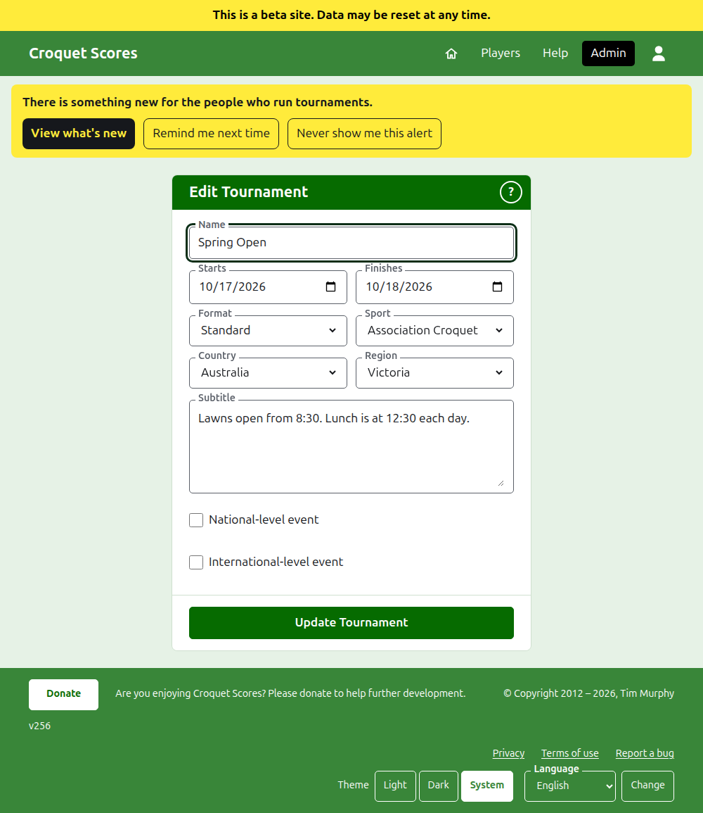
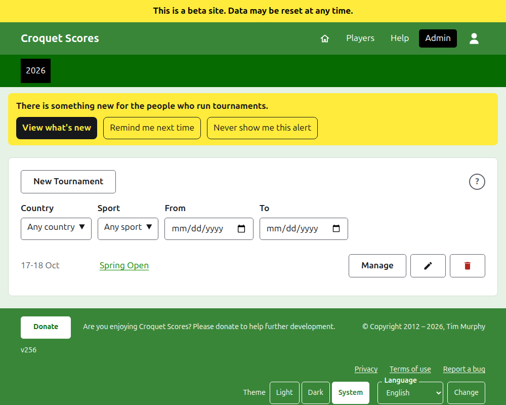
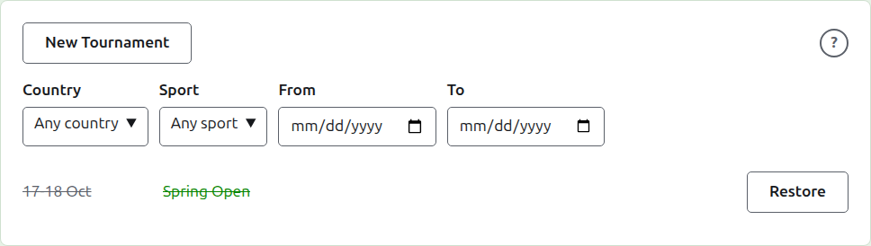

# Changing, archiving and restoring a tournament

## Changing the tournament's details

In the list of tournaments in the admin, press **Edit** on the tournament. The form is the one that created it, begun as the tournament is. Change what is wrong and press **Update Tournament**.

Once the tournament holds any player or competition, archived ones counting, its format cannot be changed to one played by teams, which has teams and tests instead.

A tournament keeps its address when its name is corrected, so that a link somebody has already sent still finds it. It moves only when the year it starts in or its sport changes, and then its old address leads to the new one. Saving takes you to the tournament wherever it is found now.

Only a manager can change a tournament. A scorer, or anybody else, is told so rather than shown the form.

## The list of tournaments

The admin lists one year at a time, starting with this year, newest tournament first. The years you have a tournament in are tabs in the dark green bar, newest first; where there are more than fit on a phone, the oldest are in a drop-down list at the end of the row. The year is in the address, so a year can be linked to.

Above the list, **Country**, **Region**, **Sport**, **From** and **To** narrow it as they are chosen, with no button to press. Only choices that would list something are offered, and a region is offered once a country is chosen. **From** and **To** are days: the list is of the tournaments that start from one to the other, both included, and both have to be chosen for it to be narrowed by days. What is chosen is in the address, so a narrowed list can be linked to; choosing another year clears it. A year with more than a hundred tournaments is listed a hundred to a page, with **Previous** and **Next** beneath. A national or international tournament is set in bold along its row.

## Archiving a tournament

**Archive** on a tournament in the list sets it aside. It is still listed, struck through and after the tournaments in use, but it offers only **Restore**: its page in the admin, and its public pages, are closed until it is restored. Archiving does not ask first, since restoring undoes it.

Next: [What the public sees](what-the-public-sees.md).
