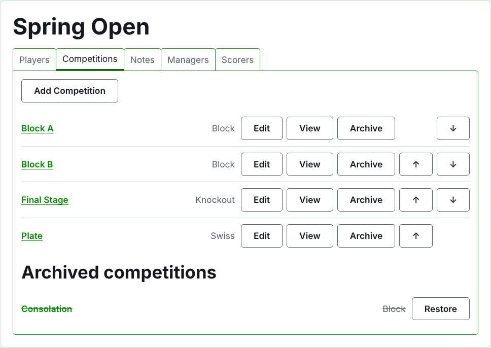
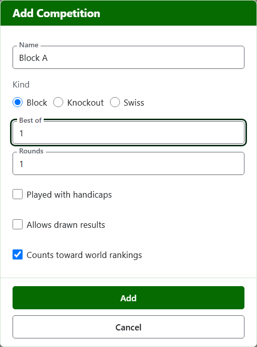
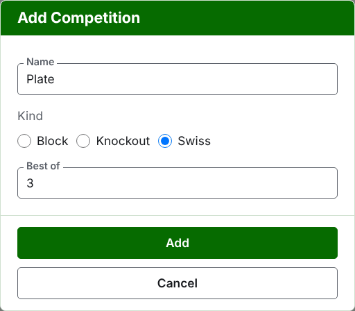
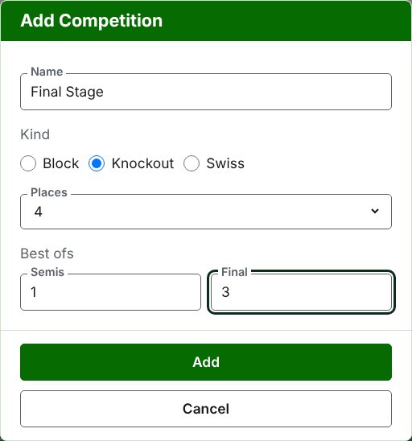

# Competitions

The **Competitions** tab of a tournament's page is where its competitions are added, put in order, and set aside. A competition is a block, a knockout or a Swiss. Each has a page of its own, where its players are entered and its scores go in.

## Adding a competition {#adding-a-competition}

Press **Add Competition**, above the list. A dialog opens over the page, asking for the competition's name, its kind, and the shape its kind has.

**Name** is what the players look for on the tournament's page to find their games. It is between 1 and 254 characters, and a letter alone will do, since a block is often called by one. Two competitions in one tournament cannot have the same name.

**Kind** is a block, a knockout or a Swiss. The dialog begins on a block, which most competitions are.

### A block

A block asks what each match is the **best of**, how many **rounds** it is played in, and how its players level on matches won are told apart by its **Tie Breaks**.

**Best of** begins on 1. The best of 3 is won by whoever wins two games. It may be an even number, since in a block a player is ranked by the games they win, and a match of two games shared one each is a result like any other.

**Rounds** is how many times each pair of players in the block meet, with a match in each round. It begins on 1, and 1 is almost always what a block wants: every player plays every other once. Raise it only for a block in which they meet again, such as a double round robin, where 2 has each pair play two matches.

**Tie Breaks** is how players who have won the same share of their matches are told apart. There are three ways, and blocks of one tournament can use different ones, since regulations differ. **Net games then net hoops then who beat who** is how blocks have always been ranked, and is where a new block begins: players level on matches won are told apart by their net games, those still level by their net hoops, and those still level by who beat who among them. Where each match is a single game, net games are left out. **Who beat who** looks only at the matches the players level played against one another. **Other** is for regulations the site does not know, and tells nobody apart. Players who cannot be told apart share a place, shown as =2, and the page says beneath the grid how players level are told apart.

### A Swiss

A Swiss asks only what each match is the **best of**, which begins on 1, just as a block does. The best of 3 is won by whoever wins two games. It may be an even number, since in a Swiss a player is ranked by the games they win, and a match of two games shared one each is a result like any other.

### A knockout

A knockout asks how many **places** its draw has, and what each round is the best of. The places are offered as 2, 4, 8, 16, 32, 64 and 128, since any other number could not halve round by round to a final, and the dialog begins on 8. Places left over once the players are entered are filled with byes, which are added where the players are.

A draw has as many rounds as it takes to halve its places to one, so a draw of 8 places has three rounds. The dialog asks what each is the best of, together under **Best ofs**, in the order they are played. The last three are named as a draw's rounds are spoken of, **Quarters**, **Semis** and **Final**, and any before them by their number, Round 1 first. Choosing more places adds rounds at the start of the draw, and choosing fewer takes them away from the start, so what was typed for the final is still the final's. Each round is the best of an odd number of games, since a knockout's match has to have a winner.

### A losers knockout {#losers-knockout}

A knockout can send those who lose a round on to a knockout of their own, a losers knockout. Beneath the **Best ofs** of a knockout, press **Add Losers Knockout**. A dialog asks for **Losers of**, the round whose losers play on, from every round but the final, and for **Losers knockout name**. Press **Add** to put it in the list beneath the button, where **Remove** takes it out again. It is added with the knockout when that is added, and if either is refused, neither is added.

A losers knockout has a place for each match of that round, and every round of it is the best of 1, which **Edit** can change. Its players are put in as the matches of that round are decided, in the order they were drawn in, so its **Players** tab only shows them. If a game is corrected or set aside, the loser is moved or taken out again, unless they have played on.

On a knockout that is already added, **Edit** shows the same button, and the losers knockout is added at once. A knockout whose losers another in use takes cannot be archived or have its places changed: archive the losers knockout first.

### How it is played and counted

Every kind asks the same three things beneath its shape.

**Played with handicaps.** Tick this for a competition played with handicaps.

**Allows drawn results.** Tick this where a game can end with neither player the winner. Most competitions do not allow it. Where it is ticked, a score entered with equal points and no mark is kept as a draw; where it is not, a game on equal points has to say who won it by a mark after the winner's score, such as "6w". A knockout's match always has a winner, so a drawn game does not decide one.

**Counts toward world rankings.** Asked only where it can be counted: a competition in Association Croquet or Golf Croquet that is neither played with handicaps nor allows drawn results. It is ticked to begin with, so untick it for a competition that is not to count.

### Adding several at once

Press **Add**. The competition is added, the dialog says so, and the name is emptied for the next, with the kind and its shape left as they were: competitions added together are mostly alike, so "Block B" after "Block A" is its name alone. Press **Cancel** to close the dialog once they are all in.

## Changing a competition {#changing-a-competition}

**Edit** opens the same dialog on the competition, titled Edit Competition, with its name, its shape and how it is played and counted as they are. Its kind is not asked, since a block is not made a knockout by changing it: a competition of the wrong kind is archived and added again. Press **Save** to keep the change and close the dialog.

A knockout that has a game has players placed in its draw, and a change to its places would move them, so it is refused once a game has been entered. Its rounds' best-ofs can still be changed.

## Order

The competitions are listed in the tournament's order, which is the order they appear in on the public pages and in the dark green bar. **Up** and **Down** move a competition one place.

## Going to a competition

A competition's name, or **View**, opens its page, where its players are entered and its scores go in. The dark green bar beneath the header leads there too, from any page of the tournament.

## Archiving a competition

**Archive** sets a competition aside, whether or not it has games, which are kept with it and come back when it is restored. An archived competition is listed under **Archived competitions**, struck through, offers only **Restore**, and is not on the public pages. Archiving does not ask first, since restoring undoes it.

Next: [Entering players in a competition](entering-players-in-a-competition.md).
