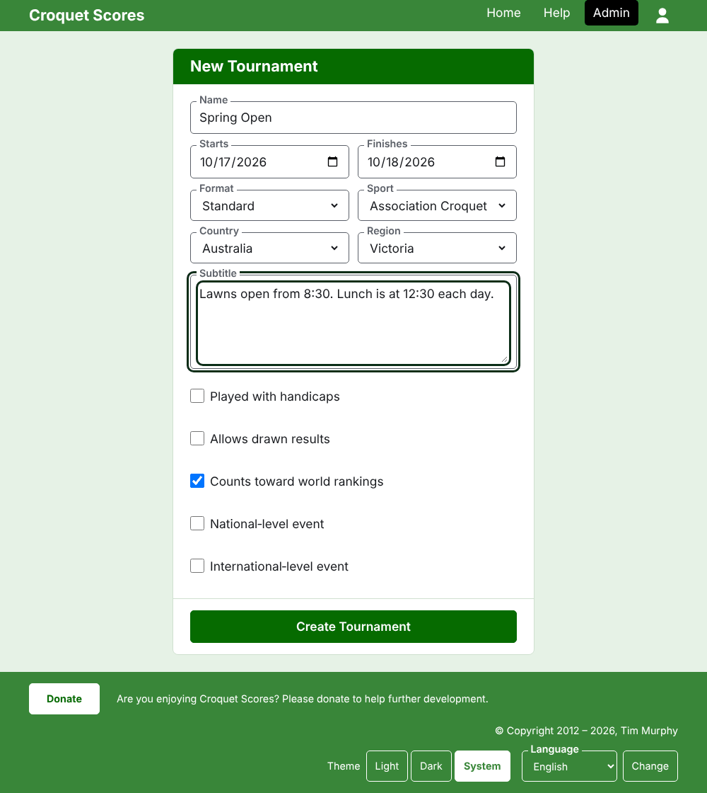

# Creating a tournament

Press **New Tournament** above the list of tournaments in the admin. It is above the list rather than beneath it, so that a long list does not push it off a phone's screen.

The form asks for everything a tournament begins with. A tournament of the ordinary kind is a name, two days and a country away: everything else is decided for you and can be changed.

## What the form asks

**Name.** What readers look for to find the tournament, such as "Spring Open". It is between 3 and 254 characters. A name all in lower case, or all in capitals, is refused, since it would look like a mistake on every page it is shown on. Two tournaments may have the same name, since the same tournament is played every year.

**Starts** and **Finishes.** The days the tournament runs. A tournament cannot finish before it starts, and cannot start or finish later than the end of next year. A tournament belongs to the year it starts in, which is also the year in its address, so one that runs over the new year is listed in the year it starts.

**Format.** Choose **Standard** for a tournament played between players. The other formats are for tournaments played between teams, which have a guide of their own.

**Sport.** The sports the website offers, in its order: Association Croquet, Golf Croquet, American 6 Wicket and Ricochet on Croquet Scores. Gateball Scores asks for neither a sport nor a format, since every tournament there is a standard tournament of gateball.

**Country** and **Region.** Where the tournament is played. A region is asked for only where the country you choose is divided into regions, such as Australia's states; a country that is its own one region asks for none. A region need not be chosen even where one is offered.

**Subtitle.** Whatever you want readers to know that has no field of its own: where to park, when lunch is, who to ring. It is shown beneath the tournament's name on every public page. It is written in Markdown, so a word can be made bold with asterisks around it and a list made with a dash at the start of each line. It can be up to 2000 characters, and can be left empty.

How its competitions are played and counted, whether with handicaps, with drawn results, and towards the world rankings, is each competition's to say when it is added.

**National‑level event** and **International‑level event.** A tournament can be one, the other, or neither, but never both: ticking one unticks the other.

## Creating it

Press **Create Tournament**. You are taken to the tournament's page in the admin, where it is run from, and you are its first manager. It is listed in the admin under the year it starts in.

The tournament's public address is made from its year, its sport and its name, as `/2026/ac/spring-open`. It keeps that address when its name is corrected later, so that a link already sent still finds it; it moves only when the year it starts in, or its sport, changes.

## If something is refused

What is refused is said beneath the field it is about, and what you typed stays typed. Nothing is kept until every field is accepted. The things most often refused are a name typed all in lower case, a finish before the start, and a country not chosen.

Next: [Players](players.md).
