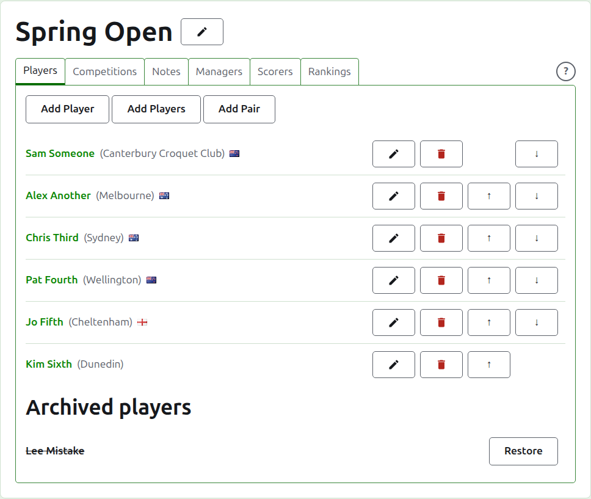
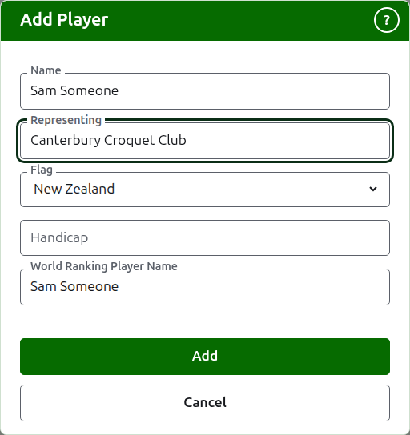
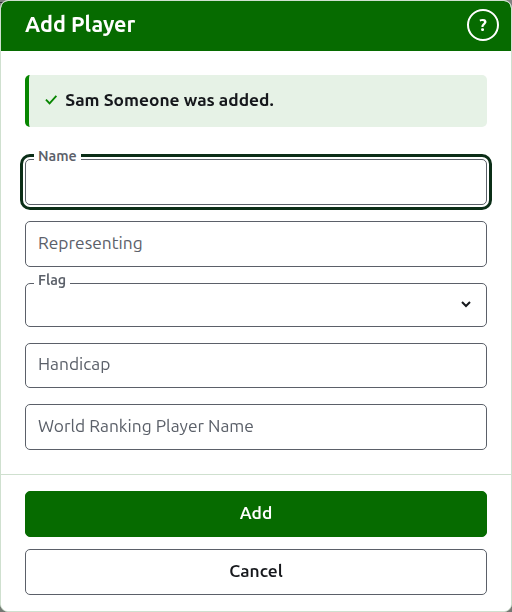
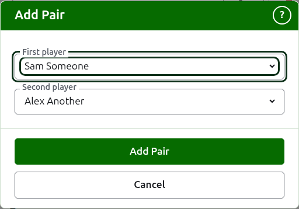
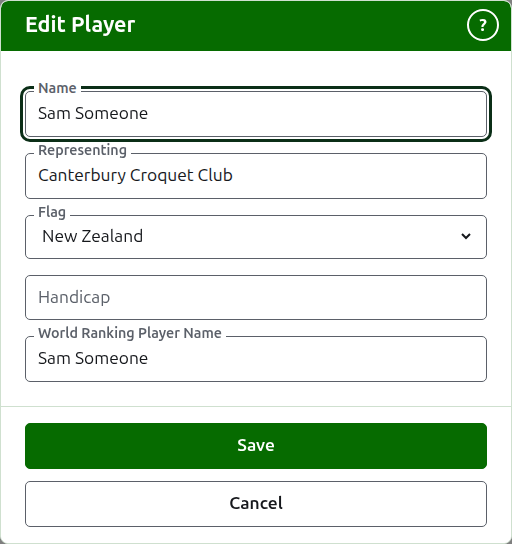
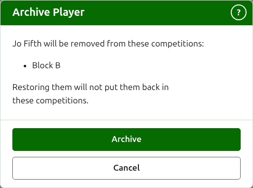

# Players

The **Players** tab of a tournament's page is where its players are entered, corrected, put in order, and set aside. It is the tab the page opens on, since entering the players is the first thing done to a tournament.

Players are entered here once, into the tournament. Which competitions each plays in is chosen afterwards, on each competition's own page, from the players entered here. See [Entering players in a competition](entering-players-in-a-competition.md).



## Add a player {#add-a-player}

Press **Add Player**, above the list. A dialog opens over the page.



**Name** is required. It is the player's name as it will be shown on every page, between 3 and 254 characters. Two players in one tournament cannot have the same name, however it is capitalised; where two players really share a name, tell them apart in the name itself, as "Andrew Hobbs (2)".

**Representing** is what the player plays for, written as a reader would say it: a club, a region or a country, such as "Canterbury Croquet Club". It is shown in brackets after the name. It can be left empty. As you type, what players of any tournament on the site have been added representing is offered where a word of it begins with what you typed, so that a club is written as it has been written before; the tab key takes the one shown after the cursor.

**Flag** is the flag shown beside the player's name. It is a drop-down list of the places by name, none first, then the places most tournaments are played in; type the start of a name to move to it. It can be left as none, which most players are. What a player represents and which flag they fly are kept apart, since a player can play for a club in one country and fly the flag of another.

**Handicap** is the player's handicap, if they have one: a sign, up to two digits and a fraction of one digit, such as 4, +4 or -1.5. It is kept as you write it, and is shown in brackets with what the player represents, before it. It can be left empty.

**World Ranking Player Name** is the name the world rankings know the player by. It is asked for only in a tournament of Association Croquet or Golf Croquet, the two sports whose players the world rankings keep a list of. American 6 Wicket's players are known to the rankings by their own names, so it is not asked for there, and each player's world ranking name is always their name. While you add a player it follows the name as you type it, since most players are known to the rankings by their own name, and stops following once you type in it. Left empty, it is kept as the player's name.

As you type a name, the players the world rankings know whose names begin that way are offered, so that you can take a name as the rankings spell it rather than typing it out. Beside the world ranking name, a tick says the rankings know the name, and a question mark says they do not: the name may be misspelled, or the player may be new to the rankings. It is only advice. A name the rankings do not know is kept as readily as one they do.

Press **Add**. The player is added, the dialog says so, and its fields are emptied for the next player, with the cursor back in the name. Add the whole list this way, then press **Cancel** to close the dialog. Cancel keeps nothing that was not already added.



A player is never called "Bye". A knockout's byes are added in the knockout itself, wherever its players are entered, so a name that is "Bye", or "Bye" with a number, as "Bye 2", "Bye-2" or "Bye (2)", is refused, and the dialog explains why.

## Adding multiple players {#adding-multiple-players}

To add a whole list at once, press **Add Players**, beside **Add Player**. A dialog opens over the page with one box, which takes several lines of text. You can copy the list from a spreadsheet and paste it into the box.

**The first line names the fields** (a list whose first line names none is refused, with "First row must be field names"), separated by commas or by tabs: **Name**, and any of **Representing**, **Flag**, **Handicap** and **WorldRankingPlayerName**, in any order. These names are typed in English, whatever language the site is in. **Name** must be one of them. **Each line after it is a player**, with a value for each field in the same order, separated in the same way. A player with nothing for a field leaves it empty, but keeps the comma or tab. For example, with commas:

```
Name,Representing,Flag
Sam Someone,Canterbury Croquet Club,New Zealand
Alex Another,,England
```

- **Name, Representing and World Ranking Player Name** are held to the same rules as when you add one player (see [Add a player](players.md#add-a-player)). A name is between 3 and 254 characters, is not already in the tournament, however it is capitalised, and is not "Bye".
- **Flag** is the name of the country or place, in your language, as the list in the Add Player dialog offers it, such as New Zealand.
- **Handicap** is a sign, up to two digits and a fraction of one digit, such as 4, +4 or -1.5.
- A player given no **WorldRankingPlayerName** is known by their name, as they are when added one at a time.
- **Commas or tabs.** Cells copied from a spreadsheet are separated by tabs, and a list typed by hand is usually separated by commas. Either works. If the first line has a tab in it, the whole list is read with tabs, and otherwise with commas.
- A value with the separator in it is written in double quotes, as a spreadsheet writes one: "Smith, John" in a list separated by commas. A quote inside a value is written twice.
- Every value has spaces at its ends removed, and a line with nothing on it is ignored.
- A list holds at most 500 players. Add the rest in another list.

Press **Add**. The whole list is checked before any of it is kept, so a list with anything wrong in it adds nobody. What is wrong is said beneath the box, on the line it is on, counting the first line as line 1. Every fault is listed, not only the first, and what you typed stays so that you can put it right. Once the list is kept, the dialog closes and the Players tab lists the new players, in the order you wrote them. Unlike **Add Player**, which stays open for the next player, there is no next: the list was the next.

The **?** in the title bar of the dialog leads here. Both this dialog and Add Player stay in the window wherever the page has been scrolled to.

## Adding a pair {#adding-a-pair}

In a doubles tournament, a pair is a player of its own. There are two ways to add one.

- **With Add Player.** Add the pair as if it were one player, and type its name with an ampersand between the two, as "Joe Blow & Jane Doe". In a tournament that is for doubles only, this is the quicker way, since nobody is entered twice.
- **With Add Pair.** Make the pair from two players already entered, as described below. If most of your singles players are playing doubles too, this is the quicker way, since the players are already there to choose from.

It is better to hold singles and doubles in tournaments of their own, one for each.

Press **Add Pair**, beside **Add Player**. It is offered where there are two players to choose from. A dialog opens with a **First player** and a **Second player**, each chosen from the players in use. The second list leaves out the player chosen first, since a player cannot be paired with themselves. Press **Add Pair** to make the pair. The dialog stays open, says which pair was added, and empties both choices so that the next pair can be made, as **Add Player** does. The pair appears in the list behind the dialog straight away. Press **Cancel** when you have made all you need.



The pair is named from the two players, in the order you chose them: "Sam Someone & Alex Another". Where both have the same last name, it is named by the two first names and the one last name, as "Peter & Rosie Landrebe". The last name is the last word of a name, with the small words before it (as in "van der Berg") and a generation after it (as in "Smith Jr"). A generation on its own is not a last name.

The pair represents what its players represent. Where only one of them represents anything, the pair represents that. Where both represent the same thing, the pair represents it once. Where they represent different things, the pair represents both, the first then the second, as "Canterbury Croquet Club / Melbourne".

The two players are left as they are, and can still be entered in competitions of their own. Nothing links the pair to them afterwards: if you correct or archive one of them, the pair keeps the name and the representing it was made with, and is corrected on its own. The pair is listed with the other players, entered in competitions like any of them, and corrected or archived like any of them. A pair whose name the tournament already has is refused: the same two players in the same order cannot be made into a pair twice. The same two the other way round is a different name, and a different pair.

## Correcting a player {#correcting-a-player}

Press a player's name, or their **Edit**, to open the same dialog on that player, titled Edit Player. Change what is wrong and press **Save**, which keeps the change and closes the dialog. A player whose name is corrected keeps the world ranking name they had, since the rankings still know them by it. In American 6 Wicket a player's world ranking name is always their name, so correcting the name corrects it too.



A player corrected here is corrected everywhere: in every competition they are in, and on every public page.

## Putting players in order

The players are listed in the tournament's order, which is the order they are offered in when they are entered into competitions, and the order a knockout is drawn in. **Up** and **Down**, the arrows at the end of each row, move a player one place. The first player is not offered Up and the last is not offered Down.

## Archiving a player {#archiving-a-player}

**Archive** sets a player aside: entered by mistake, or withdrawn from the whole tournament. An archived player is listed under **Archived players**, struck through, after the players in use, and offers only **Restore**. An archived player is in no competition and appears on no public page.

A player who has played any game cannot be archived, since the games would then be against somebody who is no longer there, so such a player is not offered Archive. A player whose only games are archived can be.

Archiving a player who is in no competition does not ask first, since restoring them puts everything back. Archiving a player who is in any competition asks first, because archiving removes them from every competition they are in, and restoring them does not put them back.



Next: [Competitions](competitions.md).
