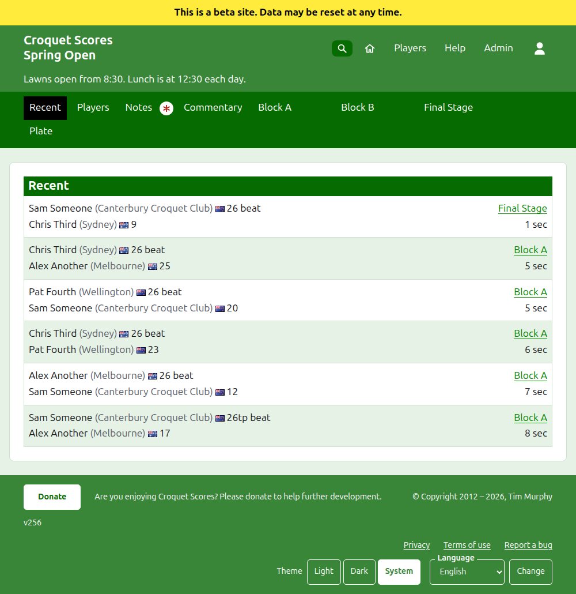
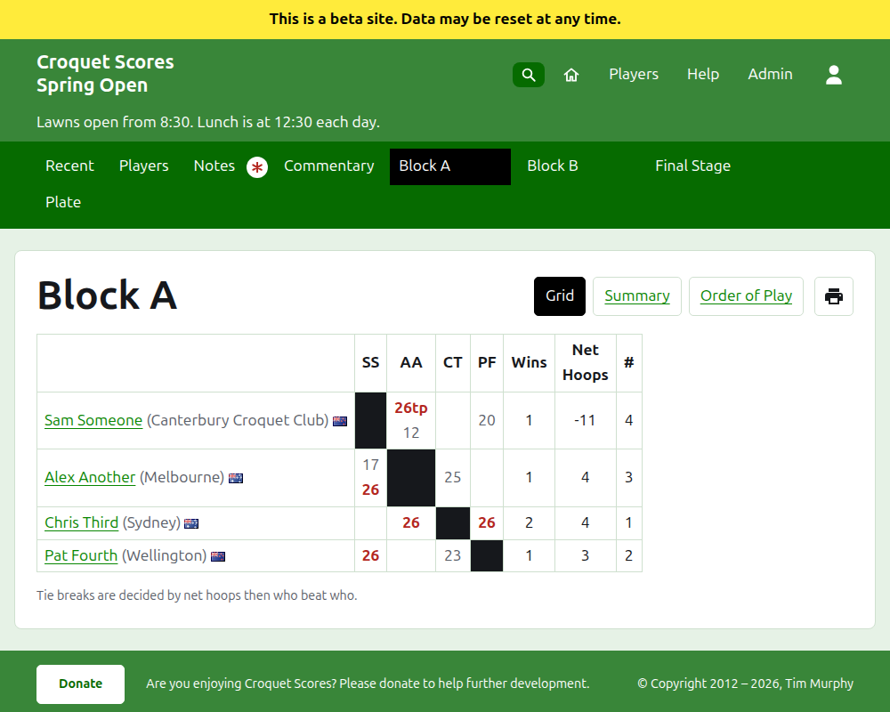
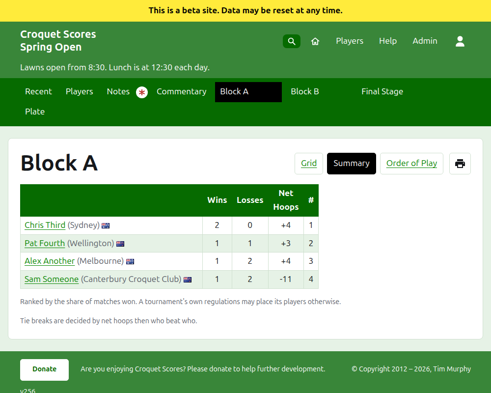
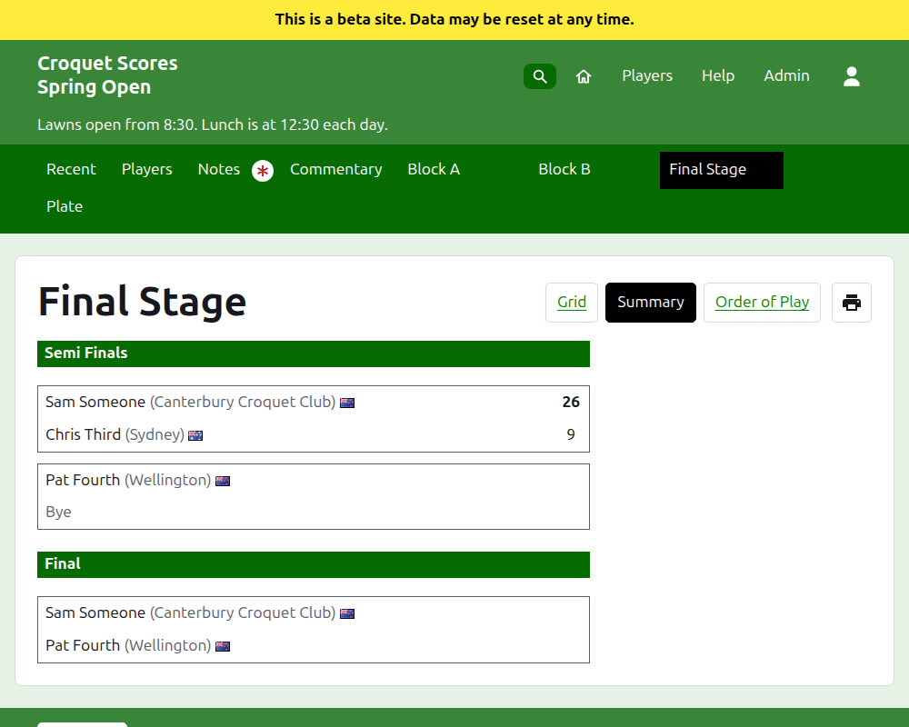
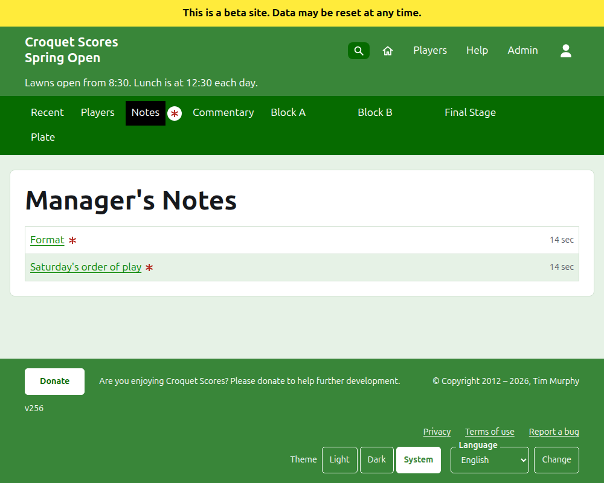

# What the public sees

Nothing is published: the public pages are drawn from what the admin holds, so a score entered is on them at once. They need no account and no scripting, and are laid out for a phone.

## The tournament's page

The tournament's page is at its year, its sport and its name, as `/2026/ac/spring-open`. It is headed by the tournament's name, with its subtitle beneath. It lists every game in use, the most recently added first, so that a reader who comes back sees what has happened since. Each game says the winner, their handicap and what they represent, their flag and their score, then the loser and theirs, with the competition it was played in and how long ago it was added.

The dark green bar offers the tournament's sections: **Recent**, which is this page, **Players**, **Notes** and **Commentary**, then each competition in use, in the order the Competitions tab has them. Notes is marked with a red asterisk while there is a note the reader has not read.

## A block

A block's page shows its results as a grid: a row and a column for each player in the block's order, with the games between two players where the row meets the column, each marked as won, lost or drawn for the row player. After the players' columns come each player's totals. Where each match is a single game, those are wins and net hoops; where a match is the best of more than one, they are matches, net games, games and net hoops. The last column, headed **#**, is each player's place: 1 for the first, and =2 where players cannot be told apart and share second. Where any players have won the same share of their matches, a line beneath the grid says how they are told apart, as the block's tie break has it (see Competitions).

A block, a knockout and a Swiss are each shown three ways, offered on the line of the competition's name: **Grid**, **Summary** and **Order of Play**. Beside them is a printer button, which prints the tournament's name, the competition's name and its results, and nothing else. The summary is the one for a phone: for a block, the players ranked, with their wins, losses, net hoops and place; for a knockout, the matches listed round by round; for a Swiss, the grid's table without its results. The order of play lists every game, oldest first to begin with. It is headed **Game** and **Date**: pressing **Game** sorts the games by the winner's name and then the loser's, and pressing **Date** sorts them oldest or newest first, and pressing the heading a list is sorted by turns it round. The way a reader sorted is remembered on their device. A reader who chooses a view keeps it for every competition until they choose another.

A competition played to other than the usual number of hoops for its sport says so beneath its name, as "Played to 14 hoops" (see [Competitions](competitions.md#adding-a-competition)).

A withdrawn player's row says so. A withdrawn score is shown struck through and counts for nothing. An archived score is not shown.

## A knockout

A knockout's page draws its draw round by round, a column for each round from the first to the final, with each match's two sides one above the other and a cell for each game the match is the best of. A later round's match stands beside the two matches whose winners it is between. On a phone the draw scrolls across, with arrows to the final and back.

## A Swiss

A Swiss's page ranks its players in a table: their games, their wins, their win percentage, and their results, each said as the opponent and the margin, as "+4" for a game won by four.

## Players

The Players page lists every player of the tournament who is not archived, in alphabetical order, with their handicap and what they represent in brackets, and their flag.

## Notes

The Notes page, headed Manager's Notes, lists the tournament's notes, the most recently written first, each leading to its own page and saying how long ago it was written. A note the reader has not read is marked with a red asterisk until they open it. A tournament with no notes says "No notes yet."

## Where the tournament is listed

A tournament is on the home page while it is being played or about to start. Its year's page, as `/2026`, lists the year's months, each of which, once pressed, lists the tournaments that start in it. A control beneath the heading, **Show all** and then **Hide all**, opens or closes every month. A tournament ticked as national or international is set in bold along its row.

## Addresses that move

A tournament keeps its address when its name is corrected. Where it moves, because its year or its sport changed, its old address leads to the new one, so that a link kept from before still works. An archived tournament's pages are not found until it is restored.
