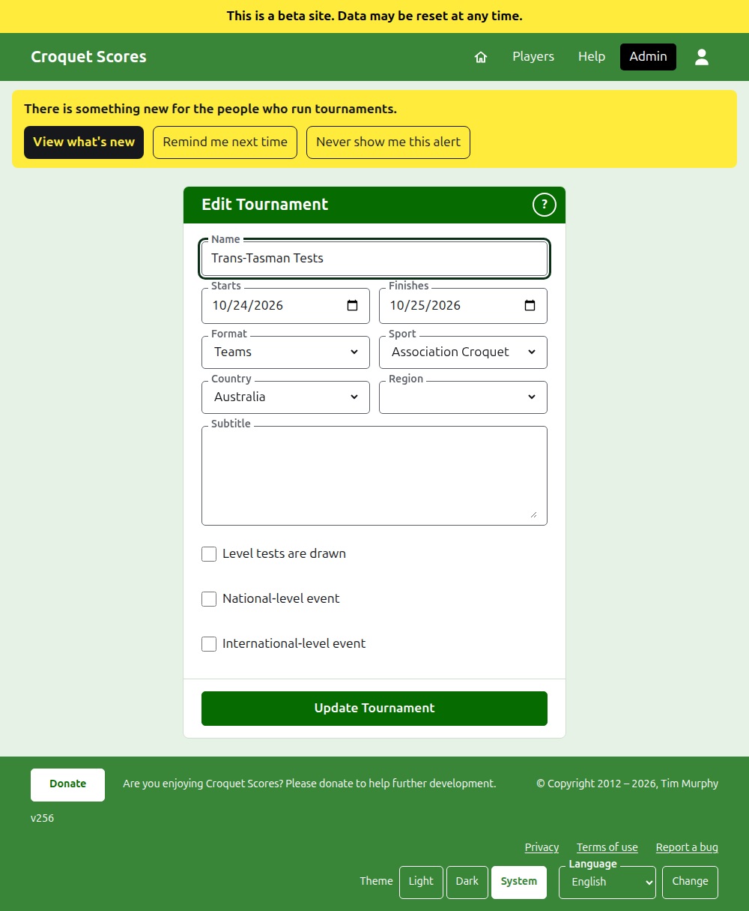
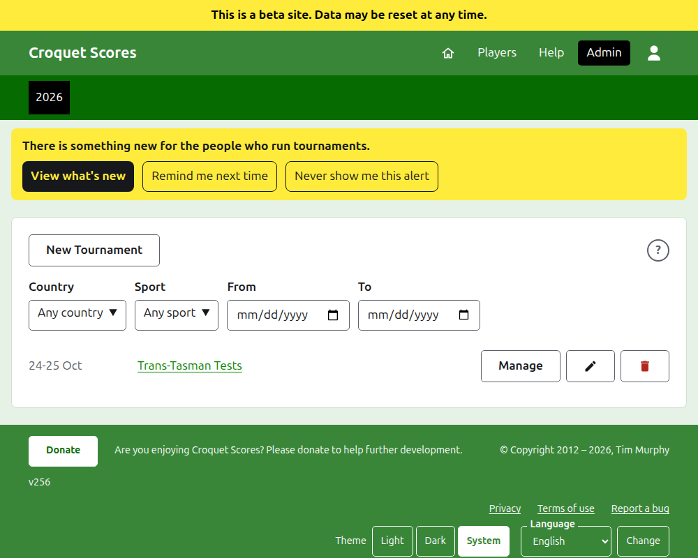

# Changing, archiving and restoring a tournament

## Changing the tournament's details

In the list of tournaments in the admin, press **Edit** on the tournament. The form is the one that created it, begun as the tournament is. Change what is wrong and press **Update Tournament**.

The tournament's days can be widened here where a test needs a day outside them, since a test is played within its tournament. Once the tournament holds any team or test, archived ones counting, its **Format** cannot be changed at all: not to the Standard format, which has players and competitions instead, and not to another format played by teams, since a test may be in a group that the other format has none of. Choose the format when the tournament is created.

A tournament keeps its address when its name is corrected, so that a link somebody has already sent still finds it. It moves only when the year it starts in or its sport changes, and then its old address leads to the new one. Saving takes you to the tournament wherever it is found now.

Only a manager can change a tournament. A scorer, or anybody else, is told so rather than shown the form.

## The list of tournaments

The admin lists one year at a time, starting with this year, newest tournament first. The years you have a tournament in are tabs in the dark green bar, newest first; where there are more than fit on a phone, the oldest are in a drop-down list at the end of the row. The year is in the address, so a year can be linked to. Beneath the buttons the list can be narrowed by **Country**, **Region** and **Sport**, and by the days it holds tournaments in, **From** and **To**. A round **?** beside **New Tournament** leads to the help.

## Archiving a tournament

**Archive** on a tournament in the list sets it aside. It is still listed, struck through and after the tournaments in use, but it offers only **Restore**: its page in the admin, and its public pages, are closed until it is restored. Archiving does not ask first, since restoring undoes it.

Next: [What the public sees](what-the-public-sees.md).
