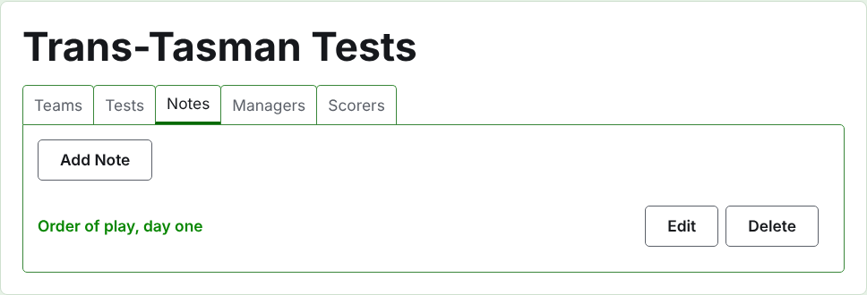
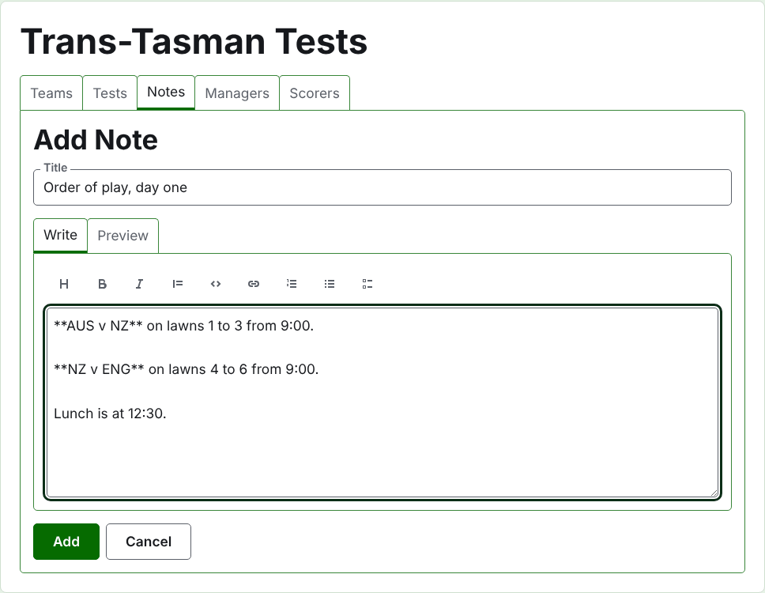
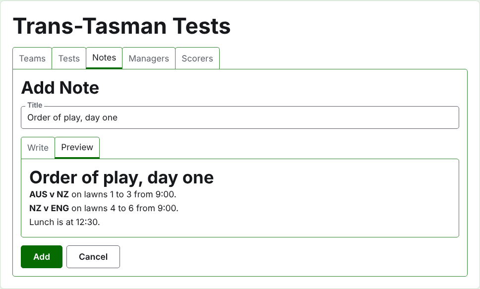
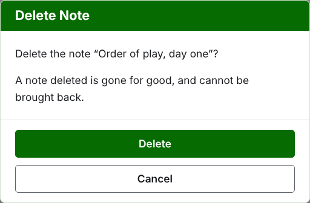

# Notes

The **Notes** tab of a tournament's page is where its managers write what the players need to know as the tournament goes on: the order of play, a change to the lawns, the time of lunch. Readers find them on the tournament's public Notes page, and a note they have not read is marked there with a red asterisk, which also marks the Notes section on every page of the tournament until they open it.

## Writing a note

Press **Add Note**, above the list. A panel takes the place of the list, since a note is written at length and needs the room.

**Title** is required, and is what the note is listed by. It is plain text.

**Description** is written in Markdown and can be left empty where the title says all there is to say. The toolbar above the box writes the Markdown for you: Heading, Bold, Italic, Quote, Code, Link, Numbered list, Bulleted list and Task list. Each works on what is selected, or at the start of each line selected, or puts the cursor where the words go.

**Preview** shows the note as a reader will see it on its page.

Press **Add**. The note is kept, the list comes back with it at the top, and it is on the public Notes page at once.

## Editing a note

Press a note's title, or its **Edit**, to open the panel on that note. Press **Save** to keep the change. A note edited since a reader read it is marked for them again.

## Deleting a note

A note that no longer applies is deleted. A note deleted is gone for good, so **Delete** asks first.

Next: [Managers and scorers](managers-and-scorers.md).
