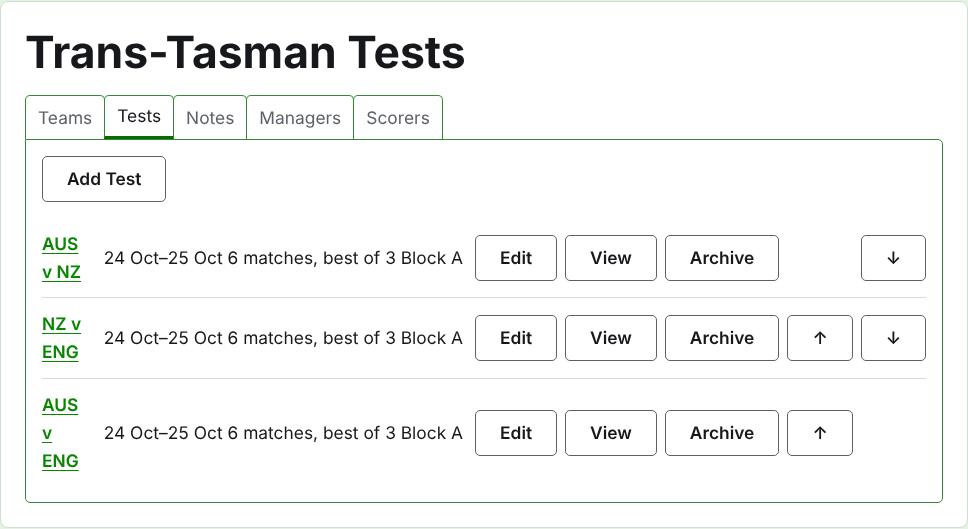
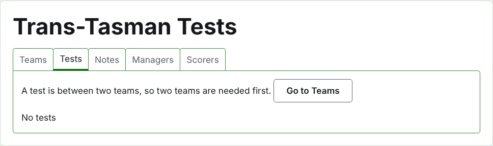
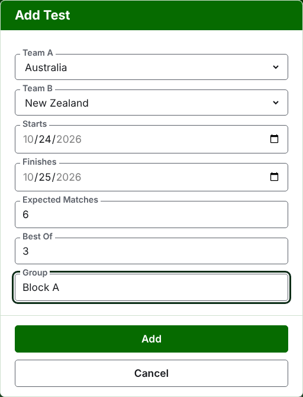
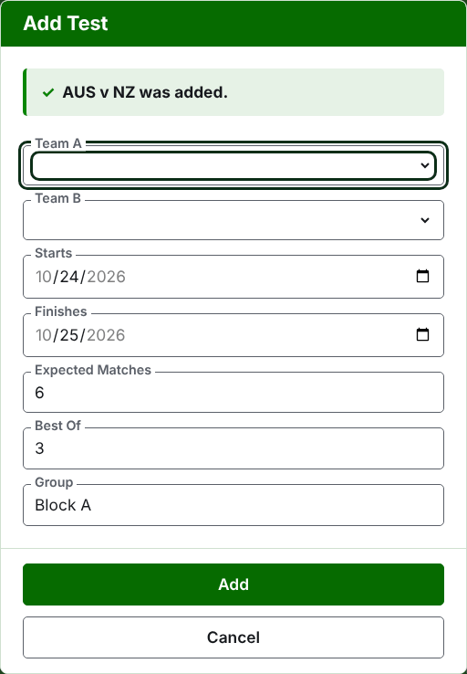
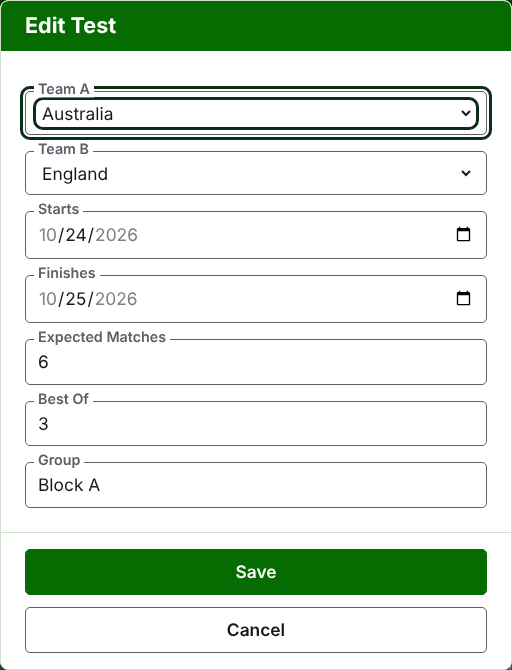

# Tests

The **Tests** tab of a tournament's page is where the tests between its teams are added, changed, put in order, and set aside. A test is one of the tournament's competitions: a contest between two teams, called by their short names, as "AUS v NZ", played as a number of matches between a player of each team. Each test has a page of its own, where its scores go in.

Each test says its name, the days it is played, how many matches it is expected to have and what each is the best of, as "6 matches, best of 3", and its group where it is in one.

## Two teams first

A test is between two teams in use, so while the tournament has fewer than two the tab says so where Add Test would be, and leads to the Teams tab.

## Adding a test {#adding-a-test}

Press **Add Test**, above the list. A dialog opens over the page, reading in the order a test is said aloud.

**Team A** and **Team B** are each chosen from the tournament's teams in use, by name, in the tournament's order. Neither is chosen to begin with, so that a test is never added between teams you did not choose. Team B offers every team but the one chosen as Team A, since a team does not play a test against itself. Team A is the first team: its players are on the left on the test's page and the public page. A test has no name of its own to type; it is called by its teams' short names.

**Starts** and **Finishes** are the days the test is played, which begin on the tournament's first day. A test is played within its tournament, so days before the tournament starts or after it finishes are refused.

**Expected Matches** is how many matches the test is to have, set by the event before it begins, so that whoever reads its scores can see how far through it is. It is a whole number from 1 up. It is also a limit: once as many matches have started as the test is expected to have, a game that would start another is refused, while the matches already started are played out. A test that is to have more is changed to expect them.

**Best Of** is what each match is the best of. It may be even, since a match can be shared.

**Played with handicaps**, **Allows drawn results** and **Counts toward world rankings** are asked as they are of any competition. The last is asked only where it can be counted: a test in Association Croquet or Golf Croquet that is neither played with handicaps nor allows drawn results. It is ticked to begin with.

**Group** is the group the test is in, where the event is played in groups, as "Block A". It is optional: left empty, the test is in none. The tests in a group have a page of their own on the public site, showing how the group's teams stand. The **Eire Cup** and the **Interstate Shield** have no groups, so the dialog does not ask for one there.

Press **Add**. The test is added, the dialog says which by its name, and the teams are emptied for the next, with the days, the expected matches, the best-of and the group left as they were: tests are added a round at a time, between teams who meet on the same day, so the next test of the round is its two teams alone. Press **Cancel** once they are all in.

## Changing a test {#changing-a-test}

**Edit** opens the same dialog on the test, titled Edit Test, begun as the test is. Press **Save** to keep the change.

A test with games in use keeps its teams: the dialog shows them but they cannot be changed. The rest can be changed, within what has been played: expected matches fewer than the matches already started are refused, and so is a best-of fewer than the most games any two players have played.

## Order

The tests are listed in the tournament's order, which is the order they appear in on the public pages and in the dark green bar. **Up** and **Down** move a test one place.

## Going to a test

A test's name, or **View**, opens its page, where its scores go in. The dark green bar leads there too, from the tournament's page or any other test's.

## Archiving a test

**Archive** sets a test aside, and is undone by **Restore**, so neither asks first. An archived test is listed under **Archived tests**, struck through, offers only Restore, and is not on the public pages.

A test with games in use has been played, and cannot be archived until its games are. A test whose games are all archived can be, since an archived game counts for nothing. A test whose team has been archived since is not restored until the team is, and the tab says so.

Next: [Scores](scores.md).
