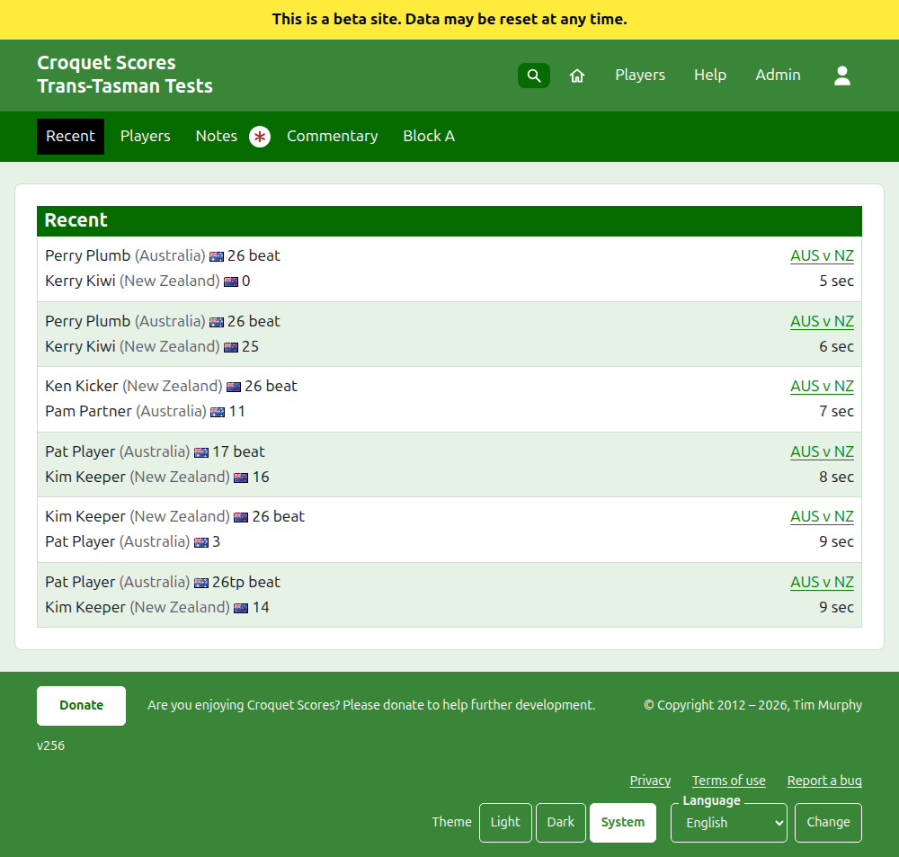
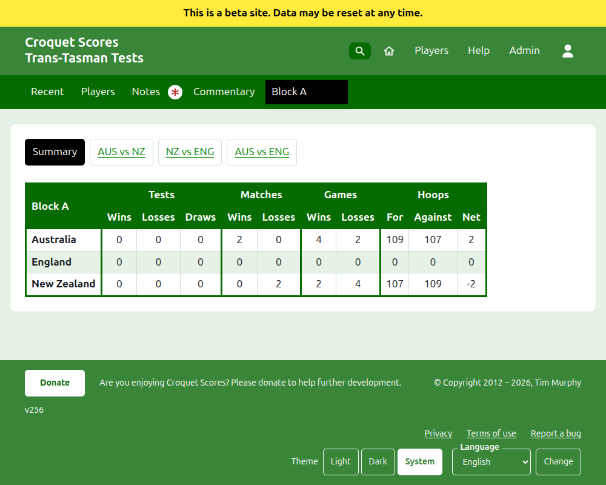
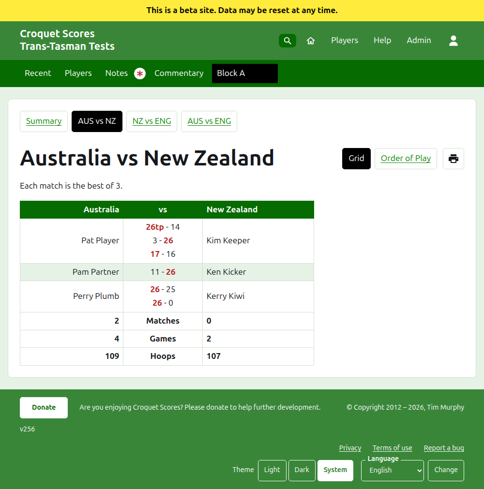
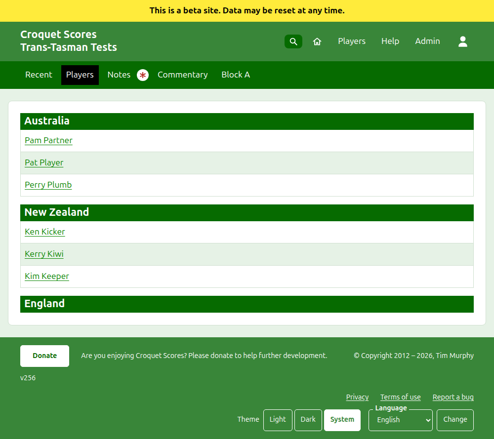

# What the public sees

Nothing is published: the public pages are drawn from what the admin holds, so a score entered is on them at once. They need no account and no scripting, and are laid out for a phone.

## The tournament's page

The tournament's page is at its year, its sport and its name, as `/2026/ac/trans-tasman-tests`. It is headed by the tournament's name, with its subtitle beneath. It lists every game in use, the most recently added first, so that a reader who comes back sees what has happened since. Each game says the winner, their team and their score, then the loser and theirs, with the test it was played in and how long ago it was added.

The dark green bar offers the tournament's sections: **Recent**, which is this page, **Summary**, **Players**, **Notes** and **Commentary**, then the tests. A test is said as its teams' short names with "vs" between, as "AUS vs NZ". Tests in a group are not offered one by one: the group is one section, named as the group is, standing where its first test would. Notes is marked with a red asterisk while there is a note the reader has not read.

## The summary

A tournament whose tests are in no group has a **Summary**: one table of every team, ranked, with the tests it has won, lost and drawn, its games won and lost, and its hoops for, against and net. Where any test's matches are the best of more than one, the matches won and lost come after the tests. The teams are ranked by the tests they have won, then the matches they have won, then their net games, then their net hoops, and then by the tournament's order. A test whose teams are level on matches is decided by net games, then net hoops, or is drawn where the tournament ticks **Level tests are drawn**. The summary is where a reader looks for each team as a whole.

In an **Interstate Shield** the teams are ranked by the tests won, then net matches in place of matches won, then net games, then net hoops. Teams still level are put in order by the tests they won against one another. Its summary shows a **Net** column under Matches and under Games as well as under Hoops, and the Shield is never played in groups.

A tournament with a test in a group has no Summary. Each group's page shows how the teams of that group stand instead, since one table of teams across groups that never played each other would rank nothing.

## A group

A group's page shows how the group's teams stand, counting the group's tests alone, in the table the summary uses. Above the table, in a row of their own, it offers **Summary**, which is this page, and each of the group's tests, leading to the test's page.

## A test

A test's page is headed by its teams' full names, as "Australia vs New Zealand", and says what each match is the best of. Its table is headed by the two teams, the first on the left. Each match played is a row, in the order it began, with the first team's player on the left, the second team's on the right, and the match's games between them, each the first side's score then the second's, the winner's marked. Beneath the matches are each team's games and hoops, and, where each match is the best of more than one, its matches won, on its own side.

A test is shown two ways, offered on the line of its name: **Grid**, which is this table, and **Order of Play**, which lists every game of the test in a table headed **Game** and **Date**, oldest first to begin with. Pressing a heading sorts by it, and the site remembers how the reader last sorted. Beside the views a printer button, shown where scripting is on, prints the page without the bars. A test in a group offers its group's Summary and tests in a row above its heading, with this test marked.

## Players

The Players page lists the players team by team: each team under a heading of its name, in the tournament's order of its teams, and its players beneath in alphabetical order.

## Notes

The Notes page is headed **Manager's Notes**, and says "No notes yet." while there are none. It lists the tournament's notes, the most recently written first, each leading to its own page and saying how long ago it was written. A note the reader has not read is marked with a red asterisk until they open it.

## Addresses that move

A tournament keeps its address when its name is corrected. Where it moves, because its year or its sport changed, its old address leads to the new one, so that a link kept from before still works. An archived tournament's pages are not found until it is restored.
