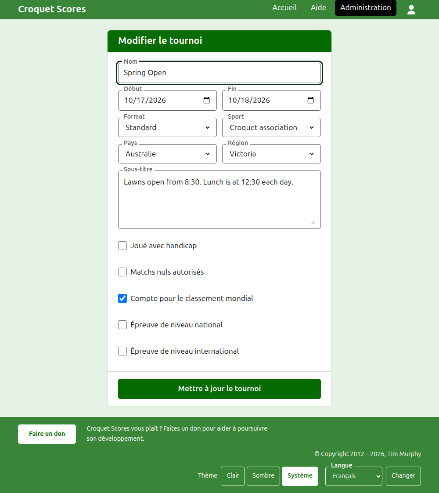
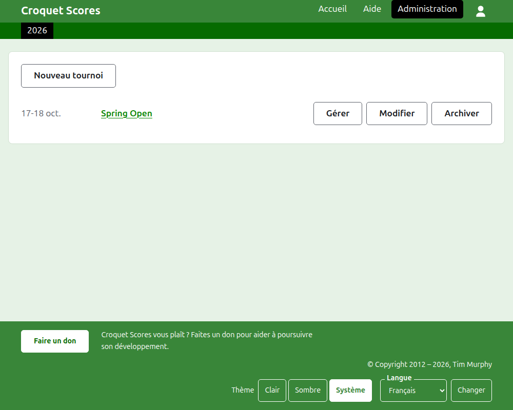
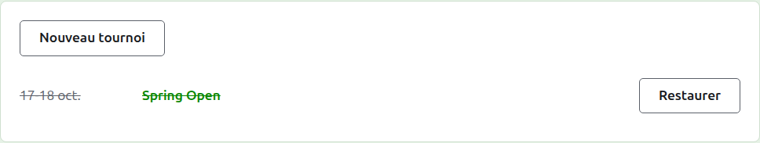

# Modifier, archiver et restaurer un tournoi

## Modifier les détails du tournoi

Dans la liste des tournois dans l’administration, appuyez sur **Modifier** sur le tournoi. Le formulaire est celui qui l’a créé, rempli tel que le tournoi est. Changez ce qui est faux et appuyez sur **Mettre à jour le tournoi**.

Dès que le tournoi contient un joueur ou une compétition, archivés compris, son format ne peut plus être changé pour un format par équipes, qui a des équipes et des tests à la place.

Un tournoi garde son adresse quand son nom est corrigé, pour qu’un lien que quelqu’un a déjà envoyé le retrouve. Il ne déménage que si l’année où il commence ou son sport change, et son ancienne adresse mène alors à la nouvelle. Enregistrer vous amène au tournoi, là où il se trouve désormais.

Seul un gestionnaire peut modifier un tournoi. Un marqueur, ou quiconque d’autre, en est averti au lieu de voir le formulaire.

## La liste des tournois

L’administration liste une année à la fois, en commençant par cette année, le tournoi le plus récent en premier. Les années où vous avez un tournoi sont des onglets dans la barre vert foncé, la plus récente en premier ; quand il y en a plus que n’en tient un téléphone, les plus anciennes sont dans une liste déroulante au bout de la rangée. L’année est dans l’adresse, de sorte qu’on peut faire un lien vers une année.

## Archiver un tournoi

**Archiver** sur un tournoi de la liste le met de côté. Il est toujours listé, barré et après les tournois en service, mais n’offre plus que **Restaurer** : sa page dans l’administration, et ses pages publiques, sont fermées jusqu’à ce qu’il soit restauré. Archiver ne demande pas d’abord, puisque restaurer l’annule.

Suite : [Ce que voit le public](what-the-public-sees.md).
