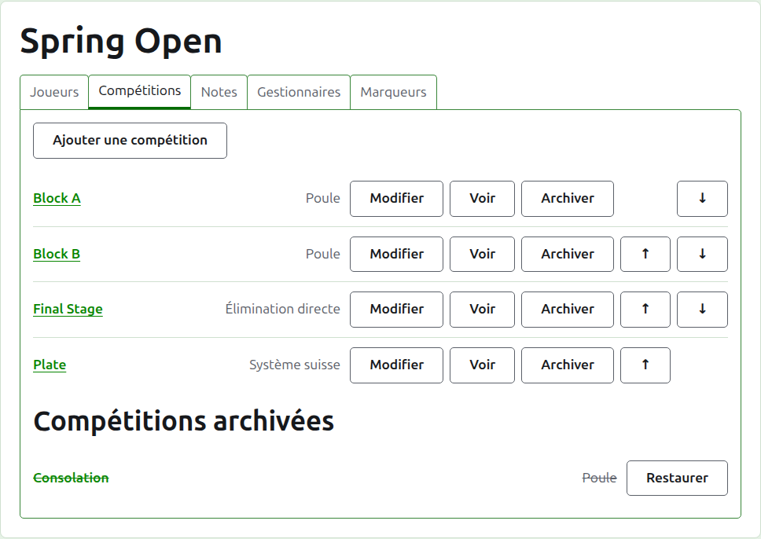
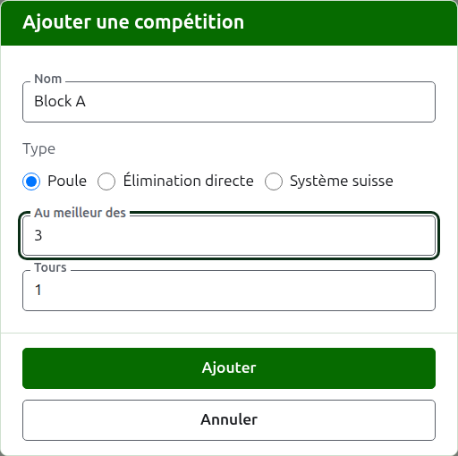
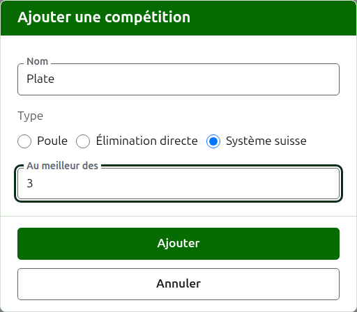
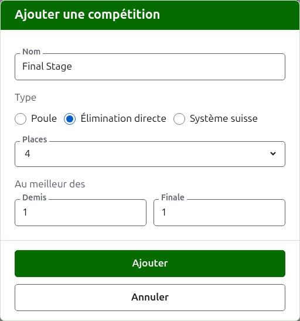

# Compétitions

L’onglet **Compétitions** de la page d’un tournoi est l’endroit où ses compétitions sont ajoutées, mises en ordre et mises de côté. Une compétition est une poule, une élimination directe ou un système suisse. Chacune a sa propre page, où ses joueurs sont inscrits et ses résultats saisis.

## Ajouter une compétition

Appuyez sur **Ajouter une compétition**, au-dessus de la liste. Une boîte de dialogue s’ouvre sur la page et demande le nom de la compétition, son type, et la forme propre à ce type.

**Nom** est ce que les joueurs cherchent sur la page du tournoi pour trouver leurs parties. Il compte entre 1 et 254 caractères, et une lettre seule suffit, puisqu’une poule porte souvent une lettre pour nom. Deux compétitions d’un même tournoi ne peuvent pas porter le même nom.

**Type** est poule, élimination directe ou système suisse. La boîte de dialogue s’ouvre sur poule, ce que sont la plupart des compétitions.

### Une poule ou un système suisse

Une poule et un système suisse ne demandent que **au meilleur des** combien de parties se joue chaque rencontre, ce qui commence à 1. Au meilleur des 3 se gagne par celui qui remporte deux parties. Le nombre peut être pair, puisque dans une poule ou un système suisse un joueur est classé par les parties qu’il gagne, et qu’une rencontre de deux parties partagées une chacune est un résultat comme un autre.

### Une élimination directe

Une élimination directe demande combien de **places** compte son tableau, et au meilleur de combien de parties se joue chaque tour. Les places proposées sont 2, 4, 8, 16, 32, 64 et 128, puisque tout autre nombre ne pourrait pas se diviser par deux tour après tour jusqu’à une finale, et la boîte de dialogue s’ouvre sur 8. Les places qui restent une fois les joueurs inscrits sont remplies par des exempts, qui s’ajoutent là où s’ajoutent les joueurs.

Un tableau a autant de tours qu’il en faut pour ramener ses places à une, de sorte qu’un tableau de 8 places a trois tours. La boîte de dialogue demande au meilleur de combien se joue chacun, ensemble sous **Au meilleur des**, dans l’ordre où ils se jouent. Les trois derniers sont nommés comme on parle des tours d’un tableau, **Quarts**, **Demis** et **Finale**, et ceux d’avant par leur numéro, Tour 1 en premier. Choisir plus de places ajoute des tours au début du tableau, et en choisir moins en retire au début, de sorte que ce qui a été tapé pour la finale reste celui de la finale. Chaque tour se joue au meilleur d’un nombre impair de parties, puisqu’une rencontre d’élimination directe doit avoir un vainqueur.

### En ajouter plusieurs à la suite

Appuyez sur **Ajouter**. La compétition est ajoutée, la boîte de dialogue le dit, et le nom se vide pour la suivante, le type et sa forme restant tels quels : des compétitions ajoutées ensemble se ressemblent le plus souvent, de sorte que « Block B » après « Block A » n’est que son nom. Appuyez sur **Annuler** pour fermer la boîte de dialogue une fois qu’elles sont toutes saisies.

## Modifier une compétition

**Modifier** ouvre la même boîte de dialogue sur la compétition, intitulée Modifier la compétition, avec son nom et sa forme tels qu’ils sont. Son type n’est pas demandé, puisqu’une poule ne devient pas une élimination directe en la modifiant : une compétition du mauvais type s’archive et s’ajoute de nouveau. Appuyez sur **Enregistrer** pour garder la modification et fermer la boîte de dialogue.

Une élimination directe qui a une partie a des joueurs placés dans son tableau, et un changement de ses places les déplacerait ; il est donc refusé dès qu’une partie a été saisie. Le nombre de parties de ses tours peut encore être changé.

## Ordre

Les compétitions sont listées dans l’ordre du tournoi, qui est l’ordre dans lequel elles apparaissent sur les pages publiques et dans la barre vert foncé. **Monter** et **Descendre** déplacent une compétition d’une place.

## Aller à une compétition

Le nom d’une compétition, ou **Voir**, ouvre sa page, où ses joueurs sont inscrits et ses résultats saisis. La barre vert foncé sous l’en-tête y mène aussi, depuis n’importe quelle page du tournoi.

## Archiver une compétition

**Archiver** met une compétition de côté, qu’elle ait ou non des parties ; celles-ci sont gardées avec elle et reviennent quand elle est restaurée. Une compétition archivée est listée sous **Compétitions archivées**, barrée, n’offre plus que **Restaurer**, et n’est pas sur les pages publiques. Archiver ne demande pas d’abord, puisque restaurer l’annule.

Suite : [Inscrire des joueurs dans une compétition](entering-players-in-a-competition.md).
