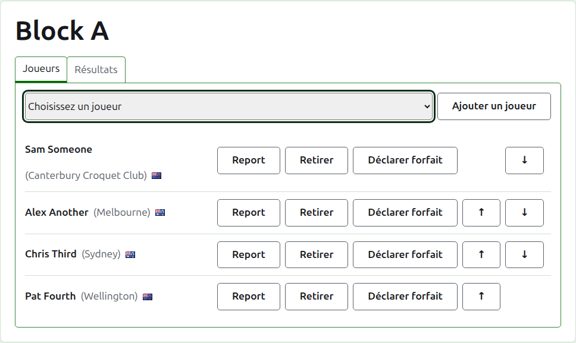
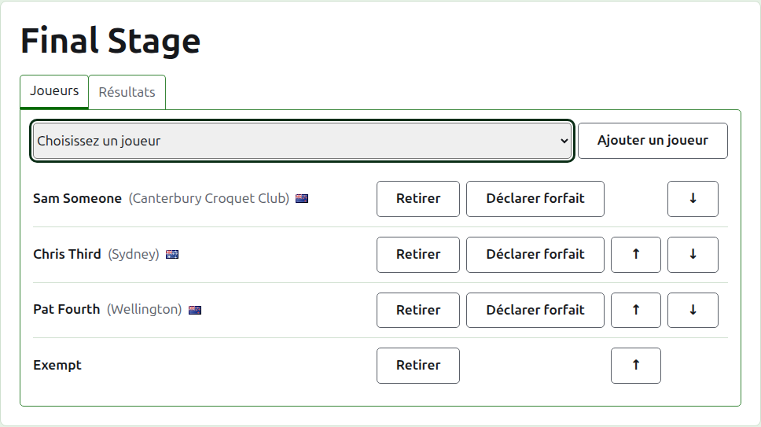
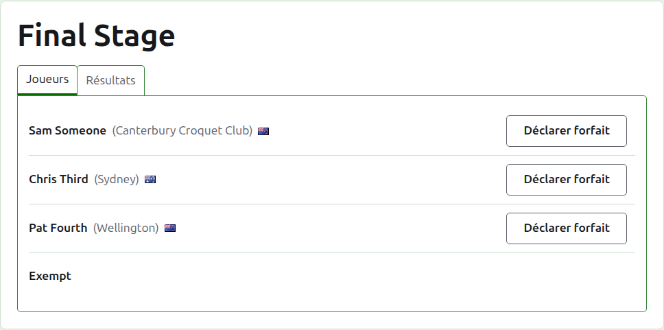
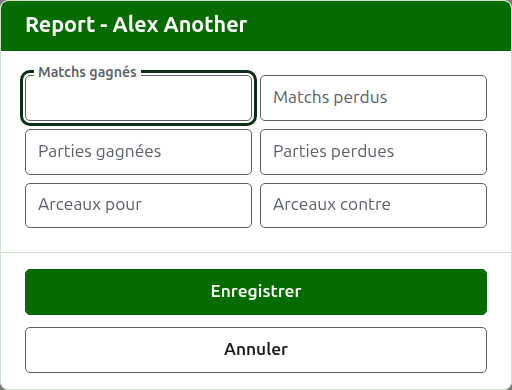
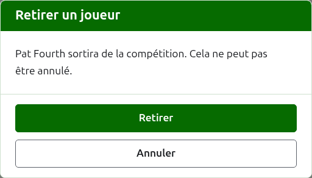
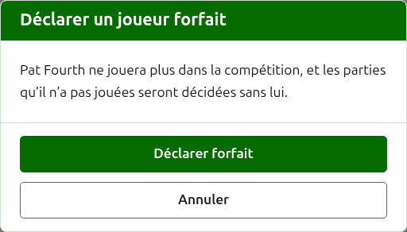
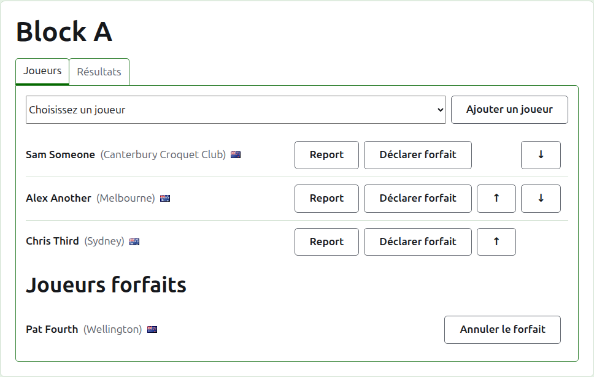

# Inscrire des joueurs dans une compétition

La page d’une compétition s’ouvre depuis son nom sur l’onglet Compétitions, ou depuis la barre vert foncé. Elle est coiffée du nom de la compétition, avec deux onglets dessous : **Joueurs** et **Scores**. Elle s’ouvre sur Joueurs, puisque les joueurs sont inscrits avant que rien ne se joue.

Un joueur d’une compétition est l’un des joueurs du tournoi ; on l’inscrit donc en le choisissant plutôt qu’en le tapant. Tout ce qui le concerne, hormis sa place dans la compétition et ce qu’il y reporte, se modifie sur l’onglet Joueurs du tournoi.

## Ajouter un joueur

Au-dessus de la liste, une liste déroulante propose chaque joueur du tournoi qui n’est pas déjà dans la compétition, dans l’ordre du tournoi. Choisissez-en un et appuyez sur **Ajouter un joueur**. Le joueur prend sa place, dans l’ordre du tournoi, parmi ceux déjà inscrits, la liste déroulante ne le propose plus, et le curseur revient dans la liste déroulante pour que le suivant puisse être choisi au clavier. Quand chaque joueur du tournoi est dans la compétition, la liste déroulante n’est pas affichée et l’onglet le dit.

Les joueurs archivés du tournoi ne sont pas proposés.

## Les exempts dans une élimination directe

Une élimination directe ne se joue qu’une fois chaque place de son tableau remplie, et les places que ses joueurs laissent libres sont remplies par des exempts. Dans une élimination directe, la liste déroulante propose donc **Bye** en premier, avant les joueurs, et continue de le proposer quel que soit le nombre d’exempts ajoutés, puisqu’un tableau peut en avoir besoin de plusieurs.

Un exempt est placé dans le tableau comme un joueur : il peut être monté, descendu et retiré, mais il ne peut pas être déclaré forfait, puisqu’il ne joue rien. Un joueur inscrit dans une élimination directe dont toutes les places sont remplies est refusé, et l’onglet le dit sous la liste déroulante.

L’ordre des joueurs d’une élimination directe est son tableau. Les deux premières places se rencontrent dans la première rencontre, les deux suivantes dans la suivante, et ainsi de suite. Mettez les joueurs dans l’ordre où le tableau doit se jouer avant de saisir le moindre résultat, car dès que l’élimination directe a une partie en service ses joueurs sont figés : personne ne peut être ajouté, retiré ni déplacé. Un joueur peut encore être déclaré forfait.

## Ordre

Les joueurs sont listés dans l’ordre de la compétition, qui est l’ordre dans lequel une élimination directe est tirée et dans lequel une poule est listée sur sa page publique. **Monter** et **Descendre** déplacent un joueur d’une place.

## Report

**Reporter** dit ce qu’un joueur apporte dans une compétition d’un jeu qu’elle n’a pas comptabilisé : les résultats d’une étape antérieure, ou de parties jouées avant que la compétition ne soit comptabilisée ici. Il est proposé dans une poule et un système suisse, qui ont un classement où le compter, et pas dans une élimination directe.

La boîte de dialogue demande six nombres : matchs gagnés et perdus, parties gagnées et perdues, et arceaux pour et contre. Chaque nombre est facultatif. Un nombre laissé vide ne reporte rien, ce qui n’est pas la même chose que reporter 0, pour que celui qui le modifie plus tard le voie tel qu’il a été laissé. Appuyez sur **Enregistrer** pour garder les six.

## Retirer un joueur

**Retirer** sort un joueur inscrit par erreur. Il reste l’un des joueurs du tournoi, et la liste déroulante le propose de nouveau, mais rien de sa place dans la compétition n’est gardé ; Retirer demande donc d’abord.

Un joueur qui a une partie en service dans la compétition ne peut pas être retiré, puisque ses parties seraient alors contre quelqu’un qui n’est plus là, et n’a pas de Retirer. Un joueur dont toutes les parties sont archivées peut l’être, et ses résultats archivés partent avec lui.

## Déclarer un joueur forfait

**Retirer de la compétition** est pour un joueur qui ne jouera plus dans la compétition. Il y reste, avec les parties qu’il a jouées, et il est listé sous **Joueurs retirés** après ceux qui jouent encore. Dans une élimination directe, son adversaire d’une rencontre non encore décidée passe au tour suivant.

Déclarer forfait demande d’abord, puisque cela change l’issue de la compétition : les parties que le joueur n’a pas jouées sont décidées sans lui.

Un joueur forfait n’offre plus que **Réintégrer**, qui le remet parmi ceux qui jouent, après ceux qui sont restés, sans demander.

Suite : [Scores](scores.md).
