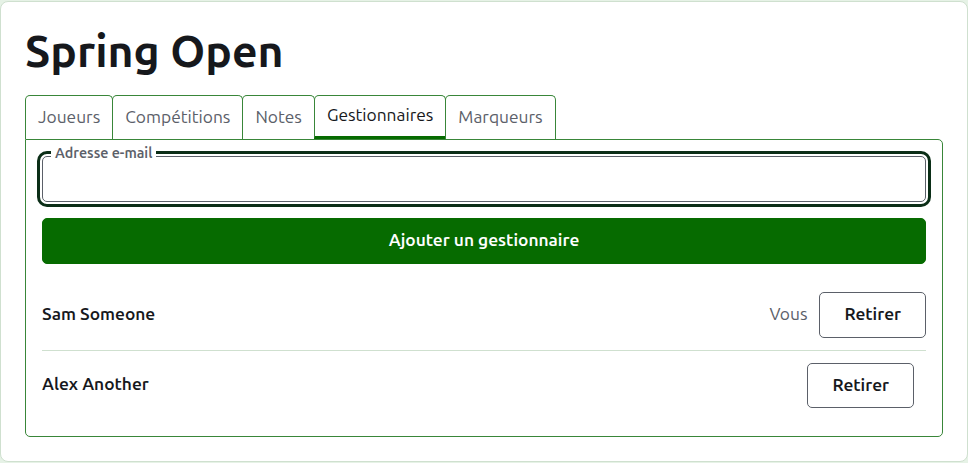
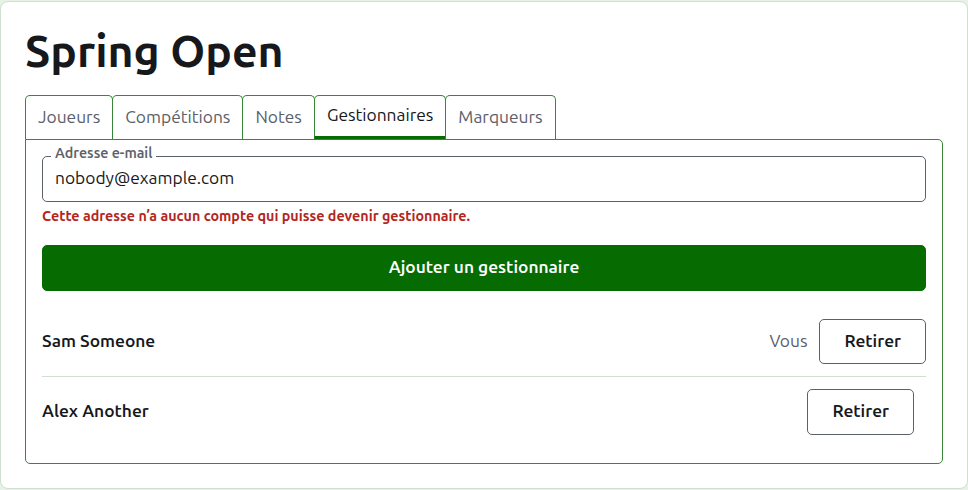
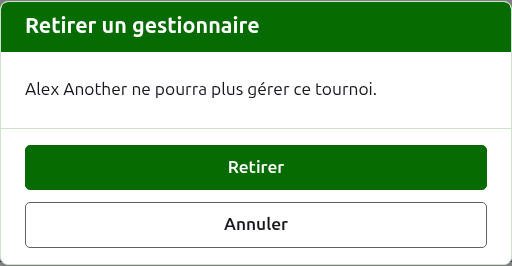
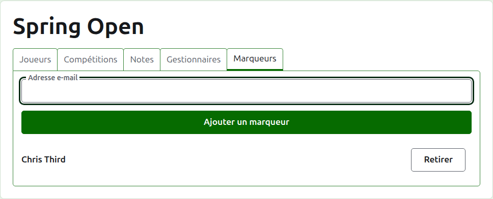
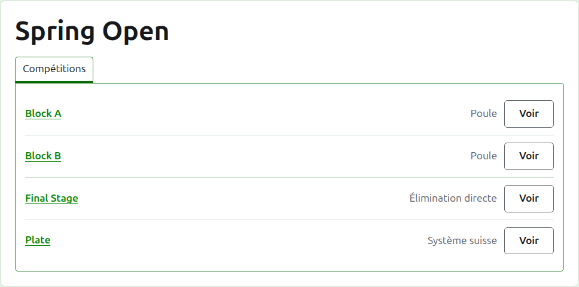

# Gestionnaires et marqueurs

Un tournoi a des gestionnaires, qui peuvent faire tout ce qui peut lui être fait, et peut avoir des marqueurs, qui saisissent ses résultats et rien d’autre. La personne qui a créé le tournoi est son premier gestionnaire.

## Gestionnaires

L’onglet **Gestionnaires** liste ceux qui organisent le tournoi, dans l’ordre où ils ont été nommés, votre propre nom marqué comme le vôtre. C’est là qu’un tournoi se partage, ou se transmet.

Quelqu’un devient gestionnaire par son adresse e-mail. Tapez-la dans le champ au-dessus de la liste et appuyez sur **Ajouter un gestionnaire**. L’adresse doit appartenir à un compte inscrit et confirmé ; une adresse qui n’en a pas est refusée sous le champ, et le site n’en dit pas plus. Un marqueur nommé gestionnaire cesse d’être marqueur.

**Retirer** enlève un gestionnaire. Rien d’un gestionnaire retiré n’est gardé ; Retirer demande donc d’abord. On le renomme gestionnaire par son adresse si l’on veut le faire revenir. Un tournoi a toujours un gestionnaire ; le dernier n’a donc pas de Retirer.

Vous pouvez vous retirer vous-même. La question dit alors ce que cela signifie : vous perdez votre propre accès au tournoi, et personne sur la page ne peut l’annuler pour vous. Un autre gestionnaire peut vous redonner ce rôle.

## Marqueurs

L’onglet **Marqueurs** est l’onglet Gestionnaires des marqueurs, et fonctionne de la même façon : une adresse e-mail et **Ajouter un marqueur** au-dessus de la liste, et **Retirer** sur chacun.

Un marqueur voit le tournoi dans sa propre liste dans l’administration, avec **Résultats** à la place de Gérer, et on ne lui propose que ses compétitions : ni joueurs, ni notes, ni gestionnaires, ni marqueurs. Sur la page d’une compétition, il ne voit que l’onglet Résultats, où il peut saisir, corriger, archiver et restaurer des résultats comme un gestionnaire. Qui joue dans une compétition, c’est aux gestionnaires d’en décider.

Un gestionnaire ne devient pas marqueur, puisqu’un gestionnaire peut déjà faire tout ce qu’un marqueur peut faire. Un tournoi n’a pas besoin de marqueur ; chaque marqueur peut donc être retiré, le dernier y compris.

Suite : [Modifier, archiver et restaurer un tournoi](changing-and-archiving.md).
