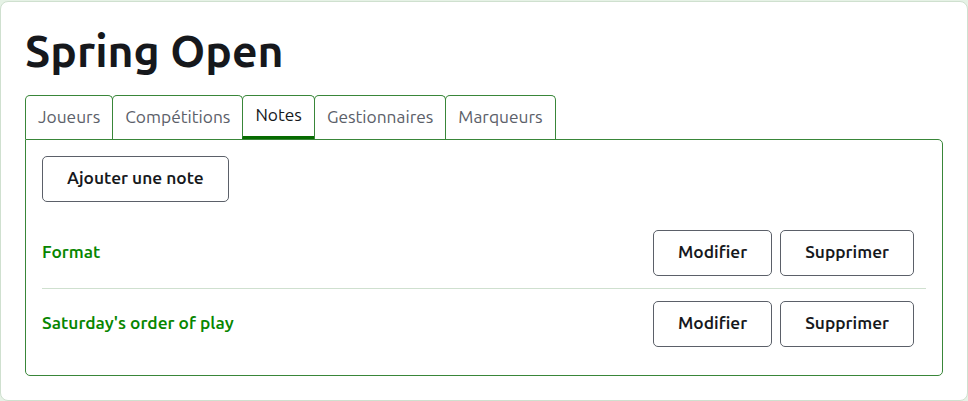
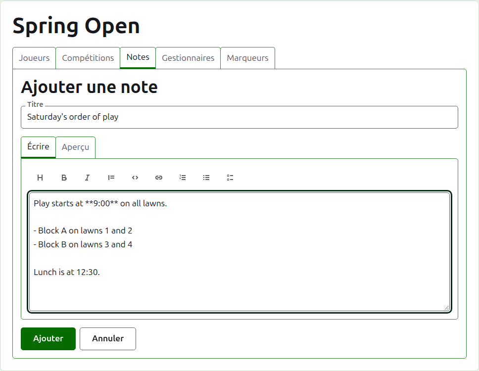
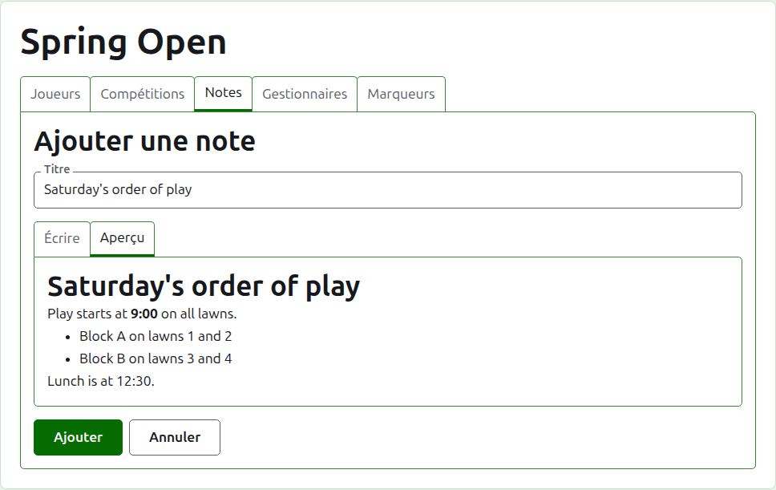
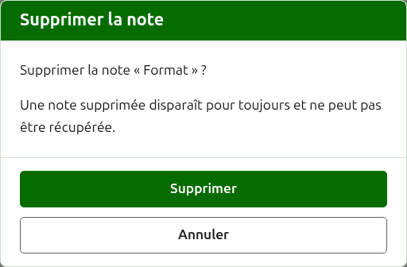

# Notes

L’onglet **Notes** de la page d’un tournoi est l’endroit où ses organisateurs écrivent ce que les joueurs ont besoin de savoir au fil du tournoi : la formule, un changement dans l’ordre de jeu, l’heure du déjeuner. Les lecteurs les trouvent sur la page publique Notes du tournoi, et une note qu’ils n’ont pas lue y est marquée d’un astérisque rouge, qui marque aussi la rubrique Notes sur chaque page du tournoi jusqu’à ce qu’ils l’ouvrent.

## Écrire une note

Appuyez sur **Ajouter une note**, au-dessus de la liste. Un panneau prend la place de la liste, puisqu’une note s’écrit longuement et a besoin de place.

**Titre** est obligatoire, et c’est sous lui que la note est listée. C’est du texte brut.

**Description** s’écrit en Markdown et peut rester vide quand le titre dit tout ce qu’il y a à dire. La barre d’outils au-dessus de la zone écrit le Markdown pour vous : Titre de section, Gras, Italique, Citation, Code, Lien, Liste numérotée, Liste à puces et Liste de tâches. Chacun agit sur ce qui est sélectionné, ou au début de chaque ligne sélectionnée, ou place le curseur là où vont les mots.

**Aperçu** montre la note telle qu’un lecteur la verra sur sa page.

Appuyez sur **Ajouter**. La note est enregistrée, la liste revient avec elle en tête, et elle est aussitôt sur la page publique Notes.

## Modifier une note

Appuyez sur le titre d’une note, ou sur son **Modifier**, pour ouvrir le panneau sur cette note. Appuyez sur **Enregistrer** pour garder la modification. Une note modifiée depuis qu’un lecteur l’a lue est de nouveau marquée pour lui.

## Supprimer une note

Une note qui ne s’applique plus se supprime. Une note supprimée est perdue pour de bon ; **Supprimer** demande donc d’abord.

Suite : [Organisateurs et marqueurs](managers-and-scorers.md).
