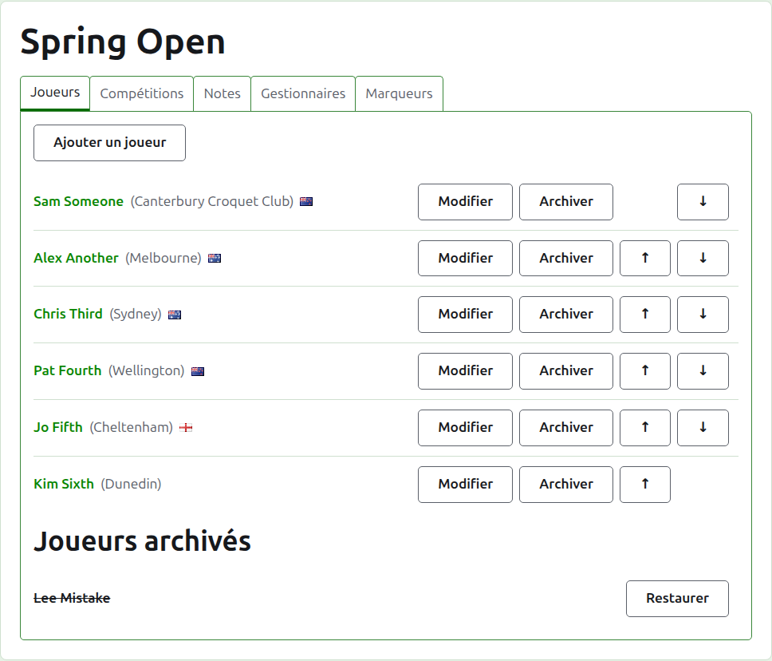
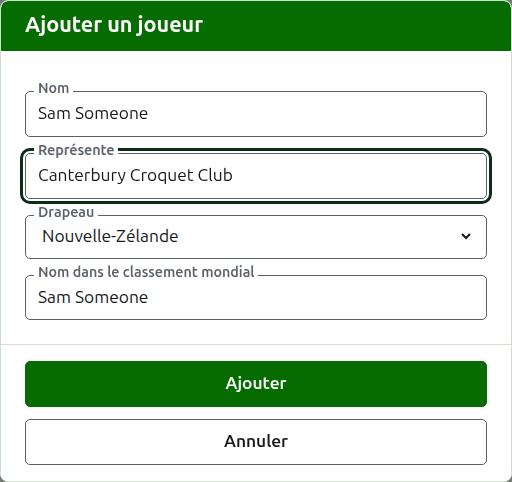
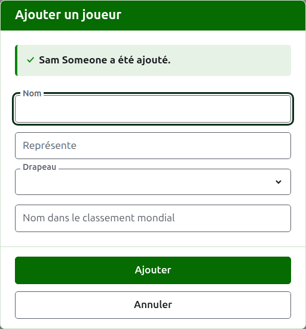
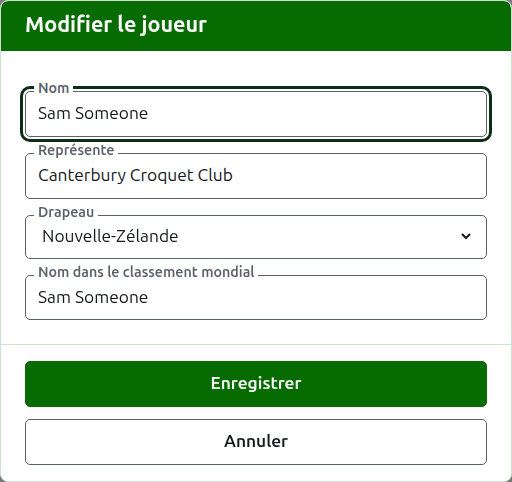
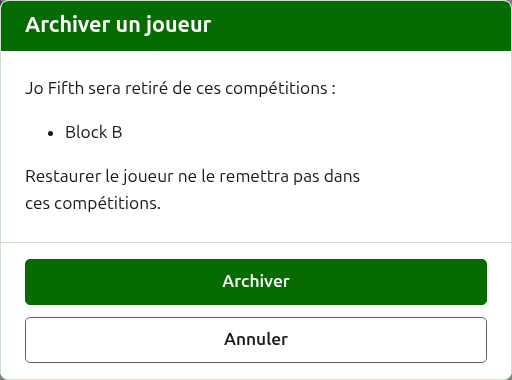

# Joueurs

L’onglet **Joueurs** de la page d’un tournoi est l’endroit où ses joueurs sont inscrits, corrigés, mis en ordre et mis de côté. C’est l’onglet sur lequel la page s’ouvre, puisque inscrire les joueurs est la première chose que l’on fait à un tournoi.

Les joueurs sont inscrits ici une fois, dans le tournoi. Les compétitions que chacun joue se choisissent ensuite, sur la page de chaque compétition, parmi les joueurs inscrits ici. Voir [Inscrire des joueurs dans une compétition](entering-players-in-a-competition.md).



## Ajouter des joueurs {#add-a-player}

Appuyez sur **Ajouter un joueur**, au-dessus de la liste. Une boîte de dialogue s’ouvre sur la page.



**Nom** est obligatoire. C’est le nom du joueur tel qu’il s’affichera sur chaque page, entre 3 et 254 caractères. Deux joueurs d’un même tournoi ne peuvent pas porter le même nom, quelles qu’en soient les majuscules ; quand deux joueurs partagent vraiment un nom, distinguez-les dans le nom lui-même, comme « Andrew Hobbs (2) ».

**Représente** est ce pour quoi le joueur joue, écrit comme un lecteur le dirait : un club, une région ou un pays, comme « Canterbury Croquet Club ». Il s’affiche entre parenthèses après le nom. Il peut rester vide.

**Drapeau** est le drapeau affiché à côté du nom du joueur. Il peut rester à aucun, ce qui est le cas de la plupart des joueurs. Ce qu’un joueur représente et le drapeau qu’il arbore sont tenus séparés, puisqu’un joueur peut jouer pour un club d’un pays et arborer le drapeau d’un autre.

**Nom du joueur dans le classement mondial** est le nom sous lequel le classement mondial connaît le joueur. Il n’est demandé que dans un tournoi de croquet association ou de croquet golf, les deux sports dont le classement mondial tient une liste de joueurs. Le classement connaît les joueurs de croquet américain à 6 arceaux par leur propre nom ; il n’est donc pas demandé là, et le nom dans le classement mondial de chaque joueur y est toujours son nom. Pendant que vous ajoutez un joueur, il suit le nom à mesure que vous le tapez, puisque la plupart des joueurs sont connus du classement sous leur propre nom, et cesse de le suivre dès que vous y tapez quelque chose. Laissé vide, il est enregistré comme le nom du joueur.

À mesure que vous tapez un nom, les joueurs connus du classement mondial dont le nom commence ainsi vous sont proposés, pour que vous puissiez prendre un nom tel que le classement l’écrit plutôt que de le taper en entier. À côté du nom dans le classement mondial, une coche dit que le classement connaît ce nom, et un point d’interrogation qu’il ne le connaît pas : le nom est peut-être mal orthographié, ou le joueur nouveau au classement. Ce n’est qu’une indication. Un nom inconnu du classement est enregistré aussi volontiers qu’un nom connu.

Appuyez sur **Ajouter**. Le joueur est ajouté, la boîte de dialogue le dit, et ses champs se vident pour le joueur suivant, le curseur revenu dans le nom. Ajoutez toute la liste ainsi, puis appuyez sur **Annuler** pour fermer la boîte de dialogue. Annuler ne garde rien qui n’ait déjà été ajouté.



Un joueur ne s’appelle jamais « Bye » (le mot anglais pour exempt). Les exempts d’une élimination directe s’ajoutent dans l’élimination directe elle-même, là où ses joueurs sont inscrits ; un nom dont le premier mot est « bye » est donc refusé, et la boîte de dialogue explique pourquoi.

## Ajouter plusieurs joueurs {#adding-multiple-players}

Pour ajouter toute une liste d’un coup, appuyez sur **Ajouter des joueurs**, à côté de **Ajouter un joueur**. Une boîte de dialogue s’ouvre sur la page avec une seule zone de texte, qui accepte plusieurs lignes. Vous pouvez copier la liste depuis un tableur et la coller dans la zone.

**La première ligne nomme les champs**, séparés par des virgules ou par des tabulations : **Name**, et n’importe lesquels de **Representing**, **Flag**, **Handicap** et **WorldRankingPlayerName**, dans n’importe quel ordre. Ces noms se tapent en anglais, quelle que soit la langue du site. **Name** doit en faire partie. **Chaque ligne suivante est un joueur**, avec une valeur pour chaque champ, dans le même ordre et séparées de la même façon. Un joueur sans valeur pour un champ le laisse vide, mais garde la virgule ou la tabulation. Par exemple, avec des virgules :

```
Name,Representing,Flag
Sam Someone,Canterbury Croquet Club,New Zealand
Alex Another,,England
```

- **Nom, Représente et Nom du joueur dans le classement mondial** obéissent aux mêmes règles que lorsque vous ajoutez un seul joueur (voir [Ajouter des joueurs](players.md#add-a-player)). Un nom compte entre 3 et 254 caractères, n’est pas déjà dans le tournoi, quelles qu’en soient les majuscules, et n’est pas « Bye ».
- **Drapeau** est le nom du pays ou du lieu, dans votre langue, tel que la liste de la boîte de dialogue Ajouter un joueur le propose, par exemple Nouvelle-Zélande.
- **Handicap** est un nombre signé, d’au plus deux chiffres et d’une décimale, comme 4, +4 ou -1.5.
- Un joueur sans **WorldRankingPlayerName** est connu sous son nom, comme lorsqu’il est ajouté seul.
- **Virgules ou tabulations.** Les cellules copiées d’un tableur sont séparées par des tabulations, et une liste tapée à la main l’est d’ordinaire par des virgules. Les deux conviennent. Si la première ligne contient une tabulation, toute la liste est lue avec des tabulations, sinon avec des virgules.
- Une valeur qui contient le séparateur s’écrit entre guillemets doubles, comme un tableur l’écrit : "Smith, John" dans une liste séparée par des virgules. Un guillemet à l’intérieur d’une valeur s’écrit deux fois.
- Les espaces aux extrémités de chaque valeur sont retirés, et une ligne vide est ignorée.
- Une liste compte au plus 500 joueurs. Ajoutez les autres dans une autre liste.

Appuyez sur **Ajouter**. Toute la liste est vérifiée avant que quoi que ce soit soit enregistré : une liste qui contient une erreur n’ajoute personne. Ce qui ne va pas est dit sous la zone de texte, à la ligne concernée, la première ligne comptant pour la ligne 1. Chaque erreur est listée, pas seulement la première, et ce que vous avez tapé reste en place pour que vous puissiez le corriger. Une fois la liste enregistrée, la boîte de dialogue se ferme et l’onglet Joueurs liste les nouveaux joueurs, dans l’ordre où vous les avez écrits. Contrairement à **Ajouter un joueur**, qui reste ouvert pour le joueur suivant, il n’y a pas de suivant : la liste était le suivant.

Le **?** dans la barre de titre de la boîte de dialogue mène ici.

## Corriger un joueur {#correcting-a-player}

Appuyez sur le nom d’un joueur, ou sur son **Modifier**, pour ouvrir la même boîte de dialogue sur ce joueur, intitulée Modifier le joueur. Changez ce qui est faux et appuyez sur **Enregistrer**, qui garde la modification et ferme la boîte de dialogue. Un joueur dont le nom est corrigé garde le nom dans le classement mondial qu’il avait, puisque le classement le connaît toujours sous ce nom. Dans le croquet américain à 6 arceaux, le nom d’un joueur dans le classement mondial est toujours son nom ; corriger le nom le corrige donc aussi.



Un joueur corrigé ici est corrigé partout : dans chaque compétition où il est, et sur chaque page publique.

## Mettre les joueurs en ordre

Les joueurs sont listés dans l’ordre du tournoi, qui est l’ordre dans lequel ils sont proposés quand on les inscrit dans des compétitions, et l’ordre dans lequel une élimination directe est tirée. **Monter** et **Descendre**, les flèches au bout de chaque ligne, déplacent un joueur d’une place. Le premier joueur n’a pas de Monter, et le dernier pas de Descendre.

## Archiver un joueur {#archiving-a-player}

**Archiver** met un joueur de côté : inscrit par erreur, ou retiré de tout le tournoi. Un joueur archivé est listé sous **Joueurs archivés**, barré, après les joueurs en service, et n’offre plus que **Restaurer**. Un joueur archivé n’est dans aucune compétition et n’apparaît sur aucune page publique.

Un joueur qui a joué une partie ne peut pas être archivé, puisque ses parties seraient alors contre quelqu’un qui n’est plus là ; un tel joueur n’a donc pas d’Archiver. Un joueur dont toutes les parties sont archivées peut l’être.

Archiver un joueur qui n’est dans aucune compétition ne demande pas d’abord, puisque le restaurer remet tout en place. Archiver un joueur qui est dans une compétition demande d’abord, parce qu’archiver le retire de chaque compétition où il est, et que le restaurer ne l’y remet pas.



Suite : [Compétitions](competitions.md).
